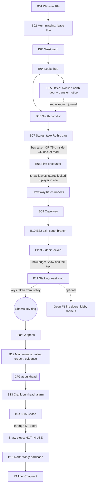

# NIGHT WARD — NW-R00: Chapter 1 Narrative and Gameplay Design

**Status: design proposal for review. Not approved, not implemented.** This document changes no
code, assets or levels. Every distance and duration is **provisional** until it has been checked
against a playable blockout and tested with players who have not seen the game.

| | |
|---|---|
| **Working title** | Chapter 1 — *The Final Round* |
| **Target length** | 25–35 minutes for a first-time player (design median ~30 min), excluding retries |
| **Player** | Powerless; no combat. First person, walk / sprint / crouch, hide, interact. |
| **Setting** | The old ward block of a British district general hospital, on the night of the planned ward transfer, **17 October 1987** |
| **Antagonist** | Nurse Shaw, the ward sister. The Patient does **not** appear in Chapter 1. |

**Reading guide.** §0 states what the current code can and cannot support. §A–§J are the
required deliverables. §K is the self-review and the corrections it led to.

---

## 0. Starting point and design principles

### 0.1 What the existing technology supports (inspected, not assumed)

| Area | Existing capability | What it means for this design |
|---|---|---|
| Player movement | Walk 2.4 m/s, sprint 4.3, crouch 1.1. Standing eye height 1.65 m, crouching 0.9 m. | The timing model (§H) and the chase pacing (§G) use these numbers. |
| Hiding | Hiding places of type `locker` and `bed`, with occupancy, exits, and memory of a witnessed entry. | Every hiding place in this design is a locker or under a bed. Proposed new types (curtain, cupboard) are open decisions, not assumptions (§J). |
| Nurse AI | Sight 7 m in a 99° cone. Hearing 2.4× the base value. Detects in 0.8 s. Patrols at 0.9 m/s, pursues at 3.4 m/s. States for patrol, investigation, pursuit and search. One warning before the first capture. NW-006B director handoff. | The stalking section (§F) depends on these rules being readable. The player sprints 0.9 m/s faster than her pursuit speed, which the chase uses deliberately (§G). |
| Presentation | NW-007B clips: idle, walk, turn, look-around, panel check, records, short listen, investigate, capture. Synthesized positional cues: heels, keys, uniform rustle, call panel, paper, station hum, capture. | The encounter and stalking choreography use only these clips, plus a small list of new ones (§F.4). |
| Systems | Journal, dialogue, puzzle state, checkpoints, cinematics, intercom lines. | The progression graph (§E) and checkpoint plan (§I.3) assume these systems. |
| Map | The playable hospital today is one ward corridor (Room 104, a Nurses' Station, east and west wings). | **It does not match the layout the user set.** Chapter 1 needs a new level. Existing assets are reused as references and props only (§J, D1). |

### 0.2 Design principles (how this avoids the failures of previous versions)

1. **Every step has a reason the player cares about.** The player is looking for their mother.
   Every objective follows from that, or from staying alive while doing it.
2. **Rules before scares.** Shaw follows hospital procedure, and the player can learn her rules.
   The scariest moments come from understanding her, not from arbitrary deaths.
3. **Hear her before you see her.** Every time Shaw appears, the player has 5–15 seconds of warning
   from sound first.
4. **No document is required reading.** Every required fact reaches the player at least two ways:
   prop, voice, signage or the journal.
5. **One physical key at most, and only when it's believable.** There's exactly one key in the
   chapter: Shaw's key ring. It is part of the stealth objective, not a collectible.
6. **Quality is uniform.** No room is "background" (§8 of the brief; see §D.4).

---

## A. Chapter synopsis

You came to Halden Vale General Hospital on Thursday evening, 16 October 1987, to sit with your
mother, **Ruth Avery**, in Room 104 of the old ward block. The block closes tomorrow; its patients
are being moved overnight to the newly built **North Wing**. You fell asleep in the visitor's chair.

You wake in **her bed**, in a hospital gown, with **her wristband on your wrist**. She is gone. Every
clock says **3:17** and none of them moves. The lights are on and the equipment hums, but there are
no staff. Then the intercom clicks: *"Night staff. The final round begins at three-seventeen. All
patients will be in their beds."*

You search the west ward for her. The lifts are dead, the stairwell is chained, and when you lift the
lobby payphone the switchboard puts you through to the same calm voice from the intercom.

In the Nurse's Office, north of the lobby, a second door leads to the North Wing. Through its wired
glass you see your mother's empty wheelchair roll slowly out of sight down an unlit corridor. You
can't follow: the door gives a centimetre, and you hear chairs scrape. Someone has wedged them
against it from the far side.

A transfer notice tells you that transfers to the North Wing go through the porters, via the
**Stores**. You follow the south corridor down to them. In the small porters' room you find your
mother's property bag, labelled with **your own handwriting**, and the porters' transfer route:
*"North Wing link via Plant 2."* Then you hear heels, keys and a squeaking trolley coming down the
corridor.

**Nurse Shaw**, the ward sister, comes into the stores doing her round. You hide. She bags and tags
property, opens the porters' room door, listens, and says quietly to the dark: *"One-oh-four. You
are not in your bed."* She leaves and **locks the stores behind her**.

The only other way out is the porters' service crawlway. It brings you up in the far south-east of
the **east ward**. The door to Plant 2 is locked, and the porters' sign-out sheet told you who has the
key: **Sister Shaw**. She is doing her round of the east ward loop with her trolley. You watch her,
learn her routine, and take her key ring from the trolley while she is checking a bed.

Behind Plant 2 the **maintenance passage** winds west through the plant rooms. It gets narrower,
hotter and lower. You find the transfer trolley that was meant to bring your mother through, abandoned.

At the far end, a **hand-cranked bulkhead** to the North Wing link is fitted with an abscondment
alarm. When it opens, the bell rings through the whole block and the intercom says: *"Patient
one-zero-four has left the ward."* Shaw is already in the passage behind you, and she doesn't walk any
more.

You run west through the twisting passage and up into the disused **north corridor** of the old
block. You make it through the North Wing's commissioning doors, marked **NOT IN USE**. Shaw stops at
the glass. She doesn't open doors that are not in use. *"That is not my ward."*

In the North Wing the clocks read **3:18**, and they're moving. The paint is unscuffed but the dust
is years deep, and a notice says the wing's opening has been *"postponed indefinitely."* You reach
the back of the Nurse's Office door and find the barricade from the other side. Your mother's
cardigan lies over the top chair, and a message is scratched into the paint: ***"SHE CAN'T COME
THROUGH IF WE DON'T OPEN IT — R."*** Through the glass, Shaw stands in her office, watching the door.

A different voice comes over the North Wing's PA: *"Would the relative of patient one-zero-four
please come to North Wing reception."* **End of Chapter 1.**

**What Chapter 1 resolves:**
- what happened tonight (your mother was taken to the North Wing);
- what Shaw wants (to finish her round);
- what the old block is (a night that never ends);
- that you can get out of it.

**What it deliberately leaves open:**
- what happened at 03:17 in 1987;
- why you were put in your mother's bed;
- why time passes in the North Wing and how much of it has;
- who is calling you to reception.

---

## B. Narrative timeline

### B.1 Story truth: the backstory the team works from

This is mostly hidden in Chapter 1. It is listed so that props, lines and later chapters agree.

| When | What happened | What Chapter 1 shows of it |
|---|---|---|
| 1985–87 | The North Wing is built to replace the old ward block. It's linked to the block by a service passage through the plant rooms (**Plant 2**). | North Wing signage; "NEW BLOCK LINK" stencils; the commissioning notice. |
| 16 Oct 1987, evening | The block's last patients are made ready to transfer overnight. **Sister Margaret Shaw** is in charge of the night. Ruth Avery (Room 104) is too frail to go by ambulance, so she is listed for the night transfer through the link with a porter. | The transfer list, Ruth's property docket, the visitors' book. |
| 22:40 | Her adult child (the player) signs the visitors' book and stays overnight. | Visitors' book entry; the player's coat in the relatives' room. |
| 03:00 | Porters begin moving patients through Plant 2 towards the North Wing. | The porters' sign-out sheet: *PLANT 2 — Sr Shaw 02:40*. |
| **03:17** | Something happens in the link. **What it was is left for later chapters.** The transfer stops. Some patients are not accounted for. | The abandoned transfer trolley; an incident slip reading only *"Transfer suspended 03:17 — 7 unaccounted — Sr Shaw continued round."* |
| Since then | In the old block it is always 03:17. Shaw goes on doing the **Final Round**: every patient in bed and counted before the night can end. The old block keeps her routine running: intercom, call lamps, beds made. | Stopped clocks; beds with body-shaped hollows; names crossed off the round sheets. |
| The North Wing | Outside the round. Its time moves. It was never opened, and it has decayed for years. | Clocks at 3:18 and moving; dust; *"Opening postponed indefinitely"*; Ruth's barricade. |
| Tonight | The player wakes as **Patient 104**. Ruth got through to the North Wing at some point and barricaded the only "in use" door Shaw could have followed her through. | The final reveal. |

**Shaw's rules** (her character and her gameplay are the same thing):
1. Patients are in their beds after lights out. A patient out of bed is found and returned.
2. She does not open a door marked **NOT IN USE**.
3. She does not enter an **ISOLATION** room without the consultant.
4. She keeps the keys of her ward. Losing them is unthinkable to her.
5. The round must be finished. Anyone missing from it is the round's only business.

These rules are taught through gameplay (§C, §F), repeated on her **Standing Orders** sheet
(optional reading), and paid off at the end of the chase. Her bandaged eyes are part of her look. In
play she has short sight (7 m) and sharp hearing. Chapter 1 does not explain the bandage.

### B.2 What the player learns, in order

| # | Beat | Discovery, reveal, appearance or supernatural event | Kind |
|---|---|---|---|
| 1 | B01 | You're in your mother's bed, wearing her wristband ("104 AVERY R."). The clock says 3:17. | Discovery |
| 2 | B02 | The intercom: *"Night staff. The final round begins at three-seventeen. All patients will be in their beds."* | Supernatural (the routine) |
| 3 | B02 | Ruth's glasses, rings and slippers are still there. She didn't leave by choice. | Discovery |
| 4 | B03 | Every bed is made, with a body-shaped hollow in it. One bay has a shape under a sheet that breathes. | Supernatural (restrained) |
| 5 | B03 | The west round sheet: everyone's name crossed off except **104**. | Discovery |
| 6 | B03 (optional) | Imaging lightbox: Ruth's hand X-ray from tonight. | Discovery |
| 7 | B04 | The lifts are dead and the stairwell is chained. The payphone reaches the switchboard, then Shaw's voice: *"Replace the receiver, one-oh-four. Return to your bed."* | Supernatural; first Shaw voice in person |
| 8 | B05 | Ruth's wheelchair rolls away down the North Wing corridor, empty. The office's north door is barricaded from the far side. | Supernatural; the chapter goal |
| 9 | B05 | Transfer notice: *"New Block transfers via porters — Stores."* Standing Orders (optional). | Discovery |
| 10 | B06 (optional) | Relatives' room: your coat on the chair, the visitors' book entry *"S. Avery — Rm 104 — 22:40"*. | Discovery (identity anchor) |
| 11 | B07 | Ruth's property bag, labelled in your handwriting (you packed it this evening). Inside: her note, *"Love — they say I'm going through tonight. Don't wait up. Mum."* | Discovery; emotional |
| 12 | B07 | Transfer route docket: *"North Wing link via Plant 2 (East Ward north). Porter escort."* Sign-out sheet: *"PLANT 2 — Sr Shaw 02:40."* | Discovery (route and key) |
| 13 | B08 | **First sight of Nurse Shaw.** She speaks to the room: *"One-oh-four. You are not in your bed."* She locks the stores. | Appearance; main encounter |
| 14 | B09 | In the crawlway: her heels pass below a grille, and the trolley stops right underneath you. | Tension |
| 15 | B10 | Plant 2 door: locked. The engraved plate matches the empty hook. | Objective confirmed |
| 16 | B11 | East ward bed-state board: Ruth's tag has been moved to *"TRANSFER — NORTH WING 03:17."* | Discovery |
| 17 | B11 | Shaw does the round: she checks each bed, tucks in the sleeping shapes, and never enters the isolation room. | Rules learned through play |
| 18 | B11 | Taking her keys. *"My keys."* Her round turns into a search. | Change of state |
| 19 | B12 | The abandoned transfer trolley, Ruth's other slipper, and the incident slip *"Transfer suspended 03:17 — 7 unaccounted."* | Discovery (the 1987 incident, as a hint) |
| 20 | B13 | The bulkhead's abscondment bell. *"Patient one-zero-four has left the ward."* | Chase trigger |
| 21 | B14–B15 | **The chase.** Shaw runs. | Main encounter |
| 22 | B15 | Commissioning doors: she stops. *"That is not my ward."* | Rule paid off |
| 23 | B16 | North Wing clocks at 3:18 and moving. Dust; *"Opening postponed indefinitely."* | Reveal: time passes here |
| 24 | B16 | The barricade from the far side: Ruth's cardigan and *"SHE CAN'T COME THROUGH IF WE DON'T OPEN IT — R."* | Reveal: Mum escaped and protected herself |
| 25 | B16 | Through the glass: Shaw in her office, watching the door. | Final image |
| 26 | B16 | North Wing PA, a new voice: *"Would the relative of patient one-zero-four please come to North Wing reception."* | Hook for Chapter 2 |

### B.3 Evaluation of earlier story ideas

| Element | Verdict | Reason |
|---|---|---|
| Room 104 | **Kept, reframed** | It's now Mum's room, which makes it personal. |
| An impossible routine | **Kept, made concrete** | It's the Final Round, with rules the player can learn. |
| Nurse Shaw | **Kept** | A ward sister with a code. She's frightening because she's consistent. |
| The Final Round | **Kept as the core** | It gives the chapter its title, rules and ending. |
| 03:17 | **Kept** | The moment the transfer failed. Stopped clocks set against the moving North Wing clocks is the chapter's final reveal. |
| A 1980s incident | **Kept, kept hidden** | Only a slip and an abandoned trolley. The cause belongs to later chapters. |
| The 2012 programme / 2026 return / "you were here before" (old NW-004) | **Dropped** | It contradicted the 1980s setting, relied on convenient amnesia, and needed several documents to explain. |
| The Patient | **Dropped from Chapter 1** | Current policy (NW-005D). |
| The power-bus puzzle, the staff access card at the start | **Dropped** | Arbitrary, and padded the opening. Room 104's door is simply unlocked. |
| The static early sighting of Shaw | **Dropped** | Already rejected by NW-007. |

---

## C. Gameplay beat sheet

Time estimates are **expected first play** (minimum / expected / slow). §H gives the assumptions behind them.

### Topology (as the user specified; north at the top, not to scale)

```
                    ┌────────────── NORTH WING (new section, Chapter 2) ───────────────┐
                    │ NB2 reception ◄── NB1 corridor ──┬── NT commissioning doors ◄── NL North corridor (old block, disused) ◄──┐
                    │                    (barricade) ▲ │                                                                    │
                    └──────────────────────────────│─┘                                                         M9 stair up │
                                         ┌─────────┴────┐                                     MAINTENANCE PASSAGE (twists west) │
                                         │ NURSE'S OFFICE│                    M8 ◄ M7 ◄ M6 ◄ M5 bulkhead ◄ M4 ◄ M3 ◄ M2 ◄ M1 ◄ M0 PLANT 2
                                         └──────┬───────┘                                                                  ▲
 W-end ═ WEST WARD corridor (rooms both sides) ═╪═ LOBBY ═══ E corridor ══ F1 ══╗  EAST LOOP (taller than wide)      EN branch (north)
   (Room 104 near the west end)                 │                            ┌──┴──────────┐                              │
                                                │                            │ ┌─────────┐ │                              │
                                        SOUTH CORRIDOR                       W │ core:   │ E ══ E-junction ═════════════════╣
                                        (rooms both sides)                   │ │ office  │ │                              │
                                                │                            │ └─────────┘ │                     ES branch (south)
                                                └══► STORES (large) ═► PORTERS' ROOM (small)                                │
                                                                     └═ crawlway (2–3 branches, rejoining) ══════════► ES2 sluice
```

### Beat template
Each beat gives: **1** location · **2** objective · **3** how it's discovered · **4** required
interactions · **5** optional exploration · **6** environmental storytelling · **7** supernatural
events · **8** what's revealed · **9** progression conditions · **10** unexpected behaviour ·
**11** onward guidance · **12** duration and assumptions.

---

### ACT I — "Where is she?" (about 11 minutes)

#### B01 — Awakening (Room 104)
1. **Location:** Room 104, a single room near the west end of the west ward.
2. **Objective:** wake, and work out where you are.
3. **Discovery:** it's the opening.
4. **Required:** none. The camera hands control over naturally.
5. **Optional:** none yet.
6. **Storytelling:** the visitor's chair has been pushed back from the bed, with your coat's dent
   still in it and a hospital blanket fallen to the floor. You are in the bed.
7. **Supernatural:** none yet. The only wrongness is the stopped clock at 3:17, with its second
   hand twitching in place.
8. **Revealed:** you're in a hospital bed, wearing a gown.
9. **Progress:** control is handed over when the waking sequence ends or is skipped.
10. **Unexpected:** skipping is allowed. With reduced motion, the sequence uses fades instead of
    head movement.
11. **Guidance:** the sequence ends looking at the wristband, then the empty chair.
12. **Duration:** 35–45 s of authored waking: breathing, focus, sitting up, standing. Skippable;
    about 0:45 when watched.

#### B02 — Mum is missing (Room 104)
1. **Location:** Room 104.
2. **Objective:** find Mum.
3. **Discovery:** the wristband reads *104 — AVERY R.*, which isn't you. Her glasses and wedding
   ring sit on the bedside cabinet. Her slippers are by the bed.
4. **Required:** open the door. It isn't locked; there's no card gate.
5. **Optional:** inspect the wristband, ring, glasses and get-well card. Press the call button: a
   dry click, then the 104 lamp lights above the door outside.
6. **Storytelling:**
   - Her bag of clothes has been packed for the transfer, and the label is in your handwriting.
   - The transfer list is clipped to the bed foot: *"AVERY R. — 03:00 — NORTH WING (link)."*
7. **Supernatural:** the intercom announcement (B.2 #2) plays when the player first stands up
   (a guaranteed moment), not on a timer.
8. **Revealed:**
   - she was due to be moved tonight;
   - someone put you in her bed;
   - there is an intercom and a routine.
9. **Progress:** leave the room.
10. **Unexpected:**
    - **Staying in the room:** the room never traps them. After 60 s the 104 call lamp starts
      ticking in the corridor, and its glow through the door's glass draws them out.
    - **Going back to bed:** a short dissolve, the intercom says *"Thank you, one-oh-four,"* and
      the player wakes standing beside the bed. They can't soft-lock themselves and the moment
      stays unnerving.
11. **Guidance:** the doorway frames the corridor, which is lit toward the lobby (east) and dim
    toward the west end.
12. **Duration:** 1:15 expected (0:20 / 1:15 / 2:30): three or four inspections at about 8 s
    each, plus the door.

#### B03 — The west ward
1. **Location:** the west ward corridor (about 30 m from 104 to the lobby) and its rooms.
2. **Objective:** find Mum, or anyone.
3. **Discovery:** it continues from B02. Sounds draw the player east: a distant trolley squeak,
   the lobby lights.
4. **Required:** walk east to the lobby.
5. **Optional rooms**, each with one story beat and one quiet supernatural detail:
   - **Room 103**, a single room: the bed made with a body-shaped hollow, dead flowers, and a card
     reading *"See you in the new place, Gran."*
   - **Bay 105–108**, a four-bed bay: four made beds, one with a sheet-covered shape that breathes.
     It doesn't react, and the player isn't allowed to uncover it. The bay's round sheet is
     ticked.
   - **The patients' bathroom.** One mirror beat (an open decision, §J D7): the reflection shows
     the cubicle behind you occupied, but it's empty when you turn.
   - **The examination room:** a couch and 1980s instruments (sphygmomanometer, otoscope), and a
     porter's mug still warm.
   - **Imaging, the X-ray room:** a lead-lined door and a lightbox showing a hand X-ray labelled
     *AVERY R. 16.10.87* with the ring visible. There's also a darkroom (safelight, developing
     tanks).
   - **The west Sister's bay:** a desk with the **west round sheet**, every name crossed off except
     **104 AVERY**.
   - **The west end window** (visible, not reachable): fog over the car park, and an ambulance with
     its blue lights turning silently.
6. **Storytelling:** the block is packed up for the move: tea chests, "TO NORTH WING" labels on
   equipment, and fire-door wedges removed.
7. **Supernatural:** made beds with no one in them; the breathing shape; the mirror (if approved).
8. **Revealed:** the round is crossing patients off, and 104 is the only one left.
9. **Progress:** enter the lobby.
10. **Unexpected:**
    - **Heading west first:** the corridor ends at the window, which makes a strong image, and
      the lobby is the only exit.
    - **Skipping everything:** allowed. The round sheet's message is repeated in the Nurse's
      Office.
11. **Guidance:** a ceiling sign at the corridor's end reads *LIFTS · STAIRS · SISTER'S OFFICE ·
    STORES · EAST WARD*, and the warm lobby light pulls them on.
12. **Duration:** 3:30 expected (0:15 / 3:30 / 7:00):
    - 30 m of corridor at a cautious 1.2 m/s is about 25 s;
    - most players will visit three of the six rooms at about 50 s each, including a reading;
    - imaging is the room most likely to be skipped.

#### B04 — The lobby
1. **Location:** the main lobby, about 12 × 10 m: the connecting space, not a reception hall.
2. **Objective:** get help and get out.
3. **Discovery:** the lobby has the obvious ways out: lifts, stairs and a payphone.
4. **Required:** none; the lobby is a hub. Its exits are listed in the register (§D).
5. **Optional:**
   - **Lift call buttons:** dead, behind gates marked *OUT OF SERVICE — TRANSFER*.
   - **The stair door:** chained.
   - **The payphone:** pick up the receiver, dial (any number works) and hear the switchboard:
     *"Halden Vale, which department?"* Then a click and Shaw's voice: *"Replace the receiver,
     one-oh-four. Return to your bed."* The handset goes dead.
6. **Storytelling:**
   - a noticeboard: *"WARD BLOCK CLOSES 17 OCT — ALL PATIENTS TO NORTH WING"*;
   - a rota showing *Sr M. SHAW — NIGHTS*;
   - the east fire doors are chained, with a card reading *"EAST WARD — TRANSFER IN PROGRESS —
     STAFF ONLY"*;
   - the south corridor sign: *STORES · PHYSIOTHERAPY · DAYROOM*.
7. **Supernatural:** the payphone; and the lobby clock, stopped at 3:17 like the others.
8. **Revealed:** there's no way out, and the voice knows who you are now.
9. **Progress:** none. The Nurse's Office draws the player next (B05).
10. **Unexpected:**
    - **Going south first:** fine. Everything still works (§E.3).
    - **Trying the east doors:** chained and padlocked. They can be opened only from the east
      side later (§D).
11. **Guidance:** the Nurse's Office door to the north stands open, lit by a desk lamp. Its phone
    rings once as the player enters the lobby, then stops.
12. **Duration:** 1:30 expected (0:05 / 1:30 / 3:00): the payphone takes about 35 s, the
    lifts and stairs about 20 s.

#### B05 — The Nurse's Office: the blocked door
1. **Location:** Sister Shaw's office, directly north of the lobby, with two doors.
2. **Objective:** follow Mum through the north door.
3. **Discovery:** the north door's wired glass shows the North Wing corridor beyond. As the
   player approaches, a wheelchair with Ruth's tartan blanket rolls slowly across the far end,
   empty, and out of sight. The far light goes out.
4. **Required:** try the north door. It gives a centimetre and chairs scrape. Through the gap,
   chair legs are wedged against it **from the far side**.
5. **Optional:**
   - **Shaw's desk:** a fountain pen, the ward keys' empty hook, a photograph (Shaw in 1960s
     uniform, eyes unbandaged), and a kettle.
   - **The Standing Orders sheet:** her five rules (B.1), worded as procedure.
6. **Storytelling:** *"NORTH WING — TRANSFERS VIA PORTERS. ENQUIRE STORES (PORTERS' ROOM)."* The
   transfer notice is pinned beside the north door.
7. **Supernatural:** the empty wheelchair. Shaw's intercom voice if the player rattles the door:
   *"That door is not to be used, one-oh-four."*
8. **Revealed:**
   - Mum is in the North Wing;
   - there's no way through here;
   - the porters know a route.
9. **Progress:** reading the notice, *or* trying the door (which records the transfer route in the
   journal), *or* reaching the stores by any route. There's no hard gate.
10. **Unexpected:**
    - **Players who miss the wheelchair:** it repeats once, on their next look through the glass.
    - **Players who never enter the office:** Ruth's docket in the stores (B07) gives the same
      route. The emotional beat is weaker but nothing breaks.
11. **Guidance:**
    - the notice;
    - a journal line: *"Porters' room — Stores. That's how they move people."*;
    - the lobby's south sign.
12. **Duration:** 1:45 expected (0:20 / 1:45 / 3:30): the glimpse sequence takes 10 s, the door
    and notice 20 s, optional reading 45 s.

### ACT II — "Stores" (about 8 minutes)

#### B06 — The south corridor
1. **Location:** the south corridor (about 35 m) and its rooms.
2. **Objective:** reach the Stores.
3. **Discovery:** the transfer notice and the signage.
4. **Required:** walk south, then turn east at the end.
5. **Optional rooms:**
   - **Staff changing room:** a bank of lockers, one tall one standing open. This is the
     **hiding lesson in safety**: approaching shows the prompt "Hide", and inside, the view is
     through the louvres. During the visit a trolley squeaks somewhere distant and the corridor
     lights dip, which gives players an instinct to try it. Nothing comes.
   - **The dayroom:** a television showing the 1987 closedown test card, armchairs, a half-done
     jigsaw (the pieces show a seaside pier). The TV turns itself to static once.
   - **Physiotherapy:** parallel bars and a row of wheelchairs, one missing from its numbered bay.
   - **Room 112:** a two-bed room, beds stripped, belongings boxed.
   - **The sluice:** a bedpan washer, macerator, and a panel stencilled *"SERVICE CRAWLWAY"*.
     It's bolted from inside, which foreshadows B09 without opening it.
   - **The relatives' room:** your coat on the chair, a cold cup of tea, and the **visitors' book**
     with your entry at 22:40 (the identity anchor).
6. **Storytelling:** packing crates; a porter's trolley parked half in a doorway.
7. **Supernatural:** the TV static.
8. **Revealed:** you were really here this evening (the visitors' book), and how hiding works.
9. **Progress:** enter the Stores.
10. **Unexpected:** players who hide for a long time get nothing, which is safe. Nothing in this
    beat can capture them.
11. **Guidance:** the corridor ends in a lit "STORES" sign over double doors on the east side.
12. **Duration:** 2:30 expected (0:20 / 2:30 / 5:00): 43 m at 1.2 m/s is about 36 s; two
    optional rooms at about 45 s each, which is where the hiding lesson happens.

#### B07 — The Stores and the porters' room
1. **Location:** the main store (large, about 14 × 10 m) and, east of it, the porters' room
   (small, about 6 × 5 m).
2. **Objective:** find the porters' route to the North Wing.
3. **Discovery:** the porters' room door is ajar at the far end of the store, lit by a desk lamp
   and a radio quietly playing static.
4. **Required:** pick up **Ruth's property bag**, the only bag on the hook marked "104". This
   triggers the encounter (§F.1).
5. **Optional, in the porters' room:**
   - **The route docket** (also printed on the transfer chart on the wall).
   - **The key board and sign-out sheet:** *"PLANT 2 — Sr Shaw 02:40"*, beside an empty hook.
   - **The porter's log:** *"03:00 first move."* The rest of the page is blank.
6. **Storytelling, in the main store:**
   - property bags tagged by bed number;
   - linen cages and racks of saline;
   - a row of transfer trolleys, one bay empty;
   - the goods shutter: closed, and visible but not reachable.
7. **Supernatural:** none. This is the calm before the encounter.
8. **Revealed:**
   - the route goes through Plant 2, in the east ward north;
   - Shaw has the key;
   - Ruth's note.
9. **Progress:** taking the bag. Fallbacks: 75 s spent inside the stores, or reading the docket.
10. **Unexpected:**
    - **Leaving the stores before taking the bag:** the encounter waits; the bag is required.
    - **Opening the crawlway hatch early:** it's bolted from the crawlway side until B09 (the
      porter bolted it from below; the bolts are visible in the gap).
11. **Guidance:** the bag's label is in your handwriting; the docket names the route; the sign-out
    sheet names the key.
12. **Duration:** 1:30 expected (0:30 / 1:30 / 2:30): crossing 20 m of store, about 4
    inspections, and reading the docket (10 s).

#### B08 — First encounter: Nurse Shaw
Specified in full in **§F.1**. Hear her, hide, watch her work, she looks in, she leaves and locks the
Stores.
**Duration:** 2:00 expected (1:40 / 2:00 / 2:40). Most of it is authored behaviour; the player's
input changes it by only about ±20 s.

### ACT III — "The east ward" (about 9 minutes)

#### B09 — Locked in: the crawlway
1. **Location:** from the porters' room hatch, through the service crawlway, to the sluice room
   (ES2) in the east ward's south branch.
2. **Objective:** get out.
3. **Discovery:** the store doors are locked and Shaw's key turned audibly. The porters' room
   hatch is now **unbolted**: as Shaw's heels fade, the bolts slide back on their own (a quiet
   supernatural nudge, B.2 #14). The stencil reads *"SERVICE CRAWLWAY — EAST WARD."*
4. **Required:** open the hatch, then crawl through. Movement is a crouch at 1.1 m/s or slower.
5. **Optional: two branch choices**, both rejoining:
   - **Split 1** at V1:
     - the **grille branch** passes over the south corridor's ceiling grilles. Below, Shaw's
       trolley stops under the player and her heels pause, then move on: the scare;
     - the **pipe branch** runs beside warm pipes, with hissing steam and quieter footsteps.
   - **Split 2** at V2:
     - the **lower duct** passes under the east corridor, with a glimpse up through floor grates
       into the lobby's east fire doors;
     - the **upper run** has a short, safe drop down.
6. **Storytelling:** porters' graffiti and dates; a lost porter's torch with a dead battery.
7. **Supernatural:** the hatch unbolting; Shaw pausing under the grille (if that branch is taken).
8. **Revealed:** she's heading east, to her round.
9. **Progress:** exit through the ES2 grille. It's a one-way drop from inside, kicked out, and it
   stays open behind them.
10. **Unexpected:**
    - **Going back:** the crawlway runs both ways, but the porters' room hatch closes behind
      them, keeping the hospital's layout coherent.
    - **Lost players:** the crawlway is a loop with two rejoining splits, so every branch leads
      forward, and there are "→ E. WARD" stencils at the junctions.
11. **Guidance:** cool air and the sound of the east ward ahead; warm light through the exit
    grille.
12. **Duration:** 2:45 expected (1:15 / 2:45 / 4:00): 60 m of main route at an effective
    0.9 m/s is about 67 s, plus a grille pause of about 20 s and 1–2 junction decisions with
    looking around.

#### B10 — The south branch and the Plant 2 door
1. **Location:** the east ward's south branch (ES), the junction, and the north branch (EN) to the
   Plant 2 door.
2. **Objective:** reach the Plant 2 link.
3. **Discovery:** the docket. Signage at the junction: *"← EAST WARD · PLANT 2 / NEW BLOCK LINK
   ↑ (STAFF)."*
4. **Required:** try the Plant 2 door: locked, with its engraved plate matching the empty hook
   (journal: *"Shaw's got the Plant 2 key."*).
5. **Optional:**
   - **ES branch:** consulting room; a side room where a sleeping figure lies with its face to the
     wall (it never turns); a store.
   - **EN branch:** the doctors' on-call room (unmade bed, telephone off the hook, whispering
     static) and a seminar room (slide projector, last slide *"North Wing: Commissioning
     Schedule"*).
6. **Storytelling:** the east ward is mid-move. Half the rooms are stripped.
7. **Supernatural:** the figure in the side room; the phone.
8. **Revealed:** the key is the only way on.
9. **Progress:** knowing that Shaw has the key leads to B11. The loop is the only way west.
10. **Unexpected:**
    - **Players who reach the loop first:** fine. B11 starts when they enter it.
    - **Waiting at Plant 2:** after 45 s, the trolley squeak is heard from the loop to the west,
      drawing them there.
11. **Guidance:** the trolley squeak and Shaw's handbell (one ring per room) carry from the loop.
12. **Duration:** 1:30 expected (0:30 / 1:30 / 3:00): about 50 m at 1.4 m/s is roughly 36 s,
    plus the door and 1–2 optional rooms.

#### B11 — Stalking: the Final Round (the east loop)
Specified in full in **§F.2**.
1. **Location:** the east loop, a rectangle about 14 m wide and 30 m tall: long west and east sides,
   short north and south sides. The office sits in the core.
2. **Objective:** take Shaw's key ring.
3. **Discovery:** her keys hang from her trolley's handle, where they visibly swing.
4. **Required:** take the keys from the trolley while she is inside a room.
5. **Optional:**
   - **The east ward office** in the core (bed-state board, B.2 #16);
   - **The isolation room** (her rule, B.1 #3);
   - **Unlocking the east fire doors** to the lobby with the push-bar: a shortcut, and a way back
     to the lobby.
6. **Storytelling:** the round sheet in the office; beds with sleeping shapes she tucks in.
7. **Supernatural:** the shapes; her round.
8. **Revealed:** Ruth's tag has been moved to the North Wing.
9. **Progress:** the keys taken; then reaching Plant 2.
10. **Unexpected:** §F.2.6.
11. **Guidance:** the trolley squeak is a constant sound landmark, and the dangling keys catch the
    light.
12. **Duration:** 5:30 expected (1:45 / 5:30 / 9:00), §H.

### ACT IV — "The link" (about 7 minutes)

#### B12 — Plant 2 and the maintenance passage before the chase
1. **Location:** Plant 2 (boilers), then passage sections M1–M4 heading west.
2. **Objective:** reach the North Wing link.
3. **Discovery:** the docket; stencils *"NEW BLOCK LINK →"*.
4. **Required:**
   - **The steam valve puzzle (M3).** Scalding steam vents across the passage. Two valves; the
     pipes carry 1980s colour bands (steam is silver-grey with a red band). Follow the banded pipe
     from the leak to its valve. The wrong valve is loud but harmless (it drains water with a
     clank) and teaches the colour code.
   - **A crouch through the low cable tunnel (M2).**
5. **Optional:** the plant room's log book (the boiler readings stop at 03:17); a porter's locker.
6. **Storytelling:** the passage narrows from 2.2 m wide to 0.9 m. The ceiling drops from 2.6 m to
   1.4 m in places, the air gets hotter, and the lighting changes from fluorescent tubes to caged
   bulkheads.
7. **Supernatural:**
   - at M4, the **abandoned transfer trolley**, with Ruth's other slipper beside it and the
     incident slip (B.2 #19);
   - the passage lights behind the player go out one by one, but only after the checkpoint.
8. **Revealed:** the transfer stopped here, at 03:17.
9. **Progress:** reach the bulkhead (M5).
10. **Unexpected:**
    - **Walking back:** Plant 2's door has a closer and stays openable from inside. The east ward
      is still there, with Shaw searching (§F.2.5).
    - **Getting stuck at the valve:** after 90 s the steam weakens on its own (pipe pressure
      drops), and the passage can be passed without solving it. Nothing more is needed.
11. **Guidance:** a single route with no branches; the stencils; the airflow pulling toward the
    bulkhead.
12. **Duration:** 3:00 expected (1:30 / 3:00 / 4:30): about 100 m at a slow 1.0 m/s is
    roughly 100 s, plus the valve at about 45 s and the trolley evidence at about 20 s.

#### B13 — The bulkhead: the commitment point
1. **Location:** M5. A fire-rated steel bulkhead with a hand crank, stencilled *"NEW BLOCK LINK —
   ABSCONDMENT ALARM FITTED — PATIENTS MUST BE ESCORTED."*
2. **Objective:** open it.
3. **Discovery:** it's the only way on.
4. **Required:** crank it. Hold the interact key for about 4 s while the shutter rises.
5. **Optional:** none. **Checkpoint CP7** is saved on arrival.
6. **Storytelling:** the warning stencil; the bell box above the frame.
7. **Supernatural:** none. The trigger is mechanical and the player causes it.
8. **Revealed:** the bell rings, and the intercom says *"Patient one-zero-four has left the
   ward."*
9. **Progress:** the chase begins (§G).
10. **Unexpected:**
    - **Players who stop cranking halfway:** the shutter stays put, and nothing happens until
      it's fully open.
    - **Players who hesitate after it opens:** §G.3 gives them a fair 6 s.
11. **Guidance:** the open shutter frames the passage ahead, lit, and her heels running behind.
12. **Duration:** 0:15.

#### B14–B15 — The chase
Specified in full in **§G**: maintenance M6–M9, then the north corridor (NL), then the commissioning
doors (NT).
**Duration:** 1:20 expected (1:05 / 1:20 / 1:45 per successful run): about 140 m at an average
3.6 m/s is roughly 39 s, plus obstacles, doors and the reveal (about 25 s).

### ACT V — "3:18" (about 2.5 minutes)

#### B16 — The North Wing: the barricade
1. **Location:** NT, then NB1 (the North Wing corridor) and NB2 (the back of the Nurse's Office
   door), then the start of NB3 (reception).
2. **Objective:** find Mum.
3. **Discovery:** it continues from the chase. The corridor leads to the office door.
4. **Required:** examine the barricade.
5. **Optional:** the commissioning noticeboard; the clock; the view from the window (§D,
   visible but not reachable).
6. **Storytelling:**
   - new, never-used lino under protective film, now torn;
   - dust years deep;
   - a 1989 calendar;
   - *"OPENING POSTPONED INDEFINITELY."*
7. **Supernatural:** the clock at 3:18, its second hand moving; the PA voice.
8. **Revealed:** B.2 #23–#26.
9. **Progress:** the barricade and the PA line end the chapter. Shaw's image at the glass is
   timed to the player's first look through it.
10. **Unexpected:**
    - **Trying to pull the chairs away:** they're wedged with a broom handle through the stack.
      The prompt reads "Leave it", and the player character doesn't do it. This is a deliberate
      choice in line with the message, not a locked interaction (open decision §J D9).
    - **Players who never look through the glass:** the PA line still ends the chapter after the
      barricade is examined.
11. **Guidance:** a single corridor; Ruth's cardigan, red against a grey corridor.
12. **Duration:** 2:15 expected (1:00 / 2:15 / 3:30).

---

## D. Room and location register

**Codes:** **R** = required, **O** = optional, **V** = visible but not reachable. The sizes are
proposals for the blockout.

### D.1 Old ward block (Chapter 1's playable area)

| Code | Location | Function | Narrative purpose | Gameplay purpose | Connections |
|---|---|---|---|---|---|
| W1 | **Room 104** (R) | Single patient room | Mum's room; the awakening | Start, and safe room | W corridor |
| W2 | Room 103 (O) | Single room | A grandmother's card; the made bed | Introduces the made beds | W corridor |
| W3 | Bay 105–108 (O) | Four-bed bay | The breathing shape | Restrained scare | W corridor |
| W4 | Patients' bathroom (O) | WC, bath, sink | The mirror beat (D7) | Atmosphere | W corridor |
| W5 | Examination room (O) | Clinical examination | A porter's warm mug | Staff were here moments ago | W corridor |
| W6 | Imaging, X-ray room and darkroom (O) | Radiography | Ruth's hand X-ray | Personal discovery | W corridor |
| W7 | West Sister's bay (O) | Desk niche | The round sheet with 104 left | Establishes the Final Round | W corridor |
| W8 | Linen cupboard (O) | Store | — | A hiding locker, used if Shaw comes back here (§F.2.5) | W corridor |
| W-C | West ward corridor (R) | Circulation, about 30 m | The block packed up for the move | Route to the lobby | W1–W8, lobby |
| W-V | West end window (V) | — | Fog, the ambulance | Shows the outside world, out of reach | — |
| L | **Main lobby** (R) | Connecting space, about 12 × 10 m | No way out | Hub | W-C, S-C, E-C via F1, O |
| L-V | Lifts and stairwell (V) | — | Dead lifts, chained stairs | Closes off escape | — |
| O | **Nurse's Office** (R) | Sister's office | Shaw's world, the blocked door | Chapter goal | L (south door), NB2 (north door, barricaded) |
| S1 | Staff changing room (O) | Lockers | — | Safe hiding lesson | S-C |
| S2 | Dayroom (O) | Patient lounge | TV closedown | Atmosphere | S-C |
| S3 | Physiotherapy (O) | Rehab gym | The missing wheelchair | Echo of the wheelchair | S-C |
| S4 | Room 112 (O) | Two-bed room | Belongings boxed | Pacing | S-C |
| S5 | Sluice (O) | Dirty utility | Crawlway panel, bolted | Foreshadows the crawlway | S-C |
| S6 | Relatives' room (O) | Overnight relatives | Your coat, the visitors' book | Identity anchor | S-C |
| S-C | South corridor (R) | Circulation, about 35 m then 8 m east | — | Route to the stores | L, S1–S6, ST1 |
| ST1 | **Main store** (R) | Stores, about 14 × 10 m | Property, trolleys | Encounter arena | S-C, ST2 |
| ST2 | **Porters' room** (R) | Porters' base, about 6 × 5 m | Docket, key board, Ruth's bag | Where the player hides; crawlway hatch | ST1, V |
| ST-V | Goods shutter (V) | Loading bay | — | Closed | — |
| V | **Service crawlway** (R) | Pipe and service void, about 60 m main route | Porters' graffiti | Way east; the grille scare | ST2 → ES2 (S5 panel stays bolted) |
| E-C | East corridor (O) | Circulation, about 15 m | — | Shortcut once F1 is open | L via F1, loop west junction |
| F1 | East fire doors (O) | Fire doors | "Transfer in progress" | Locked from the lobby; push-bar from the east | L, E-C |
| EL | **East loop** (R) | Ward circulation, about 14 × 30 m | The Final Round | Stalking arena | E-C, junction |
| EL-B1–B6 | Loop patient rooms (O/R) | Six side rooms and two bays | Sleeping shapes | Her round's stops; hiding under beds | EL |
| EL-ISO | Isolation room (O) | Barrier nursing | Her rule | Safe room for observant players | EL (south side) |
| EL-OF | **East ward office** (O) | Ward office in the core | Bed-state board | Two-door hiding and overlook | EL west and east sides |
| EL-TR | Treatment room (O) | In the core | — | Hiding locker | EL |
| EL-U | Clean and dirty utility (O) | Utility rooms | — | Hiding locker | EL |
| E-J | East junction (R) | Corridor junction | — | Split to the ES and EN branches | EL, ES, EN |
| ES1–ES4 | South branch rooms (O; ES2 R) | Consulting room, sluice, side room, store | The figure facing the wall | Crawlway exit (ES2) | ES corridor |
| EN1–EN3 | North branch rooms (O) | On-call room, seminar room, porters' lobby | Phone static; the commissioning slide | Pacing | EN corridor |
| P2 | **Plant 2** (R) | Boiler room | Log stopped at 03:17 | Gate to the maintenance passage | EN, M |

### D.2 Maintenance, north corridor and North Wing

| Code | Location | Function | Narrative purpose | Gameplay purpose | Connections |
|---|---|---|---|---|---|
| M0 | Plant 2 interior (R) | Boilers | — | Calm entry; **CP6** | EN, M1 |
| M1 | Pipe corridor (R) | Service corridor 2.2 m wide | — | Narrowing begins | M0, M2 |
| M2 | Cable tunnel (R) | 1.4 m high for 6 m | — | Crouch section | M1, M3 |
| M3 | Pump chamber (R) | Pumps, valves | — | Valve puzzle | M2, M4 |
| M4 | Transfer link (R) | Corridor 1.2 m wide | The trolley, the slipper, the slip | Evidence | M3, M5 |
| M5 | Bulkhead (R) | Steel shutter, crank, alarm | — | **CP7**; chase trigger | M4, M6 |
| M6 | Zig-zag pipe run (R) | Tight turns | — | Chase: sightline breaks | M5, M7 |
| M7 | Low duct (R) | 1.2 m high for 3 m | — | Chase: the one crouch | M6, M8 |
| M8 | Service stair (R) | Stair up one storey | — | Chase | M7, M9 |
| M9 | Service door (R) | Door into the north corridor | — | Chase: shoulder through | M8, NL |
| NL | **North corridor, old block** (R) | Disused ward corridor, about 60 m | Dust sheets; ward closed earlier | Chase continues | M9, NT |
| NL-R | North corridor rooms (V/O) | Closed rooms seen through door glass | — | Variety in the chase | NL |
| NT | **Commissioning doors** (R) | Double fire doors, *NOT IN USE* | Her rule paid off | Chase ends | NL, NB1 |
| NB1 | North Wing corridor (R) | New block circulation | 3:18; dust | Ending | NT, NB2, NB3 |
| NB2 | Back of the Nurse's Office door (R) | — | The barricade from the far side | Ending reveal | NB1; O (barricaded) |
| NB3 | North Wing reception, entrance only (R/V) | Reception | The PA voice | **Start of Chapter 2** | NB1 |
| NB-V | Atrium view (V) | Multi-storey well | A much larger hospital: Wards 5–12, lifts, signage | Establishes the scale of Chapter 2 | — |

### D.3 Count
- **Required locations: 22.**
- **Optional rooms: 27.**
- **Visible but not reachable: 7.**
- **About 56 authored spaces in total, not counting corridor segments separately.**

### D.4 Environmental and visual standard (applies to every room)
- **One modular kit** for the 1980s British ward block: wall finishes, chair rails, door frames
  and leaves, vision panels, ceiling tiles, light fittings and floor finishes. Separate variants
  for the old block (worn and patched) and the North Wing (new but abandoned, dusty).
- **No procedural visible geometry, and no fallback models** in shipped views. Every prop is
  authored. Optional rooms get the same density and finish as required rooms.
- **Each room gets a one-page dressing brief before modelling:** function, the three props that
  tell its story, the lighting motivation, its state of wear, and what's visible through its
  openings.
- **Background spaces are dressed to the camera:**
  - views through door glass, grilles and windows show real rooms, not flat cards;
  - the North Wing seen through the office glass in B05 must be the same geometry the player
    reaches in B16.
- **Lighting is motivated:**
  - working tubes, dying tubes, desk lamps and emergency fittings;
  - the old block is warm sodium and yellowed fluorescent;
  - the North Wing is cold new fluorescent, under dust.
- **Pipework and wiring follow a believable system:** colour-banded pipes, consistent cable
  trays. The valve puzzle depends on this.
- **Performance budget per room:** to be set in the blockout milestone, since it can't be
  measured until then (§I).

---

## E. Progression dependency graph

### E.1 Graph



### E.2 Items, doors and triggers

| Item or state | Where it comes from | Needed for | Can it be lost? |
|---|---|---|---|
| Ruth's property bag | ST2 hook | Triggers the encounter; holds Ruth's note | No; it's carried in the journal |
| Route knowledge (journal) | Office notice, docket or transfer chart (any one) | Nothing hard; guides the player | — |
| Plant 2 knowledge (journal) | Sign-out sheet, or trying the Plant 2 door | Nothing hard | — |
| **Shaw's key ring** | Her trolley in the east loop | Opens Plant 2 | No |

| Door | State and rule |
|---|---|
| Room 104 door | Open from the start |
| Lift gates, stair door | Never open (visible, not reachable) |
| F1 east fire doors | Locked from the lobby. Push-bar from the east side, usable any time after B10. |
| Office north door | Never opens in Chapter 1 (the barricade) |
| Store doors | Open until the encounter. Locked by Shaw only if the player is inside. |
| ST2 crawlway hatch | Bolted until Shaw has left the stores |
| S5 crawlway panel | Always bolted (foreshadowing only) |
| ES2 grille | Opens one way, from the crawlway side, and stays open |
| Plant 2 | Needs the key ring. Has a closer and opens freely from inside. |
| M5 bulkhead | Crank; one way. Ends chapter access back east (CP7). |
| M9 service door | Opened by shouldering it during the chase |
| NT commissioning doors | Push. They swing shut behind the player. Shaw won't open them (her rule). |

| Trigger | Conditions | Redundancy |
|---|---|---|
| Intercom announcement | The player first stands up in 104 | Also plays on leaving 104 if missed |
| Wheelchair glimpse | Player within 2 m of the office's north door glass and looking at it | Repeats once on the next look |
| Encounter start | Bag taken **or** 75 s inside the stores **or** docket read | Three conditions |
| Hatch unbolts | Shaw's exit sequence has finished | It also unbolts if the encounter ends in a capture-and-reload (CP3 is saved after the encounter) |
| Stalking start | Player enters the loop, the junction or the F1 corridor | Shaw has been on her round since B09, so she's already there |
| Keys noticed | Shaw returns to her trolley after the keys are taken | — |
| Chase | Bulkhead fully cranked | CP7 |
| Ending | Barricade examined | The PA line also fires 60 s after the player enters NB1 |

### E.3 Order and softlock analysis

| Case | Result |
|---|---|
| South before office | The docket gives the route; the office beat stays optional. |
| Never takes the bag | The encounter starts on the 75 s fallback; the bag can still be taken afterwards. |
| Outside the stores when Shaw comes | She doesn't lock the stores. The player gets in and uses the hatch once it unbolts. |
| East before the loop | Plant 2 is locked. The loop is unavoidable, since it's the only way west and Shaw has the key. |
| Back to the lobby via F1 | Allowed. The west, south and stores areas are all still reachable; the stores and porters' room stay open after the encounter if the player wasn't locked in. Shaw's round never comes back to them, except under §F.2.5. |
| Back from the maintenance passage before CP7 | Allowed (Plant 2 opens from inside). After CP7 the bulkhead closes behind. |
| Dropping the key ring | It can't be dropped; it's a journal item. |

**Softlocks found during the self-review, all fixed:**
- The stores could be locked with the player outside. Shaw now only locks the stores if the player
  is inside.
- The crawlway could be entered before the encounter. The hatch is now bolted.
- The valve could stall a player indefinitely. The steam now weakens after 90 s.

---

## F. Nurse Shaw encounter specification

### F.1 First encounter: the Stores (B08)

**Layout:**
- **Main store (ST1):**
  - two parallel aisles of racks, 1.2 m apart, which make a loop around the centre racks;
  - linen cages along the west wall;
  - the door to the corridor on the west wall;
  - the porters' room door in the east wall, about 3 m north of centre.
- **Porters' room (ST2):**
  - a desk, a key board and a tall staff **locker** (the hiding spot);
  - a gap behind a linen cage that's dark enough to crouch in;
  - the crawlway hatch (bolted).

**Timeline** (T = 0 when the trigger fires):

| T (s) | Shaw (authored, director-owned) | Sound | What the player can do |
|---|---|---|---|
| 0 | Starts off-screen at the south corridor's north end, 40 m away. She is walking her round and pushing her trolley. | Trolley squeak, faint and to the west. Heels. Keys. Positional. | Hear it. A subtitle reads *[A trolley squeaks, far down the corridor.]* |
| 0–20 | Walks the corridor at 0.9 m/s, stopping at the dayroom door (handbell ring, 2 s). | The sound grows; one handbell ring. | 20 s to choose: hide in ST2's locker, crouch behind the linen cage, hide in the main store, or leave the stores. |
| 20 | The store's west door opens. She parks the trolley in the doorway. | Door, keys | — |
| 20–24 | Stands just inside and **listens** (*listen_brief*). | Silence; the hum | If the player moves while not hidden, she hears it (sound radius rule) → F.1 failure path. |
| 24–60 | **Her task:** walks the aisle, takes two property bags off their hooks, tags them at the bench with paper sounds, and puts them on the trolley. | Paper, keys, heels | Her route is fixed and readable. Players hidden in the main store watch her pass. |
| 60 | Notices the empty 104 hook. Stops. *"One-oh-four."* | Voice, with the established voice treatment | — |
| 60–70 | Walks to the porters' room door and opens it fully. Stands in the doorway (*look_around*) and says *"One-oh-four. You are not in your bed."* | Door creak, voice | A player in the locker sees her through the louvres. Anyone behind the cage hears her breathe. |
| 70–74 | She **does not enter** (a design rule for fairness: first-time players aren't checked in hiding spots). Turns away. | Rustle | — |
| 74–90 | Pushes her trolley out. At the west door: *"Stores secured."* Locks it if the player is inside. | Keys, the lock turning, heels fading east | The hatch bolts slide back at T + 95. |

**Hiding opportunities (all fair to first-time players):**

| Spot | Type | Safe? | Note |
|---|---|---|---|
| ST2 tall locker | `locker` (exists) | Safe unless she *witnessed* the entry | She doesn't search it in this encounter |
| Behind the ST2 linen cage, crouched | Line-of-sight cover | Safe if crouched and not moving | Teaches cover by crouching |
| ST1 east-aisle linen cage, crouched | Cover | Safe while her task route keeps to the west aisle | Watching her work is the reward |
| Under the ST1 porter's bench | `bed`-type crawl-under, proposed | Safe | Needs the open decision on a hiding type (§J D4) |
| Leaving the stores into the corridor before T + 20 | — | Safe if they hide in an S-room | She passes them and does her task. The encounter is weaker but valid. |

**Failure and fairness:**
1. **Seen in the open (sight within 7 m and her cone, 0.8 s), or heard moving within 4 m**: she
   uses the existing first-alert grace. She says *"There you are. Back to bed."* and walks
   (investigate speed 1.35 m/s) toward the player's last known position. Because the main store
   aisles form a loop, the player can break line of sight and hide.
2. **A second detection, or she reaches capture range (0.85 m held for 0.6 s)**: capture (§I.3)
   and restart at **CP2** (stores entrance). The encounter replays in about 20 s, because the
   trigger fires as soon as the player re-enters with the bag already taken.
3. **She never checks hiding spots** in the first encounter unless she *saw* the player enter
   one. If she did, she opens it: a fair, readable consequence.
4. **Player standing still in plain sight in the doorway at T + 60:** this is detection. It's
   the only lesson that matters, and it isn't instantly lethal.

**Reliability:**
- Her movement is director-owned (NW-006B/NW-007A) on authored paths with real navigation, using
  the NW-007B clips.
- If her navigation fails, the director fades her **out of view only** and restarts her at the
  corridor entrance, with a sound cue. Visible teleports never happen.
- All of her lines have subtitles.

**How it hands on:** the store is locked → the hatch unbolts → the crawlway (B09). She heads east to
her round, and her trolley squeak is the sound bridge into B11.

### F.2 Stalking: the Final Round in the east loop (B11)

**F.2.1 The arena.**
- The loop is a rectangle about 14 m wide (east–west) by 30 m tall (north–south).
- **Long sides** (west W and east E) carry the patient rooms. The **short sides** (north N and
  south S) carry the utility rooms and the isolation room.
- The **core** holds the office, with doors to both the W side and the E side, and the treatment
  room.
- The junctions sit at the middle of each long side: the west one to the lobby corridor via F1,
  the east one to the branches.
- The long, straight sides give **sightlines of about 30 m**, so the player can watch her from a
  distance. The corners are where her line of sight breaks.

**F.2.2 Her round** (responsive AI running an authored round).
- Her round is an ordered list of stops. At each one she parks the trolley outside the door
  (its brake clicks), rings her handbell once, goes in, checks the bed and tucks in any sleeping
  shape (*records_read* with bed contact, 6–10 s), comes out, takes the trolley, and moves on.
- **Order:** W rooms northward, N side, E rooms southward, S side (skipping **ISO**; she says *"Not
  without the consultant"* the first time she passes it). Then the office: she stands at the
  bed-state board and writes for 12 s (*panel_check*). Then she starts again.
- **One lap takes about 3:20:** 88 m at 0.9 m/s is about 98 s, plus 8 stops at about 10 s each
  and the office at 12 s.
- **Her keys** hang on the trolley handle and swing visibly. They're always where the trolley is,
  and the trolley is always where its squeak is.

**F.2.3 What the player learns, through observation alone:**
1. The squeak means she's moving. Silence plus heels means she's out of the trolley, in a room.
2. The bell rings once per room, so she'll come out in about 10 s.
3. She never enters ISO, which makes it a safe room for anyone who notices.
4. Running is loud: her hearing is 2.4×. Crouch-walking is nearly silent.
5. She checks beds, not under them, unless she heard or saw someone get in.

**F.2.4 The objective: take the keys.**
- **When:** at any stop while she's inside a room. Each stop gives a window of 6–10 s, with 8
  stops per lap, so there are 8 windows every 3:20.
- **How:**
  - a careful take (hold the interact key for 1.2 s, crouched) is silent;
  - a quick take (tap) makes the keys jingle. That's a hearing event at 6 m: she comes out
    early to investigate.
- **Fairness:** after the take, the player has the rest of the window to break line of sight
  before she comes out, using the nearest corner or room (the longest distance to cover is
  about 5 m).

**F.2.5 After the keys are taken** (the round becomes a search).
- When she returns to the trolley she stops (*listen_brief*) and says, quietly, *"My keys."*
- Her state changes from **round** to **search**:
  - she uses the *investigate* clip;
  - she walks the loop and then the junction branches, checking hiding spots she has
    *witnessed or heard*, plus random under-bed checks in the room she's in (low probability);
  - she never uses omniscient tracking.
- **Search duration:** none. She keeps searching until the chase. That keeps pressure on the
  walk to Plant 2, but she's never faster than walking pace (1.35 m/s) unless she has seen the
  player.
- **If the player goes back to the lobby or west:** she widens her search there after 90 s. The
  hiding locker in W8 exists for this, and players who prefer to wait it out can.

**F.2.6 Unexpected behaviour:**

| Behaviour | Response |
|---|---|
| Refusing to engage, waiting forever | Her round continues; windows repeat every 3:20. After two laps a journal line nudges: *"She leaves the trolley outside each room."* |
| Following her closely | Allowed; it's risky. Within 4 m, footstep noise is audible to her even when walking. |
| Hiding in ISO the whole time | Safe, but no progress. ISO's door glass faces the S side, so the trolley passes the window: a good observation point. |
| Being detected | First: warning and investigation. Second: pursuit at 3.4 m/s. If the player breaks line of sight for 4 s and hides, she searches the last known area for 20 s, then goes back to the round (or to search mode, if the keys are gone). |
| Capture | Restart at **CP5** (loop entry). Her round restarts from its first stop. |
| Players who open F1 | Shaw uses F1 as part of her search only, never during the round. |

**F.2.7 From script to AI.** The director owns her entrance and her first lap's first stop (an
authored reveal: the player hears her before seeing her at the W junction). From the first
handbell onward, the existing AI runs the round as a patrol with authored stops, using real
perception. Taking the keys switches her round to search. The bulkhead bell (B13) switches the
director to the chase.

**F.2.8 How it supports the story:**
- She's not hunting you; she's working. You are the one missing from her round.
- Her rules, learned here, pay off at the end of the chase.

### F.3 Shaw's lines in Chapter 1 (all subtitled; at most 11, restrained)

1. *"Night staff. The final round begins at three-seventeen. All patients will be in their beds."* (intercom, B02)
2. *"Thank you, one-oh-four."* (only if the player returns to bed, B02)
3. *"Replace the receiver, one-oh-four. Return to your bed."* (payphone, B04)
4. *"That door is not to be used, one-oh-four."* (only if the office door is rattled, B05)
5. *"One-oh-four. You are not in your bed."* (stores, B08)
6. *"Stores secured."* (B08)
7. *"Not without the consultant."* (ISO, first pass, B11)
8. *"My keys."* (B11)
9. *"There you are. Back to bed."* (first detection, any beat)
10. *"Patient one-zero-four has left the ward."* (intercom, B13)
11. *"That is not my ward."* (NT, end of the chase)

### F.4 Clips and support needed

| Behaviour | Status |
|---|---|
| walk, turn, look_around, listen_brief, investigate, records_read, panel_check, capture | Exist (NW-007B) |
| Pushing the trolley, handbell ring, taking a bag off a hook | **New clips needed** |
| Run, for the chase | Exists, but is the old twitchy version. A restrained sprint is needed. |

---

## G. Maintenance chase specification

### G.1 Why Nurse Shaw is the pursuer
- **She is Chapter 1's antagonist, and the chase completes her arc:** from her routine (the
  round), to its disruption (the keys), to the round failing (an absconder).
- **The trigger is logical:** her rule 1 (patients in bed) and the bulkhead's abscondment alarm,
  which the player sets off. Nothing appears out of nowhere: she has been searching since the keys
  were taken, and she reaches the passage behind the player.
- **Rejected alternatives:**
  - the "night itself" (lights chasing you) is too abstract to fear for 80 s;
  - the Patient is excluded by policy;
  - a new creature would dilute Shaw.

### G.2 Before the chase (B12): claustrophobia rising

| Section | Width / height | Light | What the player feels |
|---|---|---|---|
| M0 Plant 2 | Room 10 × 8 m | Warm, boiler glow | Calm |
| M1 pipe corridor | 2.2 m / 2.6 m, then narrowing to 1.6 m | Fluorescent, then caged bulkheads | Constriction begins |
| M2 cable tunnel | 1.0 m / **1.4 m** (forced crouch, 6 m) | Low, red | Physically confined |
| M3 pump chamber | Room 6 × 5 m | Pumps, steam | Noise masks hearing; the valve puzzle |
| M4 transfer link | 1.2 m / 2.2 m, 25 m straight | Failing tubes | The trolley; the evidence |
| M5 bulkhead | Shutter, 1.0 m wide | Single bulkhead lamp | Commitment |

### G.3 The chase: section by section

Speeds:
- **Player:** sprint 4.3 m/s.
- **Shaw:** 3.4 m/s at full pursuit, director-limited.
- **Planned gap:** between 6 m and 14 m.

| Seg | Length | Layout | Obstacle or event | Reaction window | Shaw's behaviour |
|---|---|---|---|---|---|
| C0 Trigger | — | At M5 | The bell rings, then the intercom line. Her heels begin running **behind**, at M4's far end, 25 m away and in view down the straight. | **6 s** before she reaches the bulkhead. The open shutter ahead is the only way. | Appears at the far end of M4. |
| C1 M6 zig-zag | 24 m, 4 turns | 1.1 m-wide pipe run, 90° turns every 6 m | Each turn breaks the sightline. Steam bursts at the turns are cosmetic and visible early. | Turns are visible 3 m ahead | Kept 8–12 m back |
| C2 M7 low duct | 3 m at 1.2 m high | The one forced crouch (1.1 m/s, about 3 s) | A prompt-free bright gap that reads as "crouch" | Visible from 8 m away | She must crouch too (scripted, same speed). The gap holds at about 6 m. |
| C3 M8 service stair | 2 flights, 14 steps | Up one storey | — | — | Gap held |
| C4 M9 door | — | A door that sticks | **Shoulder it**: tap interact with a 1 s window; or bump it at full sprint, which opens it automatically after a 0.5 s stagger | Tolerant: any approach opens it within 1.5 s | Closes to about 6 m, no closer |
| C5 NL straight | 30 m | The disused north corridor; dust sheets billow as you pass | Her first full view of you in the light; she is **fast** | — | Gap opens to 10–14 m (the player is faster) |
| C6 NL obstacles | 20 m | A fallen IV stand and a wheelchair half across the corridor | **Optional:** slam a pair of ward cross-doors behind you (one tap), costing her about 1.5 s | Generous | She opens the doors (they're "in use") |
| C7 NT | — | Commissioning doors, marked NOT IN USE, push to open | The player bursts through. The doors swing closed behind. | — | **Stops at the glass.** *"That is not my ward."* Lays her palm on the glass, then turns away. |

- **Total:** about 140 m of running, about 40 s, plus obstacles and the reveal, for about
  **1:05–1:20**.
- **One commitment point:** the bulkhead. No branching inside the chase. Direction comes from
  light (the lit way ahead is the only lit way) and from geometry (every wrong turn is too short,
  just a recess).

### G.4 Fairness and reliability
- **Director-limited gap (rubber-banding):**
  - Shaw never comes closer than 6 m on her own; capture comes only from player error;
  - she can't fall more than 14 m behind, so the pressure holds.
- **Player errors that lead to capture:**
  - stopping for more than 2 s;
  - running back toward her;
  - getting stuck on geometry for more than 2.5 s. Geometry must be designed so this doesn't
    happen, and it's tested.
- **Capture:** a 1.5 s scare (§I.3), then retry from **CP7**. That's about 10 s back to the
  bulkhead, so retries are short.
- **Repeated failure assist:**
  - after 2 failures, her limit drops 5%;
  - after 4 failures, it drops 15%, and the door at M9 opens automatically;
  - nothing is announced.
- **No instant capture** in sections C1–C3: her capture needs 0.6 s at 0.85 m.
- **She can't cut corners:** she runs on the real navigation mesh. The director doesn't teleport
  her.

### G.5 Why the ending is reliable
- The NT doors open by pushing from the north corridor side, and swing shut by themselves behind
  the player.
- Shaw's rule (she won't open NOT IN USE doors) is a director rule, not a perception outcome:
  when she reaches the doors, the director takes over.
- The players have already seen this kind of rule: ISO in the stalking section, and the Standing
  Orders in the office. Even players who saw neither understand it at the glass.

---

## H. Timing model

### H.1 Assumptions
- **Effective movement speeds:**
  - cautious exploration 1.2 m/s (looking around; well below the 2.4 m/s walk speed);
  - purposeful travel 2.0 m/s;
  - crouching 1.1 m/s;
  - in the crawlway about 0.9 m/s (crouching plus turns);
  - sprinting 4.3 m/s, about 3.6 m/s on average in the chase.
- **Interactions:** inspecting a prop about 6–10 s; short reading about 10–20 s; a voice line
  3–6 s.
- **Optional rooms:** a first-time player in horror visits about half of them, at about 40–60 s
  each.
- **Retries are excluded**, as specified.
- **Distances are provisional**, from §D, to be checked in a blockout.

### H.2 Sequence estimates (minutes:seconds)

| Beat | Mandatory activity (what time it covers) | Min | **Expected** | Slow | Mandatory share of expected |
|---|---|---|---|---|---|
| B01 Awakening | Waking sequence (skippable) | 0:10 | **0:45** | 0:45 | 0:45 |
| B02 Room 104 | Door; 3–4 inspections | 0:20 | **1:15** | 2:30 | 0:20 |
| B03 West ward | 30 m of corridor; about 3 of 6 rooms | 0:15 | **3:30** | 7:00 | 0:25 |
| B04 Lobby | Hub; payphone, lifts | 0:05 | **1:30** | 3:00 | 0:10 |
| B05 Office | The glimpse; the door; the notice | 0:20 | **1:45** | 3:30 | 0:40 |
| B06 South corridor | 43 m; about 2 of 6 rooms | 0:20 | **2:30** | 5:00 | 0:35 |
| B07 Stores | Crossing; bag; docket | 0:30 | **1:30** | 2:30 | 0:45 |
| B08 Encounter | Authored, about 90 s | 1:40 | **2:00** | 2:40 | 1:40 |
| B09 Crawlway | About 60 m crawling; grille | 1:15 | **2:45** | 4:00 | 1:15 |
| B10 South branch and Plant 2 | About 50 m; the door | 0:30 | **1:30** | 3:00 | 0:30 |
| B11 Stalking | Watching, the take, the exit | 1:45 | **5:30** | 9:00 | 3:30 |
| B12 Maintenance before the chase | About 100 m; the valve | 1:30 | **3:00** | 4:30 | 2:00 |
| B13 Bulkhead | Crank | 0:10 | **0:15** | 0:20 | 0:15 |
| B14–15 Chase | About 140 m | 1:05 | **1:20** | 1:45 | 1:20 |
| B16 North Wing | 25 m; the barricade; the reveal | 1:00 | **2:15** | 3:30 | 1:00 |
| **Total** | | **≈ 10:55** | **≈ 31:20** | **≈ 53:00** | **≈ 15:10** |

### H.3 Reading the numbers
- **The expected first play is about 31 minutes**, inside the 25–35 target and close to the
  30-minute median.
- **About 15 minutes of that is mandatory.** The other 16 is optional exploration and the
  hesitation that comes with horror. That proportion is **deliberate** but it is **a risk**: a
  first-time player who skips every optional room would finish in about 18–20 minutes, below the
  target.
- **A minimum of about 11 minutes** is a speedrun by someone who knows the route. That's fine.
- **The slow play of about 53 minutes** is a thorough explorer. That's fine too.

### H.4 Sequences most likely to fall short of their estimates

| Rank | Beat | Why | What the blockout must check (without padding) |
|---|---|---|---|
| 1 | **B03 West ward** (3:30) | The previous estimate here was the worst, and players beeline toward light. | Whether 3 of 6 rooms really get visited. Make the rooms *pull* by sound and light, not by locks. |
| 2 | **B11 Stalking** (5:30) | Confident players may take the keys on the first window, in about 2 minutes. | Fine if they do: it's skill. Measure the median. |
| 3 | **B06 South corridor** (2:30) | Same beeline risk as B03. | The relatives' room is the strongest pull; place it on the direct route. |
| 4 | **B12 Maintenance** (3:00) | The valve puzzle may be solved in 15 s. | That's acceptable. |
| 5 | **B09 Crawlway** (2:45) | Players may crawl faster than 0.9 m/s. | Measure crouch-turn friction. |

**If testing shows first plays under 25 minutes, the approved remedy is more meaningful
content, never padding.** In order of preference:
1. one extra optional room per wing, with a story discovery;
2. a second, short stalking pass in the lobby on the way back (§F.2.5);
3. a slightly longer valve puzzle.

Artificial waiting, more walking and mandatory documents are rejected.

---

## I. Risk register

### I.1 Design and narrative risks

| # | Risk | Impact | Likelihood | Mitigation |
|---|---|---|---|---|
| R1 | The play time falls below 25 min because optional content is skipped | High | Medium | §H.4; validate with a blockout and fresh players before modelling |
| R2 | Players don't connect "Shaw has the key" with the trolley | Medium | Low | The swinging keys, the sign-out sheet, the journal line, and the 45 s squeak at Plant 2 |
| R3 | "She won't open NOT IN USE doors" reads as a cheat | High | Medium | Taught three ways first: ISO, Standing Orders, the door during B05. Her line explains it. Open decision D8. |
| R4 | A mother-and-child story feels generic | Medium | Medium | Specific, small details (handwriting, glasses, the pier jigsaw), with no sentimental exposition |
| R5 | The supernatural beats feel random | Medium | Low | Every one follows the round's logic: beds made, the routine continuing, time stopped |
| R6 | The breathing shapes are too scary too early, or not scary enough | Low | Medium | Playtest them; they never move toward the player |
| R7 | "Your handwriting" on the label is missed | Low | High | It doesn't matter for progression; it's for the attentive |
| R8 | The 1987 incident feels unexplained at the chapter's end | Medium | Medium | Deliberate mystery; the slip says just enough |

### I.2 Gameplay and technical risks

| # | Risk | Impact | Mitigation |
|---|---|---|---|
| T1 | Shaw's authored round fights the autonomous AI (pathing, doors) | High | The director owns the stops; her pathing is checked on the blockout nav mesh first |
| T2 | The trolley as an object on the nav mesh: it's pushed, and it blocks corridors | Medium | It's carried with her (no physics), as a kinematic obstacle with its own collider; its corridors are 1.6 m wide at minimum |
| T3 | Hiding behind cover with crouch isn't a hiding "type" | Medium | It already works through line of sight; it's used only where tested |
| T4 | Crawling through the crawlway with crouch movement | Medium | A forced crouch volume; ceiling clearance 1.1 m; test the camera in the tight crawlway |
| T5 | The chase gets stuck on geometry | High | 1.1 m minimum width, no snag edges, tested capsule sweeps along the whole route |
| T6 | Background geometry visible through glass (B05) must equal the real North Wing | Medium | Same scene, loaded and culled, not a backdrop |
| T7 | Performance in the long sightlines (EL sides, NL) on ordinary hardware | Medium | Budgets set at the blockout; occlusion portals at every door; measured on real GPUs, not SwiftShader |
| T8 | The existing map doesn't match this topology | High | A new level; existing assets reused only as references (D1) |
| T9 | Checkpoint restore with Shaw mid-round | Medium | CP5 and CP6 restore her round from its first stop, deterministically |

### I.3 Failure, restore and accessibility

**Checkpoints.** Every checkpoint is saved at a calm moment and restores the world state. Both
"key taken" and "door open" are persisted.

| CP | Where | Restores |
|---|---|---|
| CP0 | Start | — |
| CP1 | Lobby, first entry | West ward discoveries |
| CP2 | Stores entrance | Encounter not yet started |
| CP3 | Crawlway entrance | Encounter done, stores locked, hatch unbolted |
| CP4 | ES2 exit | — |
| CP5 | Loop entry | Shaw's round at its first stop |
| CP6 | Plant 2 interior | Keys taken; Shaw searching |
| CP7 | Bulkhead | Before the chase |
| CP8 | After NT | Chapter end |

**Capture and retry:**
- **The scare:** her hands come up and the light goes. A 1.5 s beat of a sheet being drawn up
  over you, which is "returned to bed".
- **Then the retry screen** (NW-007A's).
- **Restore checks:**
  - no duplicate Shaw;
  - doors and items exactly as at the checkpoint;
  - the correct clocks (3:17 in the old block, 3:18 in the North Wing).

**Unexpected behaviour** is covered per beat (§C, field 10) and in §E.3.

**Accessibility:**

| Area | Provision |
|---|---|
| **Subtitles** | Every line, plus captions for every gameplay sound cue: *[Trolley squeaks — east]*, *[Handbell]*, *[Keys]*, *[Heels running — behind]*. Direction words in captions for the cues that matter to stealth. |
| **Audio-only cues** | Each gets a visual equivalent: the trolley's keys catch the light, the handbell's echo shows as a subtle caption, and Shaw's position is clear through glass. |
| **Reduced motion** | No head bob (or reduced). The awakening and capture use fades; there are no camera shakes. |
| **Chase visuals** | Steam bursts aren't strobed. The colour coding uses band patterns as well as colour, which also serves the valve puzzle for colour-blind players. |
| **Stealth assistance option** | Longer reaction windows, and her detection time goes from 0.8 to 1.2 s. Off by default. |
| **Hold-to-interact** | Every hold (keys, crank) has a toggle option. |
| **Ordinary hardware** | Budgets set at the blockout; occlusion at doorways; real-GPU measurement required before sign-off. |

---

## J. Open decisions (these need your approval)

| # | Decision | Recommendation | Alternatives |
|---|---|---|---|
| **D1** | **The existing level and assets.** This topology replaces the current single-corridor map. | Build a new blockout. Reuse the Room 104 set, the station props and Shaw's clips as references and props only. | Adapt the existing map (it won't fit the user's layout). |
| **D2** | **Setting:** 17 October 1987, Halden Vale General Hospital, a British district general hospital. | Approve. It's consistent with the 1980s, the ward-sister role and previous assets. | Another year or name; another country (changes the vocabulary). |
| **D3** | **The player is Ruth Avery's adult child**, gender-neutral and unnamed (the visitors' book says only "S. Avery"). No narration from the player character. | Approve. | Name them; add a voice. |
| **D4** | **New hiding type**: crawling under a bench or desk (like a bed), and a cupboard. | Allow "under-bench" as a variant of the `bed` type. | Keep strictly to lockers and beds. |
| **D5** | **The crawlway is required** (after the lock-in), and is the only way east in Chapter 1. | Approve. It's motivated, it gives a breather, and it foreshadows the maintenance passage. | Make it optional, with F1 opening instead (that loses the lock-in beat). |
| **D6** | **Stalking objective: take the keys from her trolley** | Approve. | Keys in the office's key cabinet (simpler, less tense). |
| **D7** | **The mirror beat** in the west bathroom | Include, as a single restrained beat. | Cut it (Chapter 1 stays strictly Shaw's). |
| **D8** | **The chase ends because of her rule** (NOT IN USE doors) | Approve. It's taught three times beforehand. | A mechanical end: a fire shutter the player drops behind them. |
| **D9** | **The barricade can't be removed** ("Leave it") | Approve. | Let the player try and fail; or offer a choice (meaningful later). |
| **D10** | **The North Wing PA voice**: a new character introduced at the end | Approve; its identity is left to Chapter 2. | Mum's voice (more emotional, but resolves too much). |
| **D11** | **The breathing shapes** in beds (sleepers who never move) | Approve as restrained horror. | Leave beds empty with only hollows (subtler). |
| **D12** | **Shaw's bandage**: unexplained in Chapter 1 | Approve. | Explain it with her 1960s photograph (the photo shows her eyes uncovered). |
| **D13** | **The first encounter never checks hiding spots** unless she saw the player enter | Approve (fairness for first-timers). | She checks one spot at random (harsher). |

---

## K. Quality-control self-review

| Question | Assessment | What I changed |
|---|---|---|
| Is this genuinely a story-driven horror experience? | Yes. Mum is the reason for everything, and Shaw's round is the reason for the danger. | Added the visitors' book and your handwriting on the label, so "you" are real in the world. |
| Does the player always have a reason to continue? | Yes, at every beat (§C, field 2). The weakest is **B10**, where the reason is "Shaw has the key"; that's handled by the trolley sound pulling them to the loop. | Added the 45 s squeak cue at Plant 2. |
| Is the hospital geographically coherent? | Yes. North Wing → North corridor → maintenance → east north branch is all consistent with the office's north door. | Moved NL north of the east section so the passage goes "generally west". |
| Does the map preserve the user's layout? | Yes: lobby, west, south and stores, the east loop with branches, the crawlway, the maintenance passage, the office's two doors, and the barricade. | Checked against brief §2. **No alternative way into the North Wing.** |
| Are major interactions motivated? | Payphone, bag, keys, valve and crank: yes. The valve is the closest to "a puzzle for its own sake", but it's justified by the steam. | Gave the valve a 90 s fail-safe. |
| Is the first encounter properly staged? | Hear her, then the warning window, the task, the look-in and the exit. It's fair. | It no longer checks hiding spots (D13); she only locks the store if the player is inside. |
| Does the stalking offer meaningful choices? | Yes: which leg to take, when to take the keys, careful versus quick take, the office or ISO. | Added the quick take versus careful take. |
| Is the chase memorable and believable? | It's built to be: the bell, her running, the turns, the duct, the door, the long corridor, and her stopping at the glass. | Added a 6 s start window and the repeated-failure assist. |
| Is the Chapter 2 transition satisfying? | It sets up place (a larger hospital), time (3:18), the person (Mum is alive and resourceful) and a voice. | Mum's barricade message replaces a generic "she went that way". |
| Is 25–35 minutes supported by real activities? | About 31 min expected, but **15 min is mandatory**. That's honest, and it's a risk (R1). | §H.4 lists only content-based remedies. |
| Is any section merely walking? | The B10 south branch is closest. | B10 now includes trying the Plant 2 door and its consequences, and is short. |
| Obvious softlocks or contradictions? | Three were found and fixed (§E.3). | — |

**Remaining weaknesses (unresolved):**
1. The mandatory share of play time is low, so the duration depends on optional rooms pulling
   players in. **Only a blockout and fresh-player testing can settle this.**
2. Whether her NOT IN USE rule feels earned depends on tuning: how readably she avoids ISO.
3. Whether the trolley can carry her keys and remain readable at a distance, given model scale
   and lighting, isn't proven.
4. The new clips (§F.4) don't exist yet.
5. Nothing is validated on real hardware.

---

## Summary for review

- **Duration:** about 31 min expected for a first play (11 min minimum, about 53 min slow).
  About 15 min of that is mandatory.
- **Locations:** 22 required, 27 optional and 7 visible but not reachable, about 56 authored
  spaces:
  - the west ward;
  - the lobby;
  - the Nurse's Office;
  - the south corridor;
  - the stores complex;
  - the crawlway;
  - the east loop and its branches;
  - Plant 2;
  - the maintenance passage;
  - the north corridor;
  - the North Wing entrance.
- **Story:** looking for your mother on the night of a 1987 ward transfer. The old block is stuck
  at 03:17 inside Sister Shaw's Final Round. Your mother escaped into the North Wing and
  barricaded it behind her.
- **Encounters:**
  - the Stores (first sight, hiding);
  - the east loop (stalking, stealing her keys);
  - the maintenance chase (the bell, the run, stopped by her own rule).
- **Ready for review: yes, as a design.** **Ready for production: no.** Open decisions D1–D13 need
  approval, and the timing, the readability of her rule and her trolley need a blockout test with
  fresh players first.
