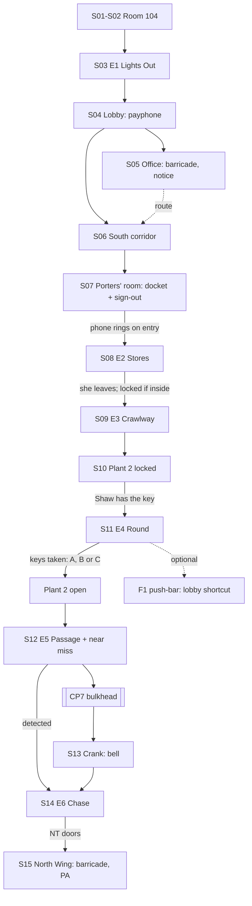

# NIGHT WARD — NW-R01: Chapter 1 Design Revision

**Status: design proposal for review. Not approved, not implemented.** This revises
[NW-R00](NW-R00-CHAPTER-1-DESIGN.md). It keeps the user's hospital topology and the approved
direction:
- the search for Ruth Avery;
- a hospital held at 03:17 in 1987;
- Nurse Shaw as Chapter 1's antagonist;
- the Final Round;
- the Nurse's Office, with its north door barricaded;
- the storage encounter and the service crawlway;
- the east-loop stealth section;
- the maintenance passage and the chase;
- the reveal at 03:18;
- no Patient until a later chapter.

No code, assets or levels change. Every distance and duration remains provisional until a playable
blockout has been tested with players who have not seen the game.

| | |
|---|---|
| **Chapter** | 1 — *The Final Round* |
| **First play** | **about 32 min expected; about 26 min even if every optional room is skipped** (§5) |
| **Night** | **Thursday 15 → Friday 16 October 1987**; the old block stopped at **03:17 on Friday 16 October** (§1.2) |
| **What's new in R01** | §0 lists every change from R00 and why |

---

## 0. What changed since NW-R00, and why

| Area | NW-R00 | NW-R01 | Why |
|---|---|---|---|
| **Dates** | "Thursday evening, 16 October 1987". The block closes on the 17th. Documents mix dates. | **The evening of Thu 15 Oct; 03:17 on Fri 16 Oct.** One rule for every document (§1.2). | 16 Oct 1987 was a Friday. The overnight dating was inconsistent. |
| **Weather** | Fog outside. | A severe autumn gale, **frozen mid-gust** outside the old block, and its aftermath in the North Wing. | It gives a believable reason for an overnight transfer through the service link (ambulances can't run), and an unforgettable supernatural image. |
| **Mandatory content** | About 15 min of 32; skipping optional rooms gave about 18–20 min. | **About 26 min mandatory, 32 expected.** | The brief requires the chapter to stay substantial when optional rooms are skipped. New required beats carry weight; nothing is padding. |
| **Act I** | Exploration with no danger before the stores. | **E1 "Lights Out"** (required). The round itself sweeps the west ward: a torch beam with no one holding it. Hiding is taught under gentle stakes. | Tension early; the round is established through play, not documents; hiding is learned before Shaw appears. |
| **Mum** | A wheelchair glimpse, a note, a barricade. | Adds a **payphone call in her voice** (fragmentary), her **unfinished knitting** for you, and her crossword. Her escape at the end becomes something she *chose*. | More emotional pull without exposition. |
| **Storage encounter** | Started by taking the bag, a 75 s timer, or reading the docket. Fixed route; she never checks hiding spots. | Started by **the porters' phone ringing** when you enter the porters' room. Whether you **answer it**, and whether you **take or leave the bag**, change her behaviour. She **notices changes** in the room. | No arbitrary timer. The player's own actions shape the encounter, and Shaw reads as intelligent. |
| **Crawlway** | Its hatch unbolted by itself after the encounter. One grille scare. | Open from the start of the encounter (escaping into it is a legitimate approach). Adds the **porters' knock code** and a **knocking presence**, steam timing, and a moment where you must **wait** above Shaw. | Interesting navigation, suspense, and a memorable supernatural moment that is also a rule. |
| **East loop** | One approach (lift the keys during a room check). | **Three approaches:** lift from the trolley; **lure her with a bed's call button**; or take the keys from the **office hook**. **Convex corner mirrors** and the office observation window let the player watch her. | Meaningful choices and multiple viable ways to succeed. |
| **Maintenance** | A calm walk, then the bulkhead. | **Escalates:** evidence, then the link's call lamps dying, then **Shaw searching Plant 2 behind you** (a near miss you can hide from), then the bulkhead. | A convincing build from exploring to danger. |
| **Chase** | A gap-controlled run with one door and one crouch. | **A set piece:** a barred door you drop behind you; **Shaw cutting ahead through a parallel passage**, which you hear through grilles, forcing a reroute; a fork you choose under pressure; obstacles you can pull down. | Cinematic, interactive and fair. Not a sprint down a corridor. |
| **Shaw** | Consistent, but mostly following a script. | **Purposeful and intelligent:** she answers call lamps, notices moved objects, takes short cuts through known routes, sings to sleepers, and keeps a notebook of rounds. | The horror comes from a mind with rules, not a timer. |
| **Feasibility** | Assumed the stories could be built on existing systems. | §8 marks every mechanic **exists / extend / new**. | Brief §5: don't assume unimplemented mechanics exist. |

---

## 1. Revised Chapter 1 storyline

### 1.1 Synopsis

**Thursday 15 October 1987, evening.** You drive through a rising gale to Halden Vale General
Hospital to sit with your mother, **Ruth Avery**, in Room 104 of the old ward block. It's her last
night there: tomorrow the block closes, and everyone moves to the new North Wing. The storm has
closed the road between the buildings, so the night sister, **Margaret Shaw**, will move the last
patients through the porters' service link instead. Ruth tells you not to fuss and to go home. You
sit down in the visitor's chair anyway, and you fall asleep with her hand on your sleeve.

You wake in **her bed**, in a gown, with **her wristband on your wrist**. Every clock says
**3:17**. Outside, the gale has **stopped mid-gust**: rain hangs in the air, a branch is frozen
halfway through the window, and the treetops lean and never move. The intercom says, warmly: *"Night
staff. The final round begins at three-seventeen. All patients will be in their beds."*

In the west ward the lights go out room by room, and **a torch beam with no one holding it** checks
each bed. You hide; it passes. In the lobby a payphone is **ringing**. You answer it, and through
static you hear your mother: *"...love? ...they're taking us through the stores way... don't let
her..."* Then a click, and the calm voice: *"Replace the receiver, one-oh-four."*

In **Sister Shaw's office**, the door to the North Wing is barricaded from the far side. Through its
wired glass, your mother's wheelchair rolls away empty down a dark corridor. A notice says that
transfers go through the porters, in the **Stores**.

In the porters' room you find Ruth's property bag, labelled in your handwriting. Inside is the
cardigan she was knitting for you, unfinished. The porters' telephone rings. **Sister Shaw is coming
to collect the property for her round.** What you do now (answer the phone or not, take the bag or
leave it, hide or slip into the crawlway) decides how she searches. She leaves, and **locks the
stores**.

The **crawlway** under the wards is the porters' old way between buildings. Their code is chalked at
its mouth: *2 knocks = clear, 3 = wait*. When you knock, **something knocks back**, always ahead of
you, as if it's leading. Three knocks come; you wait; below the grille, Shaw's trolley passes.

The crawlway brings you up in the **east ward**. The door to **Plant 2** (the link) is locked. Shaw
has the key, on her trolley. She is doing her round of the east loop: answering call lamps, checking
beds, singing very softly to the shapes sleeping in them. You learn her round and **take her keys**.
Her round becomes a search: *"My keys."*

Behind Plant 2, the **maintenance passage** leads west. It's the route the transfer took at 03:17.
Each patient's call lamp along the link goes out as you pass it. You find the transfer trolley,
abandoned, and the slip: *"Transfer suspended 03:17 — 7 unaccounted — Sr Shaw continued round."* Then
Plant 2's door bangs behind you: she has followed you in. You hide among the pumps while she
searches. You reach the **bulkhead** to the North Wing link and crank it open. **The abscondment bell
rings through the whole block.**

The chase:
- You drop a bar across a door behind you; she hammers on it, then goes **another way**.
- You hear her running in a parallel passage. She's trying to **cut you off**. You take the other
  fork.
- You come up into the disused north corridor of the old block. Through the dust sheets you reach
  the North Wing's doors, marked **NOT IN USE**.
- She stops at the glass. *"That is not my ward."*

Beyond the doors, the North Wing's clocks say **3:18**, and they're moving. Outside, the storm's
aftermath lies years old: fallen trees grown over, glass long since broken. *"Opening postponed
indefinitely,"* says a notice. You reach the back of Sister Shaw's office door. The chairs are
stacked against it from this side, with **Ruth's knitting needles** through the stack as a wedge,
and her message scratched into the paint: ***SHE CAN'T COME THROUGH IF WE DON'T OPEN IT — R.***
Through the glass, Shaw stands in her office, watching the door. A voice you don't know comes over
the North Wing PA: *"Would the relative of patient one-zero-four please come to North Wing
reception."*

### 1.2 Dates and times (one rule, used everywhere)

| Time | Date shown on documents | Event |
|---|---|---|
| Thu 15 Oct 1987, 19:30 | 15/10/87 | You arrive; the visitors' book records **22:40** as when you were allowed to stay overnight |
| 22:00 | 15/10/87 | Ruth's last observations before night; ward lights dimmed |
| 23:30 | 15/10/87 | The gale strengthens; the inter-building road is closed by a fallen tree |
| Fri 16 Oct 1987, 02:40 | 16/10/87 | Sr Shaw signs out the Plant 2 key (porters' sheet) |
| 03:00 | 16/10/87 | Porters start the transfer through the link |
| **03:17** | **16/10/87** | Something happens in the link. The transfer stops; 7 are unaccounted for. |
| Ward closure | "Ward block closes **Friday 16 October**" | Lobby notice |

**Rule:** anything written before midnight is dated **15/10/87**; anything after midnight
**16/10/87**. Night-shift documents use "Night 15/16 Oct". This fixes R00, which called the night
"Thursday 16" and listed the closure as the 17th.

**The storm** matches the real Great Storm of 15–16 October 1987 in its date and timing. Whether to
name it is an open decision (§9, D2). The design works the same either way.

### 1.3 The authorial truth (what the team works from; mostly hidden in Chapter 1)

- **At 03:17 in the link,** a power failure caused by the storm stopped the transfer in the dark.
  **What happened to the seven is the central mystery of later chapters.** Chapter 1 shows only an
  abandoned trolley, a slip and the knocking.
- **The old block** is held inside that minute. Shaw's **Final Round** keeps it running: every bed
  filled, every patient counted, so that the transfer can finish safely, which it never can. The
  block itself continues the routine around her: intercom, call lamps, lights out, the round's
  torch beam.
- **Ruth** was moved into the link before 03:17 and got through to the North Wing. She found the
  North Wing *outside* the round, with time moving, and **barricaded the one door Shaw uses**: her
  own office door.
- **The player** was put into Ruth's bed because the round needs **104 filled**. Whether the round
  took Ruth's place in the count from you, or the other way round, is unresolved (Chapter 2).
- **The North Wing** never opened. Time has passed there, years of it. How long, and who calls
  from reception, are for Chapter 2.

### 1.4 Nurse Shaw: character and rules

Margaret Shaw is a ward sister of thirty years, formidable, devoted to her patients, and the person
who lost seven of them in the dark. She isn't evil: she is **finishing her round**, and you are the
patient who isn't in bed. Her bandaged eyes are part of her design and are not explained. In play,
she has short sight (7 m) and sharp hearing.

**Her rules.** These are her behaviour and the game's rules at once. All of them are taught through
play and repeated, optionally, on her Standing Orders sheet.
1. A patient out of bed is found and **returned to bed**.
2. She **answers call lamps**: a patient calling comes first.
3. She does **not enter an isolation room** without the consultant.
4. She does **not open a door marked NOT IN USE**.
5. She **keeps her keys**. If they're lost, the round stops and she searches.
6. She **does not crawl**: "patients do not use the crawlway."

**What makes her seem intelligent:**
- she goes where sounds were, not where you are;
- she notices changes (an empty hook, a door left open, a moved trolley);
- she takes **known short cuts**, through the office's two doors and the parallel service passage;
- she talks to herself only when it serves the scene (12 lines in the chapter, §3.7).

### 1.5 Emotional arc and mystery threads

**The arc:** fear for Ruth → the shock that she was taken *with* the round → finding out she
escaped and protected herself → relief, fear and hope at once, as Chapter 2 begins.

**Mystery threads** (all left open by design):

| Thread | Where it's planted | Where it's paid off |
|---|---|---|
| What happened at 03:17 | Abandoned trolley, the incident slip, the knocking | Later chapters |
| Why you were in Ruth's bed | Her wristband on you | Chapter 2 |
| The seven unaccounted | The incident slip; seven call lamps along the link | Later chapters |
| Porter **D. Okafor** | His knock code, badge and torch | Later chapters |
| Shaw's eyes | A 1960s photograph with her eyes uncovered | Later chapters |
| How long the North Wing has been waiting | Moving clocks, years of dust | Chapter 2 |
| The voice on the PA | Its call to "the relative of patient one-zero-four" | Chapter 2 |

---

## 2. Scene-by-scene gameplay progression

Durations are **min / mandatory-only first play / expected / slow** (§5). Required beats are bold.

### Act I — The Round (about 9.5 min expected)

| # | Scene | Location | Objective | Player actions | Key events | Guidance | Duration |
|---|---|---|---|---|---|---|---|
| S01 | **Waking** | Room 104 | Wake | Look around (camera handed over smoothly) | Breathing; the frozen storm through the window; the stopped clock | The wristband, then the empty chair | 0:10 / 0:45 / 0:45 / 0:45 |
| S02 | **Mum's gone** | Room 104 | Find Mum | **Leave the room.** Inspect her glasses, the crossword (last answer "THREE-SEVENTEEN", in her hand), the call button. | The intercom announcement plays when the player first stands | The door's glass shows the corridor lit toward the lobby | 0:20 / 0:50 / 1:15 / 2:30 |
| S03 | **The west ward, then Lights Out** | West corridor and rooms | Find Mum, or anyone | Explore; **survive E1** (hide from the round's beam) | E1 (§3.1) triggers on the walk to the lobby | Lobby light; the trolley squeak beyond | 1:20 / 2:30 / 3:45 / 7:30 |
| S04 | **The payphone** | Lobby | Get help | **Answer the ringing payphone** (strongly encouraged, not gated) | Ruth's fragmentary call, then Shaw: *"Replace the receiver, one-oh-four."* | The phone rings whenever the player is in the lobby, until answered | 0:30 / 1:00 / 1:15 / 2:30 |
| S05 | **The barricade** | Nurse's Office | Follow Mum | **Try the north door.** See the wheelchair through the glass. | The empty wheelchair rolls away; the far light goes out. The transfer notice: *"via Porters — Stores."* | The notice; the lobby's south sign | 0:30 / 1:00 / 1:45 / 3:00 |

### Act II — The Stores (about 9 min expected)

| # | Scene | Location | Objective | Player actions | Key events | Guidance | Duration |
|---|---|---|---|---|---|---|---|
| S06 | **The south corridor** | South corridor and rooms | Reach the Stores | Walk; optional rooms (§4) | The TV's storm warning (dated) in the dayroom | The "STORES" sign and lit doors | 0:20 / 0:40 / 1:45 / 4:30 |
| S07 | **The porters' room** | Main store, porters' room | Find the route | **Find the docket (route) and the sign-out sheet (Plant 2 — Sr Shaw).** Optionally take Ruth's bag. | Entering the porters' room makes **the phone ring** (§3.2) | The desk lamp; the phone | 0:40 / 1:15 / 1:45 / 2:45 |
| S08 | **E2: Shaw collects the property** | Stores | Don't be found | Hide, watch, or slip into the crawlway | First sight of Shaw (§3.2) | Her sounds; her work | 1:45 / 2:30 / 2:45 / 3:30 |

### Act III — Under and around (about 10 min expected)

| # | Scene | Location | Objective | Player actions | Key events | Guidance | Duration |
|---|---|---|---|---|---|---|---|
| S09 | **E3: The crawlway** | Crawlway | Get out | **Crawl; read the knocks; wait above Shaw; time the steam** | The knocking presence; Shaw passes below (§3.3) | Knocks from ahead; cool air; stencils | 1:45 / 3:00 / 3:15 / 5:00 |
| S10 | **Plant 2** | East south branch, junction, north branch | Reach the link | **Try Plant 2: locked.** The engraved plate matches the empty hook. | Shaw's handbell carries from the loop | The handbell and squeak pull west | 0:30 / 0:45 / 1:30 / 3:00 |
| S11 | **E4: Her round** | East loop | **Get Shaw's keys** | Observe, choose an approach, take the keys (§3.4) | *"My keys."* The round becomes a search. | Mirrors, the bell, the trolley | 2:00 / 4:30 / 4:45 / 9:00 |

### Act IV — The link (about 6.5 min expected)

| # | Scene | Location | Objective | Player actions | Key events | Guidance | Duration |
|---|---|---|---|---|---|---|---|
| S12 | **E5: The maintenance passage** | Plant 2 to the bulkhead | Reach the North Wing link | **The valve; the low crouch; the evidence; hiding from Shaw at the pumps** (§3.5) | The call lamps go out; the trolley and slip; Shaw searching behind | One route; stencils; airflow | 2:00 / 3:15 / 3:30 / 5:00 |
| S13 | **The bulkhead** | M5 | Open it | **Crank it (hold)** | The bell, then *"Patient one-zero-four has left the ward."* | Checkpoint before it | 0:15 / 0:20 / 0:20 / 0:30 |
| S14 | **E6: The chase** | M6 to the north corridor to the NT doors | Escape | **Run, bar, reroute, choose, pull down** (§3.6) | *"That is not my ward."* | Light, sound, geometry | 1:40 / 2:00 / 2:00 / 2:20 |

### Act V — 3:18 (about 2 min expected)

| # | Scene | Location | Objective | Player actions | Key events | Guidance | Duration |
|---|---|---|---|---|---|---|---|
| S15 | **The North Wing** | North Wing corridor, the office door, reception | Find Mum | **Examine the barricade; look through the glass** | 3:18; the aftermath outside; the PA voice | Ruth's red knitting | 1:00 / 1:30 / 2:00 / 3:30 |

---

## 3. Detailed encounter designs

Each encounter uses this template: **objective and actions · enemy behaviour and AI ownership ·
success / failure · recovery · checkpoint and retry · accessibility · duration.** In §8, "D" means
the director (authored control), "AI" means the autonomous entity agent, and **NEW** marks a
mechanic that doesn't exist yet.

### 3.1 E1 — "Lights Out" (west ward, required)

**Fiction.** The round's routine passes through the west ward. It's not Shaw's body: only a torch
beam and soft footsteps, with no one there. It's eerie, not lethal.

**Trigger:**
- **Spatial:** the player is past the west Sister's bay (W7), heading toward the lobby.
- **Fallback:** the player has been outside Room 104 for 90 s. This is a safety net only. A
  player who hasn't left the far west end is still guaranteed the event before reaching the
  lobby.

**Sequence:**
1. The intercom: *"Lights out."* Starting at the west end, the corridor lights clunk off one bank at
   a time, every 1.5 s, sweeping toward the player.
2. A torch beam appears in the west-most doorway. It **checks each room in order**: about 5 s per
   room, the beam sweeping across the beds. Soft footsteps go with it.
3. Its route runs east along the corridor, about 30 m, through about 6 rooms. That's **about
   45 s** for it to reach the lobby.

**Objective and actions:** don't be caught in the beam. The player's options:
- **hide** in an under-bed spot (Bay 105–108), the linen cupboard locker (W8), or a bed with its
  curtains drawn (**NEW**, a curtain variant; see §8);
- **stay ahead of it** to the lobby, which it doesn't enter;
- **crouch in a dark corner** of a room it has already checked.

**Behaviour and ownership (D):**
- The beam follows a fixed route with a fixed order. It is "perception" by a simple cone: if the
  beam touches the player for 0.4 s while they're standing or not hidden, it has **found** them.
- It's not the entity AI; it's a director-owned phenomenon with its own small volume test (**NEW**).

**Success:** the beam reaches the lobby threshold and fades. The lights come back on, warm.

**Failure: soft, with no capture screen.**
- A whisper, *"Bed, one-oh-four,"* then a white-out (0.8 s), and the player **wakes in Room 104's
  bed** with the lights restored.
- Re-walking costs about 25 s. E1 doesn't repeat. The cost is the walk and the unease.

**Recovery from unexpected actions:**
- **Running toward the beam:** found, then the soft fail.
- **Already at the lobby:** E1 plays behind them. They see the corridor go dark and the beam
  coming, and nothing reaches them. That's still a strong image.

**Checkpoint:** CP1 is saved when E1 ends. The soft fail itself doesn't use a checkpoint.

**Accessibility:**
- captions: *[Lights switching off — approaching]*, *[Footsteps]*;
- the beam's position is also shown by the dust it lights up;
- the "Stealth assistance" option widens the beam's grace from 0.4 s to 0.8 s.

**Duration:** about 75 s inside S03.

### 3.2 E2 — Shaw collects the property (Stores)

**Arena:**
- **Main store (ST1):** two aisles that form a loop around a central rack; linen cages; a bench;
  the trolley bay.
- **Porters' room (ST2):**
  - a desk with the **telephone** and a desk lamp;
  - the key board and sign-out sheet;
  - Ruth's bag on hook 104;
  - a tall locker;
  - a dark gap behind a linen cage;
  - the **crawlway hatch** (4 wing nuts, about 5 s to open while crouched);
  - a **radio** on the shelf (switches on and off).

**Trigger (no timer):** the player **enters the porters' room**. On their first entry the
**telephone rings**. That's the round's routine: Shaw calls the stores before collecting.

**Player choice 1, the phone:**

| Choice | What happens | How Shaw behaves |
|---|---|---|
| **Answer** | Shaw: *"Stores. Have you bed one-oh-four's property? ...Who is this?"* Then silence, and the line goes dead. | She comes **alert** (state: investigate). She walks faster (1.35 m/s) and checks the porters' room first. |
| **Let it ring** (12 rings, about 30 s) | — | She comes **on routine** (state: patrol with stops). She collects property first, then checks the porters' room. |

**Her approach:**
- She's always heard first: the trolley squeak, heels and keys, positional. She starts at the south
  corridor's north end, **about 40 m** away.
- That's about 45 s on routine, or 30 s alert.
- Captioned: *[Trolley — approaching from the corridor]*.

**Player choice 2, the bag:**

| Choice | Result |
|---|---|
| **Take it** (the cardigan and note go into the journal) | She finds hook 104 empty, stops, and says *"One-oh-four."* She **searches more thoroughly**: she looks behind both linen cages and, if she heard someone near it, opens the locker. |
| **Leave it** | She **takes it onto her trolley**. Her search is short. (The player can still read Ruth's note in the journal if they opened the bag first; otherwise it's gone. That's a meaningful loss, but it's optional.) |

**Her behaviour (D, then AI).** The director owns her entrance and her task list. During the task
the AI's perception is live; the director hands control to the AI if she perceives the player.
1. She parks the trolley at the store's door, **listens** (*listen_brief*), and enters.
2. **Task:** she takes two property bags (from beds 103 and 106) off their hooks and tags them at
   the bench (paper sounds). She checks hook 104.
3. **She notices changes:**
   - the porters' room door open wider than she left it;
   - the radio on;
   - the hatch open.

   Each change costs about 4 s of investigation at that spot.
4. **The porters' room:** she stands in the doorway, then **steps in** (unlike R00). She looks
   around and checks the spots her search level allows. Then: *"You are not in your bed."*
5. **She leaves, and locks the stores if the player is inside.** *"Stores secured."*

**Player actions available:**
- **Hide:** in the locker; crouched behind a cage (line-of-sight cover); or **under the bench**
  (**NEW** variant of bed hiding).
- **Watch:** from cover, around the central rack loop.
- **Lure:** switch the **radio** on in the main store. It's a noise at an object (**NEW**,
  emitting noise at a position). She goes to switch it off, which opens a window to move.
- **Escape into the crawlway:** the hatch takes 5 s to open. Opening it emits interaction noise
  (heard about 7 m away), so it's safe only if she's further away than that.
  - **If the player does this,** she later finds the open hatch. She crouches and **looks into the
    crawlway** with her face at the grille: one of the scariest images in the chapter. Then: *"Patients
    do not use the crawlway."* She closes the hatch and leaves. The player watches from inside.

**Success:**
- She leaves without capturing the player: hidden, watching, or in the crawlway.
- **Progression:** the stores are locked (if the player was inside), the hatch is the way out, and
  the player is now in the crawlway.

**Failure:**

| Situation | Response |
|---|---|
| First detection | The existing first-alert grace: *"There you are. Back to bed."* She investigates at 1.35 m/s. The aisle loop lets the player break line of sight. |
| Second detection, or capture (0.85 m for 0.6 s) | The capture scare, then retry at **CP2** (stores entrance, phone not yet rung). The re-entry walk is about 15 s. |
| **Witnessed entry** into a hiding spot (existing 12 s memory) | She opens that spot. That's a fair, readable consequence. |

**Recovery from unexpected actions:**
- **Leaving the stores before she arrives:** she does her task. Because the player wasn't inside,
  she **doesn't lock** the stores. The player can come back afterwards: the hatch is in the
  porters' room.
- **Never entering the porters' room:** the phone never rings, and the route can't be learned
  anywhere else. The docket and sign-out sheet are the only sources. So the porters' room's lit
  doorway, and the transfer notice saying *"Porters' room"*, carry the guidance.
- **Navigation failure:** the director fades her out of view only, and restarts her from the
  corridor with a sound cue. She never teleports in view.

**Accessibility:**
- the phone rings in a visual rhythm (the lamp flickers);
- every one of her lines and sounds is captioned, with direction;
- "Stealth assistance" lengthens her approach by 30%.

**Duration:** about 2:45 expected, including the approach (30–45 s).

### 3.3 E3 — The crawlway (the knocking)

**Layout.** The main route is about 60 m, with two splits that each rejoin. It's a pipe and service
void, plausibly built:
- **Entrance** (porters' room hatch) → **V1, split 1:**
  - **(a) The grille run** over the south corridor's ceiling grilles;
  - **(b) The steam run** beside the heating mains, where **steam bursts every 6 s** (timing,
    telegraphed by a hiss 1 s before; being caught means a 1.5 s stagger, no damage).
- → **V2, rejoin** → **V3, split 2:**
  - **(c) The lower duct** under the east corridor. Floor grates look up into the lobby's east
    fire doors.
  - **(d) The upper run**, with a short drop.
- → **V4, rejoin** → the **ES2 exit grille** (kicked out, one way, stays open).

**The porters' knock code** is chalked at the entrance and at V1: *"2 KNOCKS = CLEAR · 3 KNOCKS =
WAIT — D.O."*

**The memorable moment (supernatural, and coherent):**
1. **Knocking back.** Knocking on a pipe (**NEW** interaction, quiet) is answered from **ahead**,
   two knocks: "clear". The answer always comes from the direction of the correct way on. The
   player discovers they're being guided.
2. **Three knocks.** At V3, three knocks come unprompted: "wait". If the player stops, **Shaw's
   trolley rolls beneath the lower duct's floor grate and stops directly below.** Her heels; a long
   pause; she moves on. If the player keeps moving, she **hears it** (crawling within about 2 m of
   the grate) and stops. That leads to a tense search below a grate she can't open, and she leaves
   after about 8 s. There's no capture: rule 6, she doesn't crawl.
3. **The knocker.** At V4, near the exit, the player finds what was knocking. There's no one. Just
   a porter's torch, on and warm, and an ID badge: **D. OKAFOR — PORTER**. Next to it, chalked
   recently: **"7"**.

**Behaviour and ownership:** the knocking and the stop beneath the grate are director-owned. Shaw's
reaction to noise uses the AI's hearing (existing). She can't enter the crawlway; it isn't on her
navigation mesh.

**Success:** exit at ES2. **Failure:** none in the crawlway. It's the chapter's safe place, made
tense by sound alone.

**Recovery:**
- **Going backwards:** allowed. The hatch is closed from the stores side if she locked them.
- **Lost players:** every branch rejoins; "→ E. WARD" stencils; the knocks always come from the
  right way.

**Checkpoint:** CP3 at the crawlway entrance; CP4 at the ES2 exit.

**Accessibility:**
- knocks are captioned with direction: *[Two knocks — ahead, left]*;
- an option shows knock-direction indicators;
- the steam bursts have a visual tell (vapour 1 s before) and a quieter setting.

**Duration:** about 3:15 expected:
- about 60 m at roughly 0.8 m/s while crouching and turning, about 75 s;
- the steam timing, about 15 s;
- waiting at the grate, about 25 s;
- the knocks and junctions, about 60 s;
- the find at V4, about 20 s.

### 3.4 E4 — The Final Round (east loop stealth)

**Arena:**
- A rectangle about 14 m wide by 30 m tall:
  - **long west and east sides** with patient rooms;
  - **short north and south sides** with utility rooms and **ISOLATION**;
  - a **core** with the **ward office**, which has **two doors** (west side and east side) and an
    **observation window** onto both long sides;
  - the treatment room, also in the core.
- **Convex safety mirrors** (a period detail) at all four corners show around them.

**Shaw's round (AI patrol with authored stops; the director owns her entrance and state changes):**
1. **Stops** at each patient room (8): she parks the trolley outside (brake click), rings the
   handbell once, goes in, checks the bed, tucks in the sleeping shape, and **sings two bars, very
   softly** at one bed per lap. About 8–12 s per stop.
2. **The office:** every lap she **hangs her key ring on the office hook** while she writes the
   round on the bed-state board (about 15 s), then takes it back.
3. **Call lamps (rule 2):** if a room's call lamp is lit, she **breaks her round** and goes there
   first (*"Coming."*). She stays about 10 s, then resumes from where she broke off.
4. **ISOLATION (rule 3):** she skips it (*"Not without the consultant"*, said once).
5. **Lap time:** about 3:20.

**The objective:** her **key ring**, which moves with her: on the trolley handle while she's on
the round, and on the office hook while she's writing.

**Three viable approaches:**

| Approach | How | Window | Risk | Needs |
|---|---|---|---|---|
| **A. Lift from the trolley** | While she's in a room checking a bed (bell, then silence, then the bed sound), approach crouched and take the keys | 8–12 s × 8 stops per lap | **Careful take** (hold 1.2 s): quiet. Quick take: jingle (heard about 7 m) → she comes out early. | **NEW:** quiet hold-take, and a noise variant per interaction |
| **B. The call-button lure** | Press a call button in a room **on the far side** of the loop (taught in the west ward, optional room W2). She answers it, leaving the trolley parked on her route. | About 20–30 s while she walks there and checks | Low, if the room chosen is far enough. The lamp leads her straight to that room, so don't stay there. | **NEW:** a world call system that changes her goal |
| **C. The office hook** | Wait in the office's other doorway, or the core's treatment room; take the keys from the hook behind her back while she writes | About 15 s, once per lap | **High:** she is within 3 m. Crouched noise is heard at about 0.9 m, so it's possible but tense. | Existing perception; **NEW** hook pick-up |

**Observation tools** (making her readable, so the player chooses with knowledge):
- the **mirrors** show around corners;
- the **office observation window** shows both long sides;
- the **ISOLATION** door's glass faces the south side;
- the **handbell** marks each room she enters;
- the **squeak** means she's moving with the trolley; **silence** means she's in a room.

**After the theft (D: state change; AI: search):**
- At her next return to the trolley or hook: *"My keys."*
- **Her round becomes a search** (existing search state):
  - she sweeps the loop, then the junction branches;
  - she checks hiding spots only if their entry was witnessed or heard;
  - she occasionally checks under the bed in the room she's in (low probability, announced by a
    slow kneeling sound);
  - she keeps to walking pace unless she's seen the player.
- The search continues into S12 (§3.5), so the pressure keeps building.

**Success:** the keys taken, then reaching Plant 2.

**Failure:**

| Situation | Response |
|---|---|
| Detection | The first-alert grace, then her pursuit at 3.4 m/s. Breaking line of sight for 4 s and hiding → she searches the last known area for 20 s → she returns to her round (or to search mode, if the keys are taken). |
| Capture | Restart at **CP5** (loop entry), with her round **restarted deterministically** from its first stop. |

**Recovery from unexpected actions:**

| Behaviour | Response |
|---|---|
| Waiting forever | Her windows repeat every lap. After two laps, a journal line: *"She leaves her keys on the trolley when she goes into a room."* |
| Pressing a call button nearby, then staying | She finds the player: a fair lesson. |
| Opening the F1 fire doors | She uses them only in search mode. |
| Going back to the lobby or west after the theft | Her search widens there after 90 s. The W8 locker exists for this. |

**Accessibility:**
- the bell, the squeak and the "*Coming*" line are all captioned with direction;
- "Stealth assistance" makes her stops 30% longer and her detection 0.8 → 1.2 s;
- a toggle for the hold-take.

**Duration:** about 4:45 expected:
- watching for about 60–90 s;
- one or two attempts, with a hiding episode;
- the walk out to Plant 2, about 40 s.

### 3.5 E5 — The maintenance passage: escalation (S12)

| Phase | Space | Purpose | Events |
|---|---|---|---|
| 1. Calm | **M0 Plant 2** (10 × 8 m, boilers, warm light) | Breathing space | The boiler log stops at 03:17 |
| 2. Constriction | **M1** pipe corridor, narrowing from 2.2 m to 1.6 m; **M2** cable tunnel, 1.4 m high for 6 m (forced crouch) | Physical unease | Caged lamps, then the red tunnel |
| 3. The seven lamps | **M3** pump chamber and **M4** transfer link | Supernatural escalation | **Seven patient call lamps** fitted along the link, all lit. Each goes out as the player passes it. The **valve puzzle**: steam blocks the way; follow the silver-and-red banded steam pipe to its valve. The wrong valve is loud and harmless. A 90 s fail-safe vents the steam on its own. |
| 4. Evidence | **M4** | The heart of the mystery | The abandoned **transfer trolley**; Ruth's other slipper; the **incident slip**. A beat of silence. |
| 5. **She's coming** | M3 and M4, from behind | Danger, before the chase | **Plant 2's door bangs.** Shaw, searching (still on foot, still searching), comes into the passage. **She reaches the pump chamber.** The player can **hide in a pump alcove** (an existing hiding type: a locker-style service cabinet), or crouch behind the pump housing (line-of-sight cover). She searches the chamber for about 20 s and goes back east, for now. |
| 6. Commitment | **M5 bulkhead** | Point of no return | **CP7** on arrival, then the crank (§3.6) |

**Ownership:**
- **The passage in phases 1–4:** D. The call lamps, the evidence and the valve are owned by the
  puzzle system.
- **Phase 5:** D owns her entrance and the duration of her search; her perception is live AI.
  Detection here → **an early chase start** (§3.6 handles both starts).

**Failure:** capture in phase 5 → **CP6** (Plant 2 interior).

**Recovery:**
- **Players who had already reached M5:** phase 5 still plays behind them, heard only, raising the
  pressure.
- **Players who went back east:** they meet her search there.

**Accessibility:**
- the valve colours are paired with **band patterns**;
- the lamps going out is captioned *[Lamps going out — behind]*.

**Duration:** about 3:30 expected:
- about 100 m at roughly 1.0 m/s, about 100 s;
- the valve, about 45 s;
- the evidence, about 20 s;
- hiding from her, about 45 s.

### 3.6 E6 — The chase (bulkhead to the NT doors)

**Trigger:**
- the player cranks the bulkhead (hold, about 4 s) → the **abscondment bell** rings → *"Patient
  one-zero-four has left the ward."*;
- **or** detection during phase 5 → she runs. The chase then starts from M3, and the bulkhead
  crank is a 2 s **tap-tap** under pressure, with her held at least 7 m back.

**Speeds:**
- **Player:** sprint 4.3 m/s.
- **Shaw:** 3.4 m/s, with the director limiting the gap (her minimum distance is 6 m).

**Sections:**

| Seg | Space | Player action | Shaw | Fairness |
|---|---|---|---|---|
| C1 | **M6** pipe run, 4 turns in 24 m | Run; steam bursts telegraphed | Comes through the bulkhead behind, at about 12 m | The turns are visible 3 m ahead |
| C2 | **Barred door** | **Slam it and drop the bar** (tap; door 1.2 s, bar 0.6 s) | Hammers on it for 2 s. **Then silence.** She takes the **parallel service passage** (a known route). | The bar is lit and on the line of travel |
| C3 | **Parallel passages** | The player **hears her running** on the other side of grilles, overtaking | Racing to the junction ahead | The grilles show her silhouette, flickering; the warning is about 3 s |
| C4 | **The fork** | She **bursts out of the left-hand junction** ahead → the player **takes the right fork** | Pursues again at about 7 m | The right fork is lit and wide; the left is where she is |
| C5 | **The low duct** | One forced crouch for 3 m (1.1 m/s) | She has to crouch too; the gap is held | It's lit; the warning is about 8 m ahead |
| C6 | **The service stair** | Up one floor (14 steps) | — | — |
| C7 | **M9 door → the north corridor** | Shoulder it: tap, or hit it at a run (auto-opens after 0.5 s) | About 6 m | Tolerant: opens within 1.5 s whatever the approach |
| C8 | **The north corridor** (disused ward, dust sheets) | **Pull down a linen trolley** behind you (optional: tap as you pass; costs her about 1.5 s) | Her first full view of the player in light; she is **fast** | Optional; the corridor is wide |
| C9 | **The NT doors (NOT IN USE)** | Push through; they swing shut | **Stops at the glass.** *"That is not my ward."* Lays her palm on the glass and walks away. | **The director owns her stop.** Her rule 4 was taught three times. |

**Ownership:**
- **D owns the scripted beats:** the bar, the parallel cut-off timing, the fork appearance, and the
  stop.
- **AI owns pursuit on the real navigation mesh,** within the gap limit.

**Failure:**

| Cause | Response |
|---|---|
| Capture (stopping for more than 2 s, running back, or getting stuck for more than 2.5 s on geometry, which must be designed and tested away) | The capture scare, then **CP7** (about 10 s back to the bulkhead) |
| Repeated failure | After 2 failures her speed limit drops 5%; after 4, 15%, and the bar and door auto-complete. Never announced. |

**Recovery:**
- **Taking the left fork into her:** the first time, she grabs and misses (a director-owned
  stagger), and the player can turn back. Doing it again is capture.
- **Never barring the door:** she simply follows. The cut-off still happens, because the director
  adjusts its timing.

**Accessibility:**
- every action is a single tap or a hold with a toggle; no button-mash;
- **reduced-motion option:** no camera shake, and steam without flashes;
- a "Chase assistance" option: her speed −10%;
- captions for every audio cue (*[Running — beyond the wall, overtaking]*).

**Duration:** about 2:00:
- about 160 m at an average of roughly 3.5 m/s, about 46 s;
- the bar, the reroute, the duct, the door and the trolley, about 30 s;
- the stop at the glass and her walk away, about 25 s;
- the run-up and bell, about 15 s.

### 3.7 Shaw's lines in Chapter 1 (12, all captioned)

1. *"Night staff. The final round begins at three-seventeen. All patients will be in their beds."*
2. *"Lights out."* (E1)
3. *"Replace the receiver, one-oh-four."* (payphone)
4. *"Stores. Have you bed one-oh-four's property? ...Who is this?"* (only if the phone is answered)
5. *"One-oh-four."* (the empty hook)
6. *"You are not in your bed."* (the porters' room)
7. *"Patients do not use the crawlway."* (only if the player escaped into it)
8. *"Stores secured."*
9. *"Coming."* (answering a call lamp)
10. *"My keys."*
11. *"Patient one-zero-four has left the ward."*
12. *"That is not my ward."*

Plus *"There you are. Back to bed."* on the first detection, and *"Not without the consultant."*
once at ISOLATION.

---

## 4. Exploration and optional rooms

Every optional room has **four layers**:
- distinctive **1980s equipment**;
- **storytelling**;
- one **subtle supernatural** detail;
- a **discovery that pays off later**, which gives the player a tool or a piece of understanding,
  not just lore.

| Room | 1980s equipment | Storytelling | Supernatural | Pays off later |
|---|---|---|---|---|
| **W2 Room 103** | Bedside cabinet, a Bakelite-style call handset on a cord | *"See you in the new place, Gran"* | The bed hollow is warm | **Pressing the call button lights the corridor lamp** (teaches approach B in E4) |
| **W3 Bay 105–108** | Curtain tracks, Balkan beam traction frame, glass IV bottles | Four beds made | One sleeping shape breathes | **Under-bed hiding**, used in E1 |
| **W4 Bathroom** | Ceramic sink, a mirror cabinet, an emergency pull-cord | — | The mirror shows the cubicle occupied (D8) | The pull-cord, as call-lamp teaching |
| **W5 Examination room** | A mercury sphygmomanometer, otoscope, an examination couch with a paper roll | A porter's mug, still warm | — | The porters exist (crawlway foreshadowing) |
| **W6 Imaging and darkroom** | Ceiling-mounted X-ray tube, lightbox, cassettes, developing tanks, safelight | Ruth's hand X-ray (her ring) | **In the darkroom tray, a photo is developing**: the night team, 1987 — Shaw and two porters, one of them **D. Okafor** | Okafor's name pays off in E3 |
| **W7 West Sister's bay** | A Kardex, carbon forms, a rubber stamp | The round sheet: 104 is the only name left | — | The Final Round, understood |
| **L Lobby** | Payphone (required, S04), a lift indicator, a WRVS tea trolley | *"Ward block closes Friday 16 October"* | The lift indicator ticks between floors, though the lift is dead | The date |
| **O Shaw's office** | Fountain pen, an in-tray, a Bakelite phone, a kettle | **The Standing Orders** (her rules); a 1960s photograph of her with her eyes uncovered | — | Rules 2–5, understood |
| **S1 Staff changing room** | Steel lockers, a uniform cape | **Shaw's locker:** a framed photo of her with a young porter (Okafor) at a retirement party | The locker door is cold | Humanises Shaw; locker hiding |
| **S2 Dayroom** | A 1980s TV on a stand, a VHS shelf | **The television:** a frozen weather warning, *"severe gale, southern England, Thursday night"* | The TV turns itself back on to the same frozen frame | The date and storm, understood |
| **S3 Physiotherapy** | Parallel bars, Zimmer frames, a row of numbered wheelchairs | One bay empty: **Ruth's** wheelchair (number 4) | — | Echoes S05 |
| **S5 Sluice** | Bedpan washer, macerator | The crawlway panel; **the knock code chalked** on it | — | **The knock code** (also chalked at the crawlway entrance; required redundancy) |
| **S6 Relatives' room** | Tea things, a vinyl sofa, the visitors' book | **Your coat; car keys; a parking ticket dated 15/10/87; the visitors' book at 22:40** | Your coat is still warm | The identity anchor |
| **ST1 Main store** | Linen cages, saline bags, oxygen cylinders (black and white), transfer trolleys | Property bags by bed number | — | E2 arena knowledge |
| **EN1 On-call room** | A bleep (pager) in a charger, a phone off the hook | A doctor's handover note: *"Sr Shaw insists on taking them through the link. Told her to wait for daylight."* | The pager shows *317* | Foreshadows the incident |
| **EN2 Seminar room** | A carousel slide projector | The last slide: *"North Wing — Commissioning Schedule"* | The projector fan is still running | The North Wing, foreshadowed |
| **EL Office** | Bed-state board, magnetic name tags, a ledger | **Shaw's notebook:** *"Round 03:17: all present"*, thousands of times, then *"one missing"* | — | Shaw, understood |
| **EL-ISO Isolation** | Barrier-nursing trolley, gowns | — | — | Safe room and observation post (rule 3) |
| **ES3 Side room** | A traction bed | A figure faces the wall | It never turns, but if you leave and come back it has moved one bed closer to the door. It's the chapter's single unexplained escalation. | Unease |

**Optional rooms are dressed to the same quality as required spaces.** The R00 §D.4 standard
still applies: one modular kit, every prop authored, no procedural fallbacks in any view, dressed
backgrounds.

---

## 5. Revised timing model

### 5.1 Assumptions
- **Effective speeds:**
  - cautious exploration 1.2 m/s;
  - purposeful travel 2.0 m/s;
  - crouching 1.1 m/s (0.8 m/s in the crawlway with turns);
  - the chase averages 3.5 m/s.
- **Interactions:**
  - inspecting a prop 6–10 s;
  - reading 10–20 s;
  - Shaw's lines 2–6 s.
- **Columns:**
  - **"Mandatory only"** is a first-time player who skips every optional room but still has to
    understand and survive each required beat;
  - **"Expected"** adds about half of the optional rooms.
- **Retries are excluded.**

### 5.2 Per scene (minutes:seconds)

| Scene | Min | **Mandatory only** | **Expected** | Slow |
|---|---|---|---|---|
| S01 Waking | 0:10 | 0:45 | 0:45 | 0:45 |
| S02 Mum's gone | 0:20 | 0:50 | 1:15 | 2:30 |
| S03 West ward + E1 | 1:20 | 2:30 | 3:45 | 7:30 |
| S04 Payphone | 0:30 | 1:00 | 1:15 | 2:30 |
| S05 Barricade | 0:30 | 1:00 | 1:45 | 3:00 |
| S06 South corridor | 0:20 | 0:40 | 1:45 | 4:30 |
| S07 Porters' room | 0:40 | 1:15 | 1:45 | 2:45 |
| S08 E2 Stores | 1:45 | 2:30 | 2:45 | 3:30 |
| S09 E3 Crawlway | 1:45 | 3:00 | 3:15 | 5:00 |
| S10 Plant 2 | 0:30 | 0:45 | 1:30 | 3:00 |
| S11 E4 Round | 2:00 | 4:30 | 4:45 | 9:00 |
| S12 E5 Maintenance | 2:00 | 3:15 | 3:30 | 5:00 |
| S13 Bulkhead | 0:15 | 0:20 | 0:20 | 0:30 |
| S14 E6 Chase | 1:40 | 2:00 | 2:00 | 2:20 |
| S15 North Wing | 1:00 | 1:30 | 2:00 | 3:30 |
| **Total** | **≈ 14:45** | **≈ 25:50** | **≈ 32:20** | **≈ 55:20** |

### 5.3 Reading the numbers
- **Expected first play is about 32 minutes**, within 25–35.
- **Mandatory-only is about 26 minutes**, so the chapter stays substantial even if every optional
  room is skipped. R00 would have dropped to 18–20 minutes in the same case.
- **The increase comes from required gameplay, not distance:**
  - E1 (+1:15);
  - the payphone (+0:45);
  - the knock-and-wait in the crawlway (+0:45);
  - the near miss in the maintenance passage (+0:45);
  - the interactive chase (+0:40);
  - a stealth approach that needs observation (+1:00).
- **Most likely to come in short:** E4 (skilled players take the keys on the first window), E1
  (players who avoid it by reaching the lobby early), and S03 and S06 (players heading straight
  for the next light).
- **If testing shows first plays under 25 minutes,** the remedy is content, never padding. In order:
  1. one more optional room per wing;
  2. Shaw's widened search catching up with players who go back to the lobby;
  3. a second step in the valve puzzle.

---

## 6. Tension and pacing timeline

The scale is 0 (calm) to 10 (peak); expected-play minutes.

```
10 |                                                                        ████ chase
 9 |                                          ██ theft                     ████
 8 |                      ██ Shaw at grate/ST2                       ██   ████
 7 |                     ███            █ grate                     ███   ████
 6 |       ██ E1         ███            ██                  ██      ███   ████
 5 |      ███            ███           ███     ███         ████    ████   ████  ██
 4 |     ████   █ phone █████          ███   ██████        ████    ████   ████  ███
 3 |   ██████ ████     ███████        █████ ███████       █████   ██████ █████  ████
 2 |  ███████████████  ████████     ████████████████    ███████  ███████ █████ ███████
 1 | ████████████████████████████  ███████████████████ ████████ ███████████████████████
   +--------------------------------------------------------------------------------------
     0    3    6    9    12   15   18   21   24   27   30   32 min
     Wake  E1  Phone Office South  E2   Crawl  Plant2  E4 Round  Maint  E5  Chase  3:18
```

**Rhythm.** Each peak is followed by a deliberate valley:
- **E1 (6)** → the payphone, eerie but safe (4) → the office (3);
- **E2 (8)** → the crawlway, tense but safe (5–7);
- **E4 (9)** → Plant 2 (3), a breath → the passage, building (5) → **E5 (7)**;
- the **chase (10)** → **3:18 (2), with silence carrying the reveal**.

**Silence as a tool.** There are four authored silences:
- after the payphone line;
- after *"Stores secured"*;
- at the abandoned trolley;
- in the North Wing's first ten seconds, where the only sound is a moving clock.

---

## 7. Progression and checkpoint logic

### 7.1 Dependency graph



### 7.2 Required items, knowledge and doors

| Requirement | Source | Redundancy |
|---|---|---|
| Route ("porters' room / Stores") | Office notice; payphone call; south corridor sign | Three sources |
| Route ("Plant 2 link") | The docket; the transfer chart on the porters' wall; the EN2 slide | Three |
| The key ("Shaw has Plant 2") | Sign-out sheet; the engraved plate matching the empty hook; the journal | Three |
| **Shaw's key ring** | E4, by approach A, B or C | Three approaches; the windows repeat |

| Door | Rule |
|---|---|
| Room 104 | Open |
| Lifts, stairwell | Never open |
| F1 fire doors | Push-bar from the east only |
| Office north door | Barricaded; never opens in Chapter 1 |
| Stores | Locked by Shaw only if the player is inside |
| Crawlway hatch | Open, from the porters' room |
| ES2 grille | One way, stays open |
| Plant 2 | Needs the key; opens freely from inside |
| Bulkhead | One way, after the bell |
| Barred door (C2) | Barred by the player |
| M9 | Shouldered open |
| NT doors | Push; swing shut; she won't open them |

### 7.3 Checkpoints (requires a new schema)

The existing chapter checkpoint stores core progression with fixed fields from the previous
chapter design (station, power-bus puzzle). **It must be replaced with a Chapter 1 schema** (§8).
Following the existing principle, **checkpoints never store Shaw's perception or memory**: they
restore her to a deterministic phase.

| CP | Where | Restored state |
|---|---|---|
| CP0 | Start | — |
| CP1 | After E1 | West ward discoveries; E1 done |
| CP2 | Stores entrance | Phone not yet rung; Shaw off-stage |
| CP3 | Crawlway entrance | E2 done; stores locked (if the player was inside); bag taken or not |
| CP4 | ES2 exit | — |
| CP5 | Loop entry | **Shaw's round at stop 1**; call lamps reset; keys on the trolley |
| CP6 | Plant 2 interior | Keys held; Shaw in search mode, on her east-side route |
| CP7 | Bulkhead | Before the chase; Shaw off-stage behind |
| CP8 | Through the NT doors | The chapter end |

**Persisted between checkpoints:**
- knowledge clues (journal);
- optional discoveries;
- Ruth's bag (taken / left);
- the F1 shortcut opened;
- doors opened.

**Restore guarantees:**
- **one** Shaw;
- the clocks correct by area (3:17 / 3:18);
- the frozen storm outside the old block, the aftermath outside the North Wing;
- no stale actor.

### 7.4 Softlock and order analysis

| Case | Result |
|---|---|
| South before the office | The payphone and the south sign carry the route |
| Never answering the payphone | The office notice carries the route |
| Never entering the porters' room | The docket and sign-out sheet are required, so the lit doorway is the guidance |
| Outside the stores when Shaw arrives | Not locked; come back |
| Into the crawlway before she arrives | A valid approach (§3.2) |
| East before the loop | Plant 2 is locked; the loop is the only way west and has the key |
| Returning west after the theft | Her search widens; the W8 locker |
| The valve stalls | The 90 s fail-safe |
| Wrong fork in the chase | A first-time grace; then CP7 |
| Never going through the NT doors | The north corridor has no other exit; she waits at a fixed distance and doesn't capture until the player moves toward her |

---

## 8. Technical feasibility and dependencies

### 8.1 Mechanics: exists, extend or new (checked against `feat/nw-006b-nurse-stealth`)

| Mechanic | Status | Notes |
|---|---|---|
| Walk, sprint, crouch; noise from footsteps (2 / 7 / 15 m radius × 0.18 / 0.55 / 0.95 intensity) | **Exists** | Shaw hears crouching within about 0.9 m, walking about 9 m, sprinting about 34 m |
| Interaction noise (6 m × 0.5, heard about 7 m) | **Exists** | **Extend:** per-interaction noise profiles, so the careful take and knocking are quiet |
| Hiding: locker, bed; witnessed-entry memory (12 s) | **Exists** | **New variants:** under-bench (bed-like), curtained bed (E1), service cabinet (E5) |
| Shaw's perception: sight 7 m in a 99° cone; hearing 2.4×; detection 0.8 s; capture 0.85 m for 0.6 s | **Exists** | Used as it is |
| AI states: idle, patrol, investigate, search, pursue, lost-target, return-to-patrol | **Exists** | **Extend:** patrol stops with authored actions; call-lamp goal override; key-loss search mode |
| Encounter director (NW-006B), authored then AI handoff | **Exists** | **Extend** to six encounters |
| Clips: idle, walk, turn, look_around, panel_check, records_read, listen_brief, investigate, capture (NW-007B) | **Exists** | **New:** pushing the trolley, handbell, taking a bag from a hook, kneeling under a bed, hammering a door, a restrained sprint, palm on the glass, crouching to look into the hatch |
| Positional audio cues (NW-007B) | **Exists** | **New:** handbell, knocks, the abscondment bell, steam hiss, lamps going out, payphone ring, radio |
| Journal, dialogue, intercom lines, cinematics | **Exist** | Need new content |
| **Chapter checkpoint schema** | **Replace** | The current schema has old-chapter fields only |
| Noise emitted at **object** positions (radio, call lamp) | **New** | Small extension of the noise event |
| **World call system** (call buttons → lamps → Shaw's goal) | **New** | Central to E4 approach B; taught in W2 |
| **E1 torch-beam phenomenon** (director-owned volume test) | **New** | Not the entity AI |
| **Telephones** (ring, answer, play a line) | **New** | Payphone and porters' phone |
| **Knock interaction** with a directional reply | **New** | E3 |
| **Steam bursts** (timed stagger) | **New** | E3 and the chase |
| **Hold-crank and barred door** | **New** (hold-interact exists in part) | E6 |
| **Gap-limited pursuit**, authored cut-off route | **New** director feature | E6 |
| **Area-based clock and sky state** (3:17 frozen storm / 3:18 aftermath) | **New** | Presentation |
| Shaw stopping at NT (rule 4) | **New** director rule | Not perception |
| Crawlway traversal (forced crouch volume) | **Extend** | Crouch exists; forced-crouch volumes are new |

### 8.2 Production dependencies
1. A **blockout of the new topology.** The current single-corridor map can't be adapted (R00 D1).
2. **Shaw's trolley** as a kinematic, pushed prop with navigation-mesh carving, with her keys as a
   visible, pickable child object.
3. **New clips and cues** (§8.1).
4. A **Chapter 1 checkpoint schema**, plus restore tests: one actor, correct area state.
5. An **environment kit** for the 1980s ward block and the North Wing (R00 §D.4), and room dressing
   briefs before any modelling.
6. **Performance budgets** set at the blockout, measured on **real GPUs**.

### 8.3 Ownership (following the NW-007 contract)
- **Codex:** directors, encounter logic, AI extensions, the call system, telephones, checkpoints,
  chase and gap logic, UI.
- **Claude:** environment, props, Shaw's presentation and clips, audio assets, the visual state of
  the frozen storm and aftermath, and asset verification.
- **Shared:** semantic bindings for every stop, hook, lamp and route.

---

## 9. Unresolved creative decisions

| # | Decision | Recommendation | Alternatives |
|---|---|---|---|
| D1 | Build a new level for the user's topology (carried over from R00) | Approve | — |
| **D2** | **Name the Great Storm of 1987** (a real event, with real casualties) | **Don't name it.** Match the date and the weather; call it "the storm" on in-world documents. | Name it explicitly; or use a fictional date |
| D3 | The player: Ruth's unnamed, gender-neutral adult child; no narration | Approve | Name and voice them |
| **D4** | **E1, the torch beam with no one holding it**, before Shaw's first appearance | Approve. It's the round, not Shaw. | Hear the round only (lights out, no beam) |
| D5 | **Ruth's voice on the payphone** | Approve: fragmentary, at most 6 words heard | Static only; Shaw only |
| D6 | **The knocking presence** (Okafor) as a guide | Approve. It's coherent with the 7 unaccounted. | No presence; chalk only |
| D7 | **The three key approaches**, including the call-button lure | Approve all three | Trolley only (simpler, riskier for duration) |
| D8 | The mirror beat (W4) | Include | Cut |
| D9 | **The ES3 figure that moves a bed closer** while unobserved | Include, once, never pays off in Chapter 1 | Cut, if it reads as a promise of a threat |
| D10 | **Shaw cutting ahead through a parallel passage** in the chase | Approve. It's purposeful and telegraphed. | A straight pursuit |
| D11 | The chase ends because of her rule (NOT IN USE) | Approve | Drop a fire shutter |
| D12 | **Ruth's knitting needles as the barricade's wedge** | Approve. It's a single image that tells us it was her. | Cardigan only |
| D13 | The PA voice belongs to a new character, identity unrevealed | Approve | Ruth's voice |
| D14 | Leaving the bag means losing Ruth's note | Approve (meaningful) | The note is always kept |
| D15 | **Stealth and chase assistance options** (longer windows, slower Shaw) | Approve, off by default | Single difficulty |

---

## 10. Self-critique: the five biggest weaknesses

1. **The mechanic count is high for one chapter.** There are about 10 new mechanics, including the
   call system, phones, knocks, steam, cranks, barred doors, the gap-limited cut-off, area-based
   sky, and three hiding variants. **Risk:** the schedule, and the polish of each. **Mitigation:**
   build in priority order: the call system, phones, gap pursuit and new checkpoints first. Steam
   and knocks can be cut to simpler versions (steam as cosmetic, knocks as one-way) without
   breaking any beat.
2. **The duration depends on stealth taking time.** E4 is the largest block (about 4:45), and
   skilled players finish faster. Mandatory-only (about 26 min) is just above the floor, so **one
   fast E4 can push a first play below 25 minutes.** Only blockout playtests can tell. The fallback
   is content, never padding.
3. **Shaw's NOT IN USE rule could still read as a cheat.** Rule 4 is taught (office, Standing
   Orders) and its sibling, rule 3 (ISOLATION), is demonstrated. But rule 4 itself is only **seen
   working once, at the end**. **Unresolved:** consider one earlier, optional demonstration (for
   example, a NOT IN USE door in the east loop she visibly won't open).
4. **E1 risks repeating as a pattern.** A sweeping beam that sends you back to bed is strong once.
   If players read it as "the hospital can always reset me", Shaw's danger later could feel
   smaller. It's mitigated by E1 never repeating and by the real capture screen from E2 onward, but
   **it should be playtested specifically**.
5. **Readability at small scale is unproven.** The keys swinging on the trolley, the convex
   mirrors, the knocks' directions, the steam tell and the silhouettes through grilles all depend
   on model scale, lighting and audio mix in the real game. **None of it has been prototyped.**
   R00's concern that Shaw's keys might not read still stands.

**Assessment.** This is a **review-ready design proposal**, substantially stronger than R00 on
motivation, interactivity and robustness. **It is not ready for production.** D2, D4, D7 and D10
need decisions, and the mechanic list (§8.1) needs a scheduling decision. Duration and readability
can only be validated by a blockout tested with fresh players.
