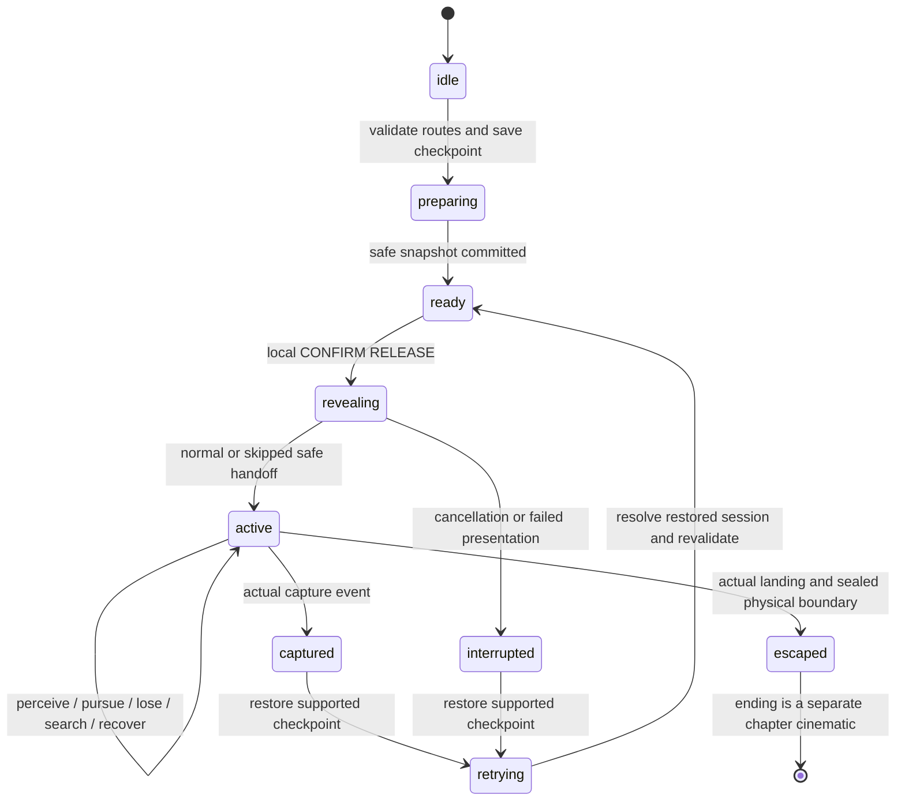

# Chapter One — The Patient chase: Do Not Discharge

## Status, source and narrative authority

This document specifies the complete intended Patient encounter before Chapter One
acceptance. It supplements [NARRATIVE.md](NARRATIVE.md), [DIALOGUE.md](DIALOGUE.md)
and the gameplay systems in this branch. It is a production and gameplay handoff,
not evidence that the finished hospital chase, acting or chapter has been delivered.

The latest observed environment handoff is
`origin/feat/nw-004a-environment` at **`475679d`**. Its `docs/NW-004A.md` withdraws
The Fractured Ward concept and proposes targeted story-driven changes to the
existing ward. Its chase options A, B, B2 and C are provisional topology ideas.
They are not approved routes, measured survival timings or instructions to copy
its coordinates into gameplay. The atrium/gallery/second-wing plan at `6b9df6b`
is historical. Neither environment proposal is silently merged or accepted here.

The established Codex treatment remains the narrative authority: the reserve bus
is armed first; a separate local confirmation with the already recovered operating
handle releases egress and observation bays. The Patient is Daniel Reed, drawn by
the release chime. The old record establishes `HVI-000104` and administrative
discharge unconfirmed, not a new deceased-patient retcon. This encounter introduces
no extra Records key or compulsory bolt-cutter fetch under pursuit. Its ending is
the hospital's recognition of the returning patient, not a playable Chapter Two.

The single semantic vocabulary remains
[`bindings.ts`](../../src/gameplay/chapter/bindings.ts). Authored room, door,
trigger, staging, route, sound and camera references resolve through one
environment revision. No new map coordinates are prescribed by this sequence.
Final geographical choreography must be approved against the produced map.

## The intended player experience

By this point the player has survived the Nurse and discovered an authentic 2012
withdrawal record bearing their permanent patient ID, signature and wrist scar.
They need the emergency stair because the hospital is retaining them, not because
the objective journal has invented another errand. The incident pack has explained
the real trade-off: the documented release opens observation bays as well as the
stair barrier. There is a reason to prepare a route before making that choice.

Correct power engagement changes the ward's tone but does not spring the threat.
The player carries the necessary handle to local release, can read the route and
choose when to confirm. At confirmation a small mechanical action produces an
unexpectedly large response: emergency circuits wake, a real door releases, and
the familiar institutional chime brings someone out of observation. The reveal
shows the Patient reacting to that sound before he has earned knowledge of the
player. He is a physical presence in the building, not a camera-side apparition.

Control returns with a legible choice. A quick direct escape may be possible;
the service route offers corners, an ordinary closable door and another way back
to the exit; credible concealment offers a third kind of response. A player who
has already studied the ward gets an advantage. A frightened first-time player
can still understand where to run without a giant waypoint or a surprise item gate.

Actual perception then determines the pursuit. His pace changes when he detects
the player; breath, foot contact and chase lighting make that change readable.
Breaking sight around a real corner buys uncertainty. He continues toward the
last credible observation, searches there and can fail to find the concealed
player. The encounter permits a quiet exit after losing him. It never summons him
back behind the player merely because a dramatic interval has not elapsed.

The final relief is physical. The player reaches the released stair, passes into
a supported safe landing and gains real separation before the ending takes
camera control. The hospital then addresses their identity with uncomfortable
precision. The route worked; the mystery has become worse.

## Preparation and entry guards

The first chase is unavailable during the awakening and Nurse tutorial. The
chapter state must establish Nurse survival, operating-pack discovery, armed
egress reserve and installed handle. Pack retrieval exposes the contradictory
record and retains its transcript even if immediate camera playback would be
unsafe. The production director plays the deferred record at the earliest safe
opportunity before the climax; it does not require a repeated inspection click.

Commit **`chapter1.after-records-power`** after records/power progress, then the
distinct **`chapter1.before-patient`** at the prepared local-release boundary.
The latter stores the actual supported player pose, installed handle, armed bus,
unconfirmed release, dormant Patient, relevant stable door poses, bounded Nurse
state, consumed story triggers and the correct lighting/audio state.

Before accepting local CONFIRM RELEASE, preflight must establish all of the
following on the actual world revision:

| Guard | Required evidence |
| --- | --- |
| Legitimate objective | The physical release mechanism is reachable and its labelled supply/handle requirements are satisfied. The required record scene has completed or been skipped automatically at a safe opportunity; no redundant prop click or extra item is inserted. |
| Safe cinematic ownership | The player is neither captured nor transitioning into/out of hiding; no incompatible scene owns the camera; entry/handoff poses and camera sweep are valid. |
| Patient staging | A dormant Patient can occupy the supplied staging/final introduction pose with real floor support, capsule clearance and a path out of the observation doorway. |
| Genuine escape options | At least two distinct, supported approaches to the released stair are traversable under current doors and obstacles. A shared final approach is acceptable; two labels for one forced corridor are not. |
| Fair response | Actual navigation, door movement, actor speeds and capture grace/dwell leave a measurable response interval after control returns. A straight-line distance alone is insufficient. |
| Nurse separation | The Nurse cannot enter the input-locked staging area or occupy the player's two first escape decisions through an already active pursuit. Physical service boundaries and actor door permissions enforce this. |
| Usable release state | Stair/observation release can be applied through interaction and collision authority, including hinge poses and occupancy. Required persistent effects can be restored on retry. |
| Presentation readiness | Approved camera/animation assets and settings-controlled audio/subtitle handlers exist for the chosen production revision. Unrecorded script slots do not pass final chapter acceptance. |

Unsafe staging defers confirmation with useful contextual feedback while the
player retains control. It never teleports the Nurse away, moves an active Patient
to a better starting point or commits a half-released checkpoint.

The target handoff spacing is **approximately 8–12 metres** along a clear authored
reveal. This is a staging target, not a guarantee of safety and not a forced
coordinate relationship. Inspect actual reachable path length, door sweep/time,
visibility, first usable junction and capsule clearance. A proposed minimum
stationary handoff-to-earliest-capture response of two seconds must be verified
with the real physics and final standard profile; it is not an extra scripted
freeze or an accepted measurement today.

## Beat, camera and sound sequence

The default Patient timing template is **`c1.cine.patient-release`**, currently
20 seconds. These are editorial placements, retimed to approved performances and
authored paths. They are not mandatory waits in normal exploration or a measured
chase duration. The camera remains in the actual environment and continuously
returns to the same valid gameplay pose; it does not cut to a second scene.

| Beat / editorial time | Player-facing staging | Sound and lighting | Gameplay / semantic authority |
| --- | --- | --- | --- |
| Preparation — player paced | The local mechanism reads **EGRESS ARMED — LOCAL CONFIRMATION REQUIRED**. Its diagram makes the stair direction and service alternative understandable. | Quiet emergency hum; keep footsteps and distant Nurse cues audible. | Player can inspect, retreat or confirm. No Patient activation, capture or countdown. |
| Confirmation — 0–5 s | The inserted handle moves, relay contacts settle and the stair retention barrier physically releases. Keep the player's hand/door relation credible. | Local mechanism, then a short reduction of incidental ambience. Essential route lighting stays visible. | One attempt-scoped release commit latches the mechanism. Presentation cues do not independently advance objectives or rotate collision meshes. |
| Ward response — 5–10 s | Observation latch and doorway are framed as real connected geometry; readable emergency direction is already in composition. | Egress chime, emergency profile. **Intercom:** “Emergency transfer active. Observation bays releasing.” | Chime has a real authored position/radius. It is an environmental stimulus, not a fabricated player-noise event or the player's latest position. |
| Patient introduction — 10–16 s | Reed emerges from the supplied doorway/approach. Show gait, breath and reaction to the chime. Frame the first usable retreat or branch. | Directional contact/Foley and strained breath. No intelligible villain speech or full-volume arbitrary sting. | Cinematic staging uses the dormant actor's authored representation; the live physical AI starts only at the collision-valid handoff. Any authored movement ends at that exact actor pose. |
| Handoff — 16–20 s | Return naturally to the player's existing pose and intended gameplay FOV. The visible threat and exit choices remain readable. | Transition into normal positional enemy audio; music tension follows actual perception after control returns. | Release the camera/input lease, clear held keys/velocity, then enable the existing AI. No body/camera snap and no pursuit progress while the player cannot respond. |
| Acquisition — player controlled | The Patient notices credible motion/sound or sees the player. A brief change of posture/pace marks alertness. | Actual chase start drives tension/lighting hooks once; foot contacts come from the actor's position. | Sustained range/FOV/LOS or justified player sound, never an omniscient current-position target. The chime alone justifies investigation, not identification of the player. |
| Pursuit — player controlled | The selected route, doors and real corners determine distance. The player can change their mind at a genuine connection. | Dynamic chase layer, directional Patient sounds, readable emergency pools. Avoid a constant wall of alarm that masks location cues. | Existing obstacle-aware AI and collision run normally. No scripted catch-up, speed teleport, door collision bypass or forced failure. |
| Loss/search — player controlled | Reed approaches the last observation, checks nearby justified places and recovers toward his route if evidence expires. | End full chase intensity on actual loss; retain quieter local search cues. A nearby search is tense without a fake “all clear”. | Losing the trail does not reveal a hiding occupant. Reacquisition requires fresh evidence. No forced replay of the introduction. |
| Stair approach — player controlled | The released route remains open. The player crosses the true threshold into the safe landing. | Chase audio resolves through the real boundary; breathing and stair ambience can become prominent. | Ending guard validates support, crossing and containment. Ending cannot begin merely because a timed camera reaches a stair anchor. |
| Recognition — ending cinematic | Band-reader pairs the old and current permanent ID: **HVI-000104 — RETURN ADMISSION CONFIRMED**. Rest toward the lower stair, then fade. | Same intercom performer, clearer and restrained: “Patient one-zero-four. Return admission confirmed. Your discharge request is still pending.” | Normal completion or skip commits `chapter1.complete` once. Mechanical release stays earned. No automatic Chapter Two. |

Canonical presentation requests come from `CHAPTER_CINEMATIC_CUES`, including
`c1.presentation.release-handle`, `c1.presentation.emergency-route`,
`c1.presentation.egress-chime` and `c1.presentation.patient-emerges`. They are
semantic adapter requests, not invented asset filenames. Claude supplies actual
animation/sound handlers and final asset IDs.

## Decisions, routes and hiding

The environment team may use the latest proposal's A/B/B2/C labels when discussing
the map, but production binds the canonical `chase-route-a` / `chase-route-b`
triggers and actual route/portal IDs. Extra choices can be authored branches of
those approaches. All lengths, timings, doorway states and sight breaks remain
unapproved until the actual geometry is delivered and traversed.

| Player choice | Intention and readable cue | Legitimate advantage | Risk / fairness condition |
| --- | --- | --- | --- |
| Direct stair approach | Emergency sign, established stair landmark and visible released door | Short route rewards prior observation and immediate commitment. | Must not become a surprise dead end because the player lacks a newly invented chase item. If the route is temporarily obstructed, show that before confirmation and provide the service choice. |
| Service bypass | Labelled service connection, familiar maintenance material/pipe landmark | Real corners and an ordinary closable door can break sight; alternate connections permit a loop. | Door motion/collision and enemy approach time must be measured. Do not assume “closing a door buys 0.8 s” independently of its authored animation and occupancy. |
| Branch back toward the main ward | A visible junction and known connection | A longer route can buy concealment and avoid an exposed final approach. | No incompatible Nurse pursuit is secretly waiting at the first branch. Longer does not automatically mean safe: hearing and later sight still work. |
| Concealment | A physically reachable familiar locker, bed or archive hiding place | If entry is unseen/unheard, concealment can break the observation trail. | No guaranteed compulsory hiding spot or two-second “move instantly or fail” requirement. If Reed witnessed entry or heard a sufficiently local distinct action, inspection is justified; capture still needs a reachable approach, range/LOS and grace/dwell. |
| Lose the Patient, then walk out | Genuine corner loss followed by quiet observation | The player can use the already released exit without another mandatory chase. | Do not re-alert Reed from a hidden global player tracker, respawn him ahead or require an active `pursue` state to finish. |
| Remain exposed or repeatedly sprint | Player knowingly produces credible evidence | None is promised; the threat can close distance and capture. | Capture follows physical approach and the configured response window, never an unavoidable cinematic result. |

Obstacles should produce readable choices: a fixed trolley narrowing a passage,
a sight-breaking column, a normal door leaf or a familiar turn. They must have
matching colliders and navigable clearances for both actual capsules. Do not spawn
debris behind the player, block both routes after confirmation or silently omit
furniture from enemy physics. A narrow passage that cannot accommodate passing
must have a route consequence understood before committing to it.

Hiding is optional. Its exit candidates must remain supported and unoccupied;
an occupied exit keeps the player concealed with clear feedback rather than
placing them inside Reed, a door or furniture. Correct per-spot furniture
exemptions remain local to hiding. Global collision is never disabled.

## What the Patient actually knows

The actor reuses the existing perception/navigation state machine. Environmental
sound investigation must retain a separate sound goal; an anonymous chime cannot
populate `lastKnownPlayer` with the player's coordinates. A valid player sight,
player-generated noise or witnessed hiding action supplies player evidence.

The default existing Patient profile is a tuning baseline, not a final encounter
measurement: patrol 0.75 m/s, investigation 1.35 m/s, pursuit 4.1 m/s, vision
13 m, sustained visual detection 0.45 s, loss interval 1.25 s, search 8 s,
recovery 2 s, capture range 0.85 m, capture grace 1.2 s and dwell 0.6 s. Player
sprint is currently 4.3 m/s. These values make straight-line escape plausible,
but actual doors, corners, input latency and route width determine fairness.
Tune through configuration and repeat physics/browser tests; never increase
enemy speed secretly based on player separation.

| AI state / evidence | Allowed behavior | Forbidden shortcut |
| --- | --- | --- |
| Dormant/staged | Preserve the approved pose; consume no old player noises; no capture. | A hidden live pursuer advancing during the reveal. |
| Chime heard | Investigate the finite recent environmental sound with local distance/occlusion checks and a real route. | Turning the chime into proof of where the player is. |
| Player detected | Pursue the observed player; refresh evidence only through credible current sight/sound. | Direct steering through walls or continuous access to an unseen concealed target. |
| Sight lost | Continue toward the last observation, then transition to loss/search. | Updating the last-known position from the player's hidden body each frame. |
| Hiding witnessed | Retain bounded memory of that spot, navigate to a valid inspection approach and test local capture conditions. | Remote capture or checking every locker because the scene has a hidden flag. |
| No evidence after search | Recover toward an authored patrol route while remaining able to detect a new observation. | Teleporting onto another route or declaring a forced new chase. |

No-path or budget-exhausted queries mean wait/recover/replan under the existing
bounded navigation policy. They never fall back to direct wall-crossing motion.
Production route preflight must reject trapping geometry rather than hiding an
unreachable enemy behind camera effects. Keep one physical owner per entity ID;
the chapter actor cannot also exist in the default always-active EntitySystem.

## Escape boundary and ending guard

`stair-safe-landing` must describe an actual supported landing reached through
the released threshold on the correct floor. Its identity alone is not a safe
volume. The adapter validates the crossing and current actor/door relationship.
If a closing door is occupied, let the normal occupancy rules delay closure;
keep player input available and let actual AI continue until separation is real.

A documented Patient access policy may prevent operating the protected stair
door from the ward side. It must agree with real door collision and navigation.
It is not an invisible plane that freezes an active agent, and does not permit
capturing through the leaf. A temporarily inaccessible last observation produces
normal near-side investigation/recovery. Only after safe containment may the
ending acquire control and settle chase effects.

The mechanical **release latch remains released** even if an ordinary door leaf
closes behind the player. The hospital's recognition cannot relock the earned
exit, introduce an unexplained extra lock or move the player into an unbuilt
lower chapter. If final scenery shows a reaction behind wired glass, its model
cue must agree with the actor's real near-side position and collision state.

## Capture, retry and interruption

Capture is a settled failure state, with the existing capture transition and
restart choice. The first Patient retry loads `chapter1.before-patient`, not the
beginning of the chapter. The installed handle and solved reserve puzzle remain
earned. The player does not revisit Records or repeat the Nurse tutorial.

Restore the complete attempt in a validated transaction:

1. Validate schema/content/world-binding revisions and checkpoint invariants
   before disrupting the current attempt.
2. Acquire transition/input ownership; fade; cancel cinema, voices/subtitles,
   actor cues and scoped chase lighting/music/ducking.
3. End each old chase exactly once and release attempt-owned listeners,
   presentation nodes and physics resources without destroying a reused engine.
4. Rebuild/apply stable door poses and colliders, pre-release mechanism/puzzle,
   navigation obstacle state, supported player pose and dormant Patient placement.
5. Restore core objectives/clues, completed preceding scenes, bounded Nurse
   preset, atmosphere/audio profile and consumed triggers. `releaseConfirmed`
   is false at this snapshot; no stale old attempt callback can commit it.
6. Present the same legible local confirmation/reveal choice. A normal reveal
   or skip reaches the same valid pose and fair response conditions. A shortened
   retry scene requires an approved alternate asset, not an assumed camera snap.
7. Release the transition only after the attempt is complete. Never expose an
   actor-active/door-locked or partly restored state to free control.

The release and chime are once **per attempt**, not once forever. A fresh retry
can perform its release normally, while duplicate callbacks within one attempt
cannot play repeated alarms, instantiate two Patients or append two captures.

Skipping stops owned presentation and smoothly reaches the same handoff. Remaining
semantic terminal effects are committed once; active AI is not teleported.
Pause freezes owned audio/timeline and the relevant gameplay host, then resumes
without consuming wall-clock time. Native recorded speech supplies its audible
playhead so camera/subtitles can resynchronize after a capped frame. A cancelled
or failed release scene cannot simply abandon a released mechanism and enable
free control: replay safely with its attempt token or restore the pre-Patient
checkpoint. Title/disposal cancels every scope. Loading never resumes halfway
through a camera path or a hiding transition.

The existing core checkpoint codec validates narrative data only. It does not
currently implement the live door/player/actor/audio restore transaction above.
That integration remains an explicit acceptance requirement.

## Required producer bindings and presentation

Use existing canonical keys rather than independent coordinate arrays:

| Canonical declaration | Required environment deliverable |
| --- | --- |
| Rooms `records`, `electrical`, `maintenance`, `release-vestibule`, `patient-observation`, `stairwell-b` | Actual room/subzone IDs with correct floor/connection metadata; no requirement for a withdrawn atrium or Wing B to make the chase exist. |
| Interactions `handle-socket`, `release-confirm`, `stair-reader`; prior `records-pack` and panel controls | Real interaction anchors, prompts, readable instructions and published IDs. |
| Doors `stair-barrier`, `observation-bay`, `service-boundary` | Existing/published door IDs, exact hinge poses, release/access policy and collision/occupancy behavior. Resolve any provisional chain/key treatment deliberately. |
| Anchors `patient-stage`, `patient-camera-start`, `patient-release-door`, `patient-emergence`, `patient-handoff`, `egress-chime` | Supported dormant actor/handoff pose, authored first-person path/clearance and actual directional sound source. |
| Triggers `release-safe-boundary`, `patient-introduction-zone`, `chase-route-a`, `chase-route-b`, `stair-safe-landing` | Real three-dimensional bounds, room/floor references and semantic crossing rules. |
| `checkpoint-before-patient`, `checkpoint-complete` and ending anchor set | Supported, unoccupied player feet/yaw and approved camera handoff for the final world revision. |
| Patient actor binding | Actual spawn identity, obstacle-aware route/portal graph, permitted door operations, hiding approaches and presentation node ownership. |
| `c1.light.reserve-armed`, `c1.light.patient-release`, `c1.light.chase`, `c1.light.recovery`, `c1.light.stair-recognition` | Bind to actual atmosphere profiles/circuits; do not emit these semantic keys as unknown current fixture IDs. |
| `c1.voice.intercom.release`, `c1.voice.intercom.recognition` | Approved original performances, measured subtitle segments and existing mixer route. Current script status remains `not-recorded`. |

Named staging data may come from `getHospitalExtras(world).staging`, passed through
the agreed adapter. Reuse producer IDs without copying their positions. Trigger
volume geometry, acoustic boundaries and final route segments require actual
authored metadata; metadata preflight is not proof of physical safety.

The alarm is environmental and spatial, with falloff/occlusion appropriate to
the produced ward. Patient breath and steps track his actual current position.
Music is a nonspatial tension layer on the existing music bus; Foley/intercom
use the agreed existing SFX route. Master/music/SFX settings apply throughout.
Duck competing ambience modestly for speech and restore it on every exit path.
Do not silence useful directional enemy cues while the player has control.

Emergency lighting must reveal thresholds, route choices, doors and floor hazards
on Low at ordinary laptop viewports. A red pulse is mood, not the only readable
route indicator. Avoid rapid full-screen flashes, perpetual blackout and visual
distortion that conceals a collision decision. Evaluate added shadow/effect cost
against the existing bounded lighting/baked baseline before enabling it.

## Verification and chapter acceptance gate

This is a variable-duration survival encounter, not a required stopwatch event.
An experienced player can escape quickly; a cautious player may hide/search for
longer. Neither outcome should be padded or punished to fit the chapter's
20–30 minute first-time target. Measure controlled chase time, cinema, reading,
pause/loading and retries separately. Editorial timings and route arithmetic
cannot substitute for an actual player-controlled run.

| Verification | Required pass condition |
| --- | --- |
| Entry/preflight | Invalid/missing routes, unsupported poses, blocked handoff, incompatible Nurse activity or unresolved required release state cannot start a half-working chase. |
| Release semantics | ENGAGE alone never activates the Patient; local confirm latches world state once. The continuing egress alarm emits a real fresh pulse at AI handoff rather than re-timestamping an old sound or fabricating player noise. |
| Chime perception | A valid recent local chime produces real sound investigation without a player last-known position or forced pursue; occluded/stale/out-of-range stimuli are handled credibly. |
| Reveal/control | Normal, early/mid/late skip, pause and cancellation all clean up exclusive control; no capture while input is locked; valid same-body/FOV handoff and measured response interval. |
| Primary escape | Fresh player can recognize the stair direction and physically reach its released threshold; no new compulsory collectible under pursuit. |
| Service alternative | Actual doors/corners/obstacles change sight/path; route is continuous and navigable for both capsules, with measured door occupancy and first-junction margins. |
| Hiding and loss | Unwitnessed concealment can work; witnessed entry supports a justified reachable inspection; blocked exits remain safe; corner loss leads to last-observation search and genuine recovery. |
| No path / dynamic changes | A blocked route never causes wall crossing or teleport; bounded planning and recovery do not create a performance spiral or strand both exit choices. |
| Stair/ending | Correct-floor crossing plus real containment precedes ending lock; occupied/blocked closing door keeps gameplay responsive; escape remains valid after losing the Patient. |
| Capture/retry | Grace/dwell capture, fade/restart, every restored door/puzzle/actor/cue state, repeated retries and one terminal result per attempt. No whole-chapter reset or stale callback. |
| Audio/settings | Native unlock, positional Patient cues, settings-controlled mix, subtitle preference, clock resynchronization and restoration of scoped ducking/lighting after every interruption. |
| Lifecycle/performance | Single engine/camera/loop; stable collider/model/audio/listener counts across retries/title; bounded nav work and hardware frame/memory profile over complete real routes. |
| Real browser acceptance | Fresh and restart playthroughs, both approaches, hiding, capture and escape; representative screenshots and complete recorded chapter with measured timings. |

Root implementation work supplies actor/chase systems and dedicated automated
coverage separately; tests and reports must identify exactly what ran. Final
map placement, produced reveal/ending assets, approved voice recordings, full
live checkpoint restoration and combined chapter playtesting remain incomplete
until verified. **Do not mark Chapter One complete before this encounter passes
the real-world acceptance gate.**

## Implemented encounter API and integration

Actual verification and prototype recordings:
[Patient chase evidence](../evidence/nw-004-patient-chase/README.md).

`createPatientChase(options)` is exported by `src/gameplay/chapter/index.ts`.
It owns encounter sequencing, not the engine, world or AI's steering decisions.
Methods: `prepare()`, `confirmRelease()`, `fixedUpdate(frame)`,
`update(deltaSeconds)`, `skipReveal()`, `interrupt(reason?)`, `pause()`, `resume()`,
`tryEscape()`, `retry()`, `getSnapshot()` and `dispose()`.

Supply one `PatientChaseLayout` resolved from the actual environment manifest:
revision, Patient final reveal mark, player handoff, chime position, exit approach
and two to four named routes. Each route has three to twenty-four producer anchor
points. No coordinates are embedded in the controller. Optional tuning is
`minimumSeparationMetres` (default 8), `minimumDecisionLeadSeconds` (default 1.5)
and `playerSprintSpeed` (default 4.3). These are configurable conservative preflight
thresholds, not measured approval of the final hospital.

`inspectPatientChaseLayout(layout, navigation)` checks actual capsule support,
player and Patient paths along each approach, distinct authored branches,
handoff spacing and the first decision's lead. It computes the Patient's earliest
full-speed route against the player's sprint route without assuming extra delay
from detection, doors, grace or dwell. Queries are bounded, run at preparation/
handoff and use the existing navigation provider/cache, not every rendered frame.

Supply `session(): PatientChaseSession` with the current player, staged Patient,
physics/navigation, existing GameEvents, chapter reducer port, cinematic player,
approved reveal builder, real Nurse-clear test and world mechanism/landing/exit
ports. A full restore can replace the session: the controller resolves it again
and rebinds its subscriptions. Exclude its Patient ID from any simultaneously
created `EntitySystem`; there must be one physical AI owner.

The checkpoint port's `save()` receives `{schemaVersion: 1, layoutRevision, core}`
and returns an opaque reference. The host must save the **complete live world**
alongside this core, and `restore(reference)` must finish before resolving.
Saving only this core envelope is insufficient for production. The isolated QA
fixture implements actual player/capture, door/gate, chapter/puzzle and actor
restoration in place while retaining the existing engine. The live game's save
slot and Continue transaction are still separate integration work.

`createPatientEncounter(options)` is exported by `src/entities/index.ts`. Its
methods are `stage`, `activate`, `offerSound`, `settleEscape`, `deactivate`,
`reset`, `getPlacement`, `getSnapshots`, `witnessesEntry`, `fixedUpdate`, `dispose`.
It reuses the existing EntityAgent. `settleEscape()` ends chase authority while
retaining the real capsule and model snapshot behind the verified opaque exit;
only later teardown removes it. Active/settled actors cannot be staged or reset.

`EnvironmentalSoundStimulus` carries `id`, `position`, `radius`, `intensity` and
fixed simulation `timeSeconds`, with no player identity. A valid heard alarm
becomes an environmental investigation/search goal; `lastKnownPlayer` changes
only from genuine player evidence. Sound queues and recent-ID memory are bounded
at 128 and remain usable during a long attempt. Vision, player noise, hiding
witnesses, grace/dwell capture and recovery still use the actual existing FSM.

Presentation cues are `prepared`, `release`, `alarm-pulse`, `pursuit`, `search`,
`recovered`, `capture`, `retry`, `escape`. Optional returned scopes provide
`stop()` and `pause()/resume()`. A cleanup function is also accepted. Scopes are
replaced/disposed on state changes; a throwing adapter interrupts into checkpoint
recovery and releases input. Ordinary chase start/end/capture remain existing
GameEvents, so choose one owner for their audio/lighting rather than duplicate
the existing atmosphere handler. Positional encounter cues use the current
Patient position; release/alarm cues use the authored chime source.

Call the controller's fixed/update methods exactly once from the existing host.
It owns its Patient tick and reveal transport tick. Do not also tick those objects
independently. Pause the shared fixed simulation clock and engine audio with the
frontend's existing pause path, then use the controller's scoped pause/resume.
No second RAF, renderer, physics world or AudioContext is created by these APIs.

The implemented escape guard needs a real supported landing, occupancy-safe
closure, producer verification that every actor-accessible landing portal is
closed, blocked enemy LOS, and blocked LOS/capsule travel across the actual exit
aperture from the authored ward-side approach. A distant corner or boolean-only
door claim fails that aperture test. A budget-exhausted global A* result cannot
prove disconnection; the guard uses the actual portal/physics evidence instead
of launching an expensive unreachable-route search during escape. If closure is
blocked, input stays live and the encounter continues.
`escaped` advances only to the safe stair arrival; it does not fabricate an
approved ending scene or mark the entire chapter complete.
