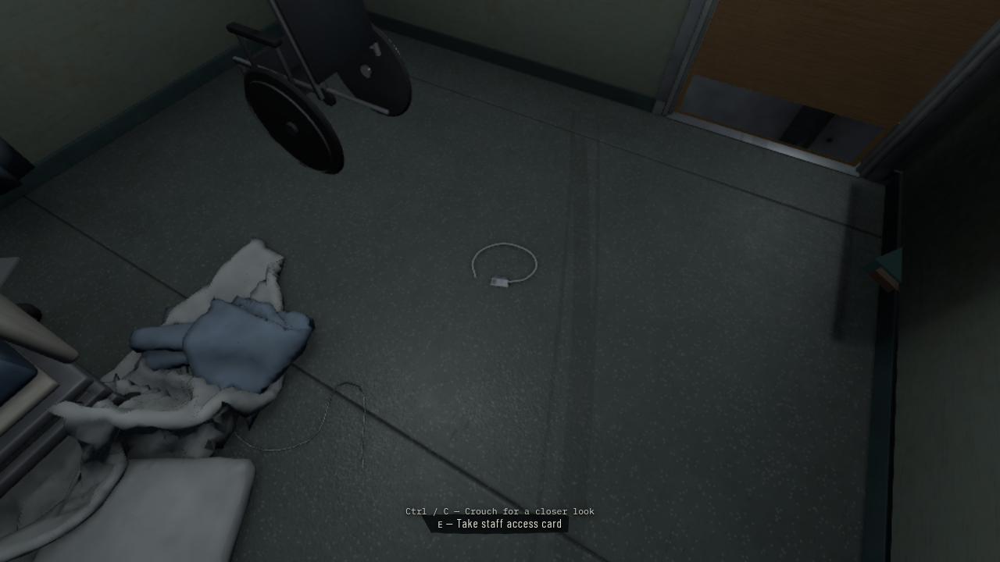
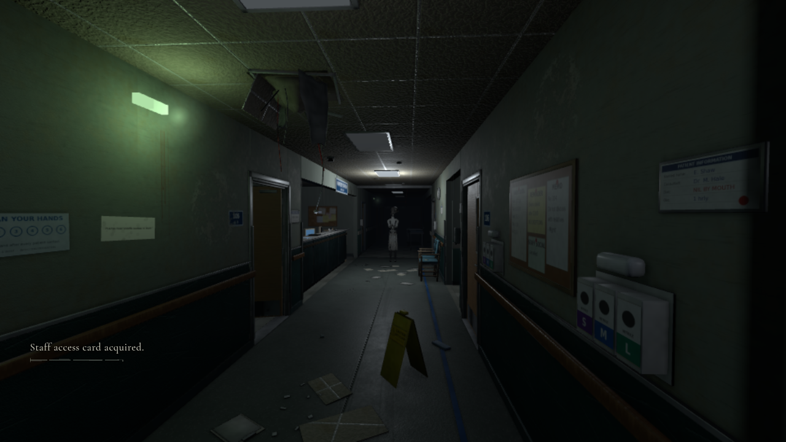
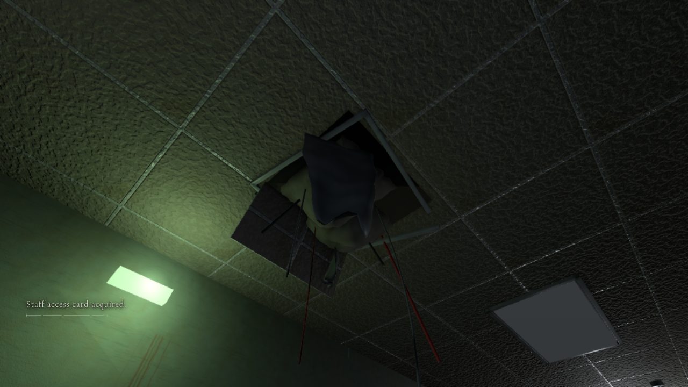

> Continued by [NW-006B](../nw-006b/REPORT.md), which adds the directed first Nurse encounter. This document records the earlier protected opening milestone.

# NW-005D — final opening integration

## Scope and provenance

Updated draft PR19 on `feat/nw-005c-opening-integration`. The exact PR17 environment integrated is **83f33be348e3ae6a4aa0d91d5d11dd5d4397af48**; merge commit **865e52a**. This includes the final full-quality remodelled ceiling collapse and matching bake, replacing the intermediate quick bake. No subsequent environment changes are included. See [SYNC.md](SYNC.md).

The approved classic hospital, Blender assets, atlas, lightmap, lighting rig, door identities/colliders, semantic opening bindings and NW005B/C systems are retained. No environment files were manually edited in this pass. PR14's rejected layout and PR15's chase remain excluded. Nothing is merged to main.

## Narrative and safety

Nurse Shaw is Chapter One's antagonist. The Patient belongs much later in the game, with no Chapter One release or finale. The live opening permanently selects Nurse-only AI even if a future director authorizes danger. The legacy Patient encounter presentation adapter is not installed for the opening. Generic Patient AI/navigation/chase infrastructure remains available for later game modules.

The dormant phase-one chapter proposal also uses Nurse-only confrontation effects/bindings and content revision `c1.2-nurse`, preventing old proposal saves from replaying the withdrawn Patient casting. These templates remain unregistered; no new stealth encounter or full chapter is introduced. Existing opening checkpoints keep their version and compatibility. Superseded NW004 planning documents now point to [current canon](NARRATIVE.md).

Room104, the corridor and station handoff remain safe phases. Reaching the station alone cannot enable lethal AI. Actual training, presentation readiness and explicit next-director authorization are still required. The nonphysical first sighting cannot capture the player.

API delta: `CHAPTER_ONE_ENTITY_TYPES: readonly ['nurse']` is exported by `src/gameplay/opening/onboarding.ts` and enforced by the existing `createGameplayModule()` opening path. `GameplayRuntime.opening.onboarding` and its training/readiness API are unchanged. Dormant chapter identifiers change from `c1.cine.patient-release` / `chapter1.before-patient` to `c1.cine.nurse-confrontation` / `chapter1.before-confrontation`; associated camera, lighting and actor binding keys change with the versioned content revision. No world/shared foundation contract is changed. See the exported arrays in `src/gameplay/chapter/bindings.ts` for the exact inactive proposal keys.

## Launch and normal-game walkthrough

```sh
git fetch origin
git switch feat/nw-005c-opening-integration
npm install
npm run dev
```

Open the printed root URL, normally `http://localhost:5173/`. No query parameter, harness, console command or developer tool is required. Choose **New Game**, then **Enter ward**. The existing menu, loading screen, settings and save slot are reused. For a production smoke test, run `npm run build` then `npm run preview`.

1. Let the bed awakening finish, or press Space for its smooth skip. Escape pauses; Resume returns to the same sequence.
2. Explore104 freely using WASD and mouse look. Try its exit: the handle responds, the door remains locked, and Shaw says “Patient one-zero-four. Please return to your bed.” Repeated attempts do not repeat the line.
3. Notice the pale staff card/lanyard on the floor near the bed. Look down, crouch with Ctrl/C if desired, and use the contextual interaction key to take it. Pickup removes the physical card and produces restrained feedback.
4. Use the reader beside the exit. Without the card it denies access; with it the lock releases. Shaw says “Patient one-zero-four. You have not been authorised to leave.” once. Repeated accepted scans produce device feedback without replaying dialogue.
5. Step back from the physical door swing and open it normally. Walk through the actual doorway into the corridor. Card-first exploration also works; it does not manufacture the earlier locked-door voice after unlocking.
6. Look toward the station: Shaw can be noticed at a distance without a camera grab or attack. Try106's handle; it responds but the door remains closed. Follow the corridor to the station.
7. Station approach saves a safe handoff and leaves ordinary movement available. There is no completion overlay, artificial wall or stealth encounter. Continue restores the existing checkpoint; New Game resets the puzzle and one-shots.

## Verification

Latest source checks:

- `npm run typecheck`: passed.
- `npm test`: **519 passed, 1 skipped**. The skipped optional external Blender sampler is unchanged. Coverage includes activation policy, interactions/LOS/range, physical doors, puzzle event ordering, dialogue/settings, pause/cinematic handoff and checkpoint recovery.
- `npm run build`: passed; existing Three/Rapier large-chunk advisory remains.
- `NW005_SOFTWARE_SCALE=1 PLAYWRIGHT_CHROMIUM_EXECUTABLE=/usr/bin/chromium npm run test:browser -- tests/browser/nw-005c-onboarding.spec.ts -g 'keyboard route'`: **1 passed** on the pinned environment. Menu → full awakening → crouch/card-first puzzle → repeated reader → real door traversal →106 → Nurse sighting → station. Positioning/aim shortcuts throw if called; movement and looking use input only. Read-only diagnostics inspect progress. Capture provocation is rejected, zero chase events and hostile bodies, 224 colliders, one live game.

`PLAYWRIGHT_CHROMIUM_EXECUTABLE=/usr/bin/chromium npm run test:browser -- tests/browser/nw-005d-readability.spec.ts`: **1 passed (2.1m)**. Assisted visual inspection at shipping Low resolution, with no test pixel-ratio override: card/wake view, reader/intercom subtitle, Nurse sightline, remodelled collapse and east ward. No browser errors. These camera placements are visual QA, distinct from the input-only route above.

`NW005_REAL=1 NW005_SOFTWARE_SCALE=1 PLAYWRIGHT_CHROMIUM_EXECUTABLE=/usr/bin/chromium npm run test:browser -- tests/browser/nw-005b-opening.spec.ts tests/browser/nw-004-systems.spec.ts`: **7 passed (4.4m)**. Three opening tests run against the real root hospital: awakening/input suppression/pause/settings/skip; door-first denial, both one-shot lines, card acceptance, normal door/collision traversal,106, sighting, exit-checkpoint retry and safe station; saved Continue/menu/reload/New Game and subtitles disabled. Four explicitly isolated systems regressions cover camera lease/noise suppression, interruption/restart/resource cleanup, refusal of unrecorded production voices and native audio-clock catch-up. The isolated harness tests are not claimed as a chapter playthrough. [Selected screenshots and lifecycle/audio evidence](evidence/regressions/).

`NW005_SOFTWARE_SCALE=1 PLAYWRIGHT_CHROMIUM_EXECUTABLE=/usr/bin/chromium npm run test:browser -- tests/browser/nw-005c-onboarding.spec.ts -g 'three minutes'`: **1 passed (4.2m)**. Real180-second Room104 dwell, no capture or hostile entity, stable collider count, then input-driven locked-door/denied-reader exploration, dialogue pause and clean puzzle restart. [Raw before/after state](evidence/safe-exploration/safe-exploration.json).

`PLAYWRIGHT_PREVIEW=1 PLAYWRIGHT_CHROMIUM_EXECUTABLE=/usr/bin/chromium npm run test:browser -- tests/browser/foundation.spec.ts tests/browser/nw-005c-onboarding.spec.ts -g 'boots the renderer|context loss|literal normal'`: **3 passed (3.1m)** against the built production bundle. Actual registered hospital, WebGL/Rapier/audio startup,800×600 canvas and camera resize, handled context loss and cleanup, and literal `/` NewGame/awakening with no QA bridge or harness. [Production screenshots](evidence/production/).

**13 relevant browser scenarios passed in this pass.** No test was deleted or weakened to obtain these results. The historical full sandbox browser suite was not run; its immediate-Patient gameplay assumptions are a different phase. No outstanding functional failure was observed in the tested opening sequence; the production limitations below still apply.

Previous NW005C results are historical evidence and are not represented as fresh runs against83f.

## Visual findings and first-time-player usability

The pale card and lanyard contrast with the floor, and the existing contextual crouch/pickup guidance is readable without a permanent HUD. The reader, door hardware and second intercom subtitle remain legible. The Nurse's pale uniform reads against the darker end of the corridor, while the overhead collapse, hanging cables and emergency pool are visible. The east-ward inspection retains readable exit signage and local falloff. No global ambient increase or local lighting patch was needed.

This is a screenshot-based engineering assessment, not an independent player study. Trying the locked exit naturally directs attention toward the access system; card-first play also remains valid. The card is small and can be missed if the player never looks down, so existing delayed, transient assistance remains useful. A first-time player can explore without a countdown or lethal pressure and reaches the safe station handoff without having to guess a hiding mechanic. Final voice delivery and an authored Nurse departure remain presentation limitations.







## Evidence and measurement limits

[Keyboard-route screenshots and raw telemetry](evidence/keyboard-route/) are from this pinned environment. The route uses a test-only `.25` pixel ratio for the software GPU; no physics/input/time override is used. A separate assisted visual inspection uses the shipping Low `.75` pixel ratio, and is labelled separately from the input-only playthrough.

This machine has no `/dev/dri` and Chromium uses ANGLE SwiftShader. Observed keyboard-route handoff: 285 draw calls,143308 triangles,386 geometries,93 textures. The240-frame telemetry window recorded p95 fixed work4.7ms, physics0.6ms and update5.0ms; frame intervals p95≈1433ms and a cold CPU/render spike≈1.76s. These observations demonstrate the severe software-rendering bottleneck, not acceptable shipping performance or a fix for the earlier hardware lag report. Real-GPU performance, extended hardware memory stability and independent human playtesting remain unverified.

## Outstanding work

- Both Shaw WAVs are explicitly temporary synthetic timing recordings, not final British voice performances. Replace recordings through the cue manifest in `src/gameplay/opening/audio.ts` and `src/gameplay/opening/assets/audio/`; keep the two stable cue IDs, lines and one-shot timing, and update measured subtitle durations with approved performances.
- The distant Nurse has no authored departure path. She stays while observed and withdraws only unobserved; no visible teleport or dangerous AI is used for this sighting. A production walk-off animation/route remains an environment/presentation follow-up.
- A full body get-out-of-bed animation is not supplied; the controlled shared-camera rise is the opening treatment.
- Station stealth onboarding is the next coordinated milestone, not part of this delivery. Do not authorize danger just because the station checkpoint is reached.
- No independent first-time-player or real-GPU approval is claimed. Historical immediate-Patient sandbox browser tests are not applicable opening acceptance tests and are not claimed green.
