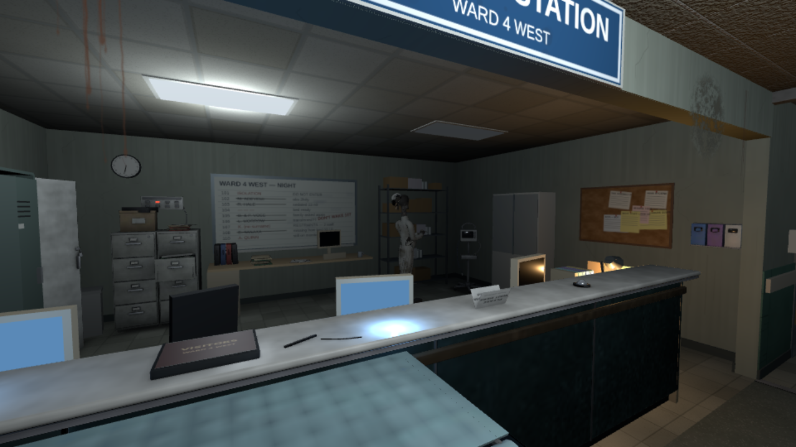
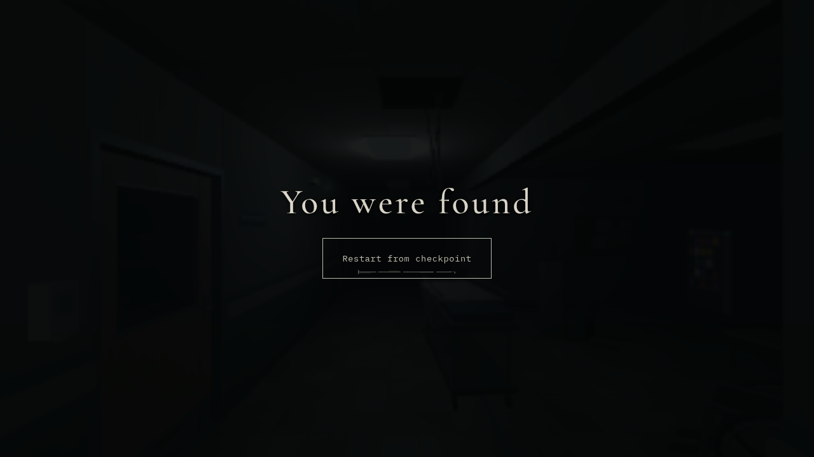

# NW-006B verification and delivery report

## Implementation

[Implementation, phase transitions, API contracts and compromises](IMPLEMENTATION.md) · [Launch and player walkthrough](PLAY.md)

Pinned environment: **0f4f0f30292361c9b1b040b2a8d365566a686491** (PR20), containing PR19's opening. The draft stacks on `claude/nw-006a-nurses-station`; no merge to main, PR19 or PR20 is performed. No world, atmosphere, horror, Blender, texture/lightmap or foundation contract file is edited by this feature.

New: a typed ordered encounter director; same-capsule authored movement authority for the existing AI; the four-phase station encounter; guarded perception/capture/entry witnesses; bounded enemy navigation; canonical station checkpoints in the existing save slot; a capture/retry overlay using the existing gameplay text treatment; opt-in read-only station diagnostics; unit and browser coverage. No new production asset or paid service is introduced.

Reused: actual Room104 puzzle/camera/dialogue, all station assets/colliders/anchors, Nurse perception/navigation/search/chase/hiding framework, existing model/animations, both actual hiding spots, atmosphere sound/music events and the existing frontend/menu/loading/restart lifecycle. The Patient is not activated, and no later chapter chase is implemented.

## Source verification

- `npm run typecheck`: passed.
- `npm test`: **556 passed,1 skipped** (the existing optional Blender sampler). All prior tests are retained.
- `npm run build`: passed; existing large Three/Rapier chunk advisory remains. Station set remains1,363.82kB and Room104 set9,155.98kB in the bundle; no art re-export.
- `npx vitest run tests/encounters tests/opening tests/chapter/nurse-encounter.test.ts`: **100 passed** after the final staging/domain fixes.

New unit coverage includes prerequisite/arrival triggers; ordered and nonrepeating phases; no pre-stealth perception or capture; continuous collision-safe entrance movement; safe learning time; actual standing/crouched trolley LOS; fresh sound observations; real locker and bed occupancy/exits; first-alert grace and concealed recovery; every checkpoint phase; clean completion; Room104 immunity and discarded out-of-domain noise. Existing Nurse tests retain obstacle detours, search, capture dwell, witnessed hiding and lifecycle/resource cleanup coverage. World tests retain the actual directional trolley and both hiding access measurements.

## Browser verification

`NW005_SOFTWARE_SCALE=1 PLAYWRIGHT_CHROMIUM_EXECUTABLE=/usr/bin/chromium npm run test:browser -- tests/browser/nw-006b-encounter.spec.ts`: **3 passed (11.2m)** on the final staging/domain revision. Fresh menu → full104 awakening/puzzle → authored introduction with pause/resume → safe learning/crouch cover → real105 bed interaction → autonomous alert/pursuit → escape and completed Continue checkpoint. The route uses no positioning or phase shortcuts. The second scenario deliberately attracts the actual Nurse, verifies the first-alert recovery window, reaches a real capture, and restarts safely into stealth without replaying A. The third restores B and verifies pause/menu restart with no repeated introduction or early capture.

`PLAYWRIGHT_CHROMIUM_EXECUTABLE=/usr/bin/chromium npm run test:browser -- tests/browser/nw-006b-encounter.spec.ts -g 'shipping Low checkpoint'`: **1 passed (1.9m)**, refreshing the same checkpoint scenario with input-driven movement to a better viewing point and an explicit rendered-frame wait. Shipping Low remains0.75 with no renderer override. The Nurse and station are clearly visible. This is an additional run of the same scenario, not a fourth distinct encounter scenario.

`PLAYWRIGHT_PREVIEW=1 NW005_REAL=1 NW005_SOFTWARE_SCALE=1 PLAYWRIGHT_CHROMIUM_EXECUTABLE=/usr/bin/chromium npm run test:browser -- tests/browser/nw-005b-opening.spec.ts tests/browser/foundation.spec.ts tests/browser/nw-005c-onboarding.spec.ts tests/browser/nw-006a-stealth.spec.ts -g 'awakening locks|locked door, two|saved station Continue|boots the renderer|context loss|literal normal|station set loads'`: **6 production regressions passed;1 asset-host assertion failed (8.5m)**. All three opening scenarios, both engine scenarios and literal normal-root startup passed. These verify the unchanged puzzle/voices, awakening pause/settings/skip,106, exit retry, saved Continue/menu/reload/New Game, subtitles disabled,1024×640 layout, audio unlock,800×600 resize, context loss and disposal.

The NW006A asset spec matches the development URL `station_set.glb` and did not match the hashed production URL `station_set-BMiAUvC_.glb`. This was a test-host mismatch, not a missing world set; the original spec is retained unchanged and its development-server rerun is reported separately. No failed check is counted green.

`PLAYWRIGHT_CHROMIUM_EXECUTABLE=/usr/bin/chromium npm run test:browser -- tests/browser/nw-006a-stealth.spec.ts`: **1 passed (6.0m)** on the development host. Both sets load with no fallback; keyboard station traversal and13 assisted player views pass, with draw calls below500 at every view. Original asset test unchanged. [Selected cover/105 views](evidence/environment-regression/).

**Final coverage:10 distinct relevant browser scenarios passed** across the new encounter, original opening, engine, literal-root and station-asset suites. The extra native-Low rerun refreshes visual evidence for one of those scenarios. The historical full immediate-Patient sandbox browser suite was not run or claimed green. Final TypeScript checks also passed after the test-only screenshot framing adjustment.

The normal route includes a real alert and pursuit, then succeeds at the intended exit. Exit is an authored stand-down: the director retasks the same Nurse to walk back to the station and the existing chase lifecycle ends with reason `cancelled`. The durable `station.phase:'complete'` checkpoint is the story-success signal; it does not falsely report an autonomous loss of sight. Geometry-based hiding/vision loss and search remain verified by the new and retained Nurse unit tests.

The new normal-game spec uses the actual menu, hospital and input controllers. Teleport and direct-aim helpers throw in the fresh route. Read-only snapshots supply semantic targets, phase observations and existing navigation waypoints; only keyboard/mouse input changes the player. It is automated play, not an independent human first-playthrough. [Full normal-route recording](evidence/normal-route/video.webm) and [raw snapshots](evidence/normal-route/normal-route.json) are included. The recording is silent and re-encoded at8fps for review without cuts or speed changes (538s); it does not establish real-GPU duration or performance. Some immediate route screenshots captured a preceding WebGL view on the software renderer; use the explicitly frame-synchronised [native-Low image](evidence/native-low/06-native-station.png) for visual review.

The first exploratory pass found a real missing capture/retry screen: the formerly safe opening had no recovery control when an actual Nurse capture occurred. That is now connected to the existing application restart callback, with a restrained fade and focused restart button. The automation also pressed movement before the existing cinematic anti-key-bleed guard had observed neutral input; the route now waits for that handoff before walking. These failed/interrupted attempts are not counted as successful runs. A subsequent successful full route and real capture/retry pass exposed a visual staging issue: the checking beat was too occluded at the back station. The beat now uses a visible published waypoint, with an actual-geometry LOS regression. A domain regression also caught the thin metadata gap at105’s wall face; the gameplay adapter bridges that band without changing physical geometry. Final browser runs use those corrections.

## Performance and limitations

Chromium is running ANGLE SwiftShader; no real GPU is available. Functional route runs explicitly allow SwiftShader and can use test-only0.25 rendering scale (`NW005_SOFTWARE_SCALE=1`) without changing physics, input or simulation clocks. A separate shipping-Low checkpoint scenario keeps the actual0.75 preset. Raw telemetry, screenshots and the automated route recording distinguish those settings. No hardware frame-rate guarantee, fix for the earlier hardware lag report, extended real-GPU memory soak or independent human playtest is claimed.

Final input-only route telemetry at completion:230 colliders,206 draw calls,53347 triangles,405 geometries and98 textures. Over the240-frame rolling sample, fixed work p95≈6.1ms (max39.8ms), physics p95≈0.8ms and update p95≈5ms. Software frame intervals p95≈1633ms; the53s of simulation in the earlier successful route and49.48s in the final route took many real minutes on this host. These observations distinguish bounded gameplay work from severe software-renderer pacing; they are not a shipping frame-rate benchmark. Capture and native checkpoint retries retain collider counts and one live game canvas.

The first sighting is deliberately continued into the station entrance, with no second spawn or visible repositioning. Camera freedom means a player can look away from a beat. A fast player may leave the physically open route during the safe teaching period; ordered story phases still settle, without an arbitrary wall or surprise capture. Checkpoints restore safe semantic milestone poses and canonical doors, rather than exact in-flight AI memory/door swings. See IMPLEMENTATION.md for the rationale and next-section integration.

The panel-check beat reuses the current observation/listening pose; bespoke hand/paperwork animation is not delivered. Existing Room104 Shaw WAVs remain explicitly temporary synthetic timing assets, not final British performances. No additional dialogue, objective journal or main-menu redesign is introduced.
