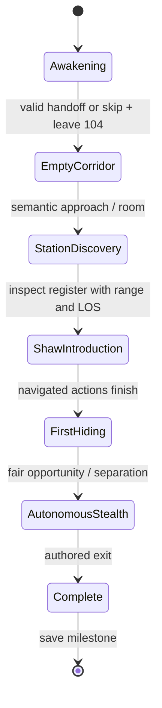

# NW-007A scene, ownership and animation interface — v1

Implements the [Shared Design Contract Revision 1](SHARED-DESIGN-CONTRACT.md) on the existing GameModule runtime. This is the opening/first encounter, not a Chapter One finale. The Patient and PR #15 are excluded.

## Six scenes and triggers

| Scene | Narrative steps | Trigger / resulting behavior |
| --- | --- | --- |
| 1 — Awakening | 0, then 1 (`awake`) | Enter ward starts the shared-camera transport at the published bed eye. Orient, sit, settle and stand; exact safe controller handoff. Space skips through a blend. |
| 2 — Empty corridor | 2 (`left-room`) | Walk through the unlocked 104 doorway. The station call tone/indicator, existing signs and the intercom's assistance legend motivate finding the station. Shaw's model is hidden and her actor is dormant: no invisible capsule or early patrol. |
| 3 — Station discovery | 3 (`station-found`) | Reach the published station approach or enter the Nurse spawn's semantic room. Explore freely. Examine the existing raised register/paper tray; the validated range/LOS interaction commits `record-read` (step 4). |
| 4 — Shaw introduction | 4 | Eligibility requires awakening, released 104 lock, discovered register and no awakening camera lease. Acquire Nurse/dialogue ownership; stage the dormant actor only at an unseen, clear published point. Footsteps precede a navigated corridor/doorway entrance, panel check, record inspection and listening pause. No perception/capture. |
| 5 — First hiding opportunity | 5 (`shaw-introduced`) | Shaw repositions on an authored station round. The nearby locker retains its actual `Hide in locker` prompt. Both it and 105's bed work. A minimum 10 seconds and 1.5 seconds of concealment/covered crouch allow handoff; otherwise a clear separation after 18 seconds allows players who choose to move on. Face-to-face slow exploration remains nonlethal. |
| 6 — Autonomous stealth / escape | 6 (`concealment-offered`) | Transfer authority to `ai:shaw`. Existing patrol, sight, hearing, investigation, witnessed hiding, pursuit, search and loss run within the original encounter domain. Cross the published exit: settle pursuit, return Shaw physically to work, commit `escaped` (7), save completion. No later chase. |

The record is an environmental clue, not a fetch key: **Patient 104; admitted yesterday; a prior admission on 17 June 1998; attending E. Shaw; discharge withheld.** It contradicts the player's apparent recent admission without explaining the larger mystery. Shaw responds to the ward's systems/routine, not supernatural access to the player's coordinates. The two existing 104 intercom lines are unchanged; no third Room 104 speech or protagonist narration is added.

A player may look away or retreat. The script provides a reliable opportunity, rather than forcing camera attention or erecting a barrier. Discovery is required before an introduction; autonomous AI cannot start the story prematurely.

The **existing** Encounter Director still runs `waiting → introduction → tension → stealth → escape → complete`. Narrative scenes 4–6 consume those transitions; it was extended, not replaced. Real navigation and the same Nurse capsule persist through authored-to-AI handoff.

## Ownership and cancellation

`ExperienceCoordinator` leases are per attempt; they never enter a save:

| Owner | Resources | End |
| --- | --- | --- |
| `narrative:awakening` | camera, dialogue | Transport completes/skips/is interrupted. Real controller lease suppresses look/movement/interactions/noise. |
| `narrative:intercom` | dialogue | Serial speech ends. A staged entrance waits for this channel. |
| `encounter:shaw` | nurse, dialogue | Authored entrance and hiding opportunity finish. |
| `ai:shaw` | nurse | Real stealth ends, capture cancels it, or attempt disposal. |
| `encounter:capture` | camera, nurse, dialogue | Brief captured presentation completes/skips. Player remains captured. |

Conflicting leases are denied. Camera transports combine coordinator and real player-control cancellation signals. Stale authored encounter work stops after its lease is aborted. Lifecycle cancellation (capture/menu/retry/disposal) stops audio, transports, actor ownership and subscriptions; fresh attempts reconstruct from validated semantic milestones. A future owner must honor its lease signal and release its own presentation resources. This is not a general adaptive Tension Director or actor simulation scheduler.

Atmospheric requests use `AuthoredCue` (`sound`, `light`, `environment`) mapped to existing shared events. Current sounds use installed cue IDs; the panel emits one restrained local fixture cue. Authored cues never fabricate player noise or grant AI perception. Walking noise still comes from real collision-resolved player travel.

## Spatial adapter and optional NW-007B nodes

All positions are obtained from existing world contracts/named objects, not copied hospital coordinates. Current assets run independently of NW-007B:

| Optional producer node | Current fallback |
| --- | --- |
| `nw:cinematic:station-record` | Raised paper-tray cluster in the actual `station_paperwork` mesh. Lower counter papers are behind a solid transaction ledge/trolley and are not used. |
| `nw:cinematic:shaw-entry` | Published station-round corridor point, then other clear published points if needed. |
| `nw:cinematic:shaw-panel-target` | Bounds of `station_annunciator`. |
| `nw:cinematic:shaw-panel-stand` | Valid stance derived from that target and station patrol metadata. |
| `nw:cinematic:shaw-record-stand` | Valid stance derived from the register and patrol metadata. |

Existing `nw:opening:awakening-eye`, player spawn, room doors, reader/card, station entry/observation/exit, patrol route and both hiding identities are preserved. Legacy corridor-sighting bindings remain compatible data; they no longer trigger a sighting.

Optional points must be unique, in world space after parent transforms, supported and unobstructed for the existing capsule. The record needs a reachable 2.3 m interaction with real LOS. No collider is disabled to make the clue work. A missing/unreachable required clue fails setup rather than publishing an unwinnable opening.

Staging checks distance and conservatively sampled silhouette visibility through the actual camera and static physics. It is only permitted before activating the actor, at most twice per simulated second while eligibility is pending. Once active, the actor follows navigation; it is never restaged live. Saved attempts may reconstruct at canonical safe locations behind the loading screen.

A stationary reader can occupy a preferred work stance. After a short verified stall, Shaw may inspect from a nearby clear vantage within a narrow distance/LOS limit. Her collision stays active. `contactReady=false` tells an optional animation adapter to use a noncontact fallback; no hand-to-panel clip should play from that alternate vantage.

## Animation interface

No new asset path or exact clip name is assumed. `NurseAnimationBinding` requires:

- semantic category;
- exact producer-supplied clip name and duration;
- looping/one-shot mode;
- documented entry and exit poses;
- `rootMotion: 'in-place'`;
- required semantic target (or null for targetless animation);
- existing visual-state fallback.

`resolveNurseAnimations(rows, clips, hasBinding)` accepts only supplied, duration-matching clips with documented poses and present targets; rejected optional bindings fall back to current assets. It does not invent or load a replacement character.

| Category | Existing fallback / integration note |
| --- | --- |
| idle / breathing | Existing idle state. |
| walk | Existing locomotion, time-scaled to measured speed. |
| turn / look | Existing bounded actor yaw and idle/observation. |
| check-panel | Existing observation while facing the real panel; custom contact requires `contactReady`. |
| inspect-records | Existing observation toward the register; custom contact requires `contactReady`. |
| listen / alert | Existing observation/listening presentation. |
| investigate | Existing AI locomotion/search. |
| capture | Existing idle/breathing with the real captured camera and quiet cloth/tension sound; bespoke grab is pending. |

`StationActorPose` adds `visible`, semantic `action` and `contactReady` to the existing delta/actor/yaw/speed/checking flag. `GameplayOptions.openingScene` accepts existing `loadNurse(): Promise<EntityVisual>` and optional `onNurseAction(pose)`. The observer selects semantic intent for a supplied visual; allocate no resources per frame. A custom visual owns/disposes its mixer, skeletons and cloned materials, while its asset library owns shared geometry/textures/bitmaps. Navigation owns translation. Do not translate the physical actor or add another Nurse.

NW-007C can provide a scene adapter through `createGameplayModule({ openingScene: ... })` in the existing gameplay registration after real NW-007B manifests are reviewed. No `main.ts` edit is needed. Verify duration/targets/root motion first, retain fallbacks, then rerun phase/retry/browser tests.

## Checkpoint contract

Opening saves remain version 1 and gain optional `narrative: { version: 1, step: 0..7 }`. Saves require an exited/unlocked room; narrative milestones have a validated prefix and matching encounter phase. Arrival is the existing `state.stationReached`; completion is narrative step 7 plus `station.phase='complete'`.

Old saves migrate deterministically: old introduction → step 4; tension → 5; stealth → 6; complete → 7. Existing players are not forced to replay a completed introduction or rediscover an obsolete clue. Intro/learning retries are nonlethal. Stealth retries restore the existing safe observation spawn and Nurse home with recovery grace, not privileged target/hiding memory. Complete restores at the exit with no pursuit. New Game discards all prior milestones/card/door/voice state.

Only milestones save: 104 exit, discovery/record, authored transitions and completion. Reading/retrying arbitrary furniture does not add autosaves. Actor paths, rendered nodes, camera leases, audio nodes, timers and transient pursuit memory are never serialized.

## Camera, audio and resource rules

The same engine camera uses the existing cinematic transport. Full awakening lasts 9 seconds with eased orient/sit/stand beats; Reduced Motion uses a 3.2 second restrained blend. Space skips safely; pause/settings stop transport time. Changing to Reduced Motion during awakening takes the safe skip blend. Walking bob is at most 8 mm downward, distance-based and disabled by the existing Reduced Motion/OS preference; no roll or physics displacement.

Footsteps use actual grounded travel/noise intensity and the existing SFX mixer. Capture changes no body position or narrative state: bounded focus (no more than 0.42 rad yaw / 2° FOV), quiet cloth/tension cue, short fade and focused retry. Reduced Motion removes focus movement; Space/Escape advances to retry. A captured hidden pose that cannot lease the camera still receives retry. The player stays captured until a fresh attempt is built. Skip keys are intercepted only during active captured playback; after it settles, the focused Retry button regains normal Space/Enter activation.

The Phase 1 byte store owns immutable source bytes, never scenes. Every attempt parses fresh objects. Canonical Room 104/station/card are mandatory; missing critical assets give the existing error path rather than obsolete procedural gameplay. This is the safe critical-loading fallback. Optional new animations fall back to existing states. Texture owners dispose GPU maps and close shared ImageBitmap backing stores once; model instances dispose skeleton bone textures; audio voices/listeners/leases are scoped and released. No new animation loop, camera, renderer or AudioContext is created.

## Published NW-007B handoff (read-only inspection)

Claude's draft PR #22 is now available at environment/assets commit
`dbebd306dbe52e9f7142873995b7935ae83a502b` on
`claude/nw-007b-cinematic-assets`. It has **not** been merged or cherry-picked here.
The adapter accepts its actual named nodes before the legacy optional aliases above:

| Published NW-007B node | Consumer |
| --- | --- |
| `nw:station:record-104` | Physical clue interaction target. |
| `nw:station:call-lamp-104` | Panel observation/look target. |
| `nw:station:nurse-panel` | Navigation work stance. |
| `nw:station:nurse-records` | Navigation records stance. |

These are resolved in world space. Their coordinates are not copied into gameplay.
A transformed-parent unit fixture verifies precedence and coordinate handling. This
prepares the naming boundary; it does **not** certify the combined NW-007C build.

NW-007C integration steps:

1. Integrate the separately reviewed A/B branches, resolving only actual loader/lifecycle
   overlaps. Preserve the canonical byte-source and owner-disposal fixes. Do not restore
   the procedural browser fallback.
2. Read B's `getStationStaging(world)` / `nwStation` metadata for exact yaw, contact target
   and look target. Check the supplied work stances against the physical capsule and player.
3. Feed the producer's `NURSE_CLIPS` metadata through the validation boundary. B publishes
   `EntityVisual.playClip(name, options)` and live `visual.clip` state. Use the supplied
   `panel_check` (one-shot, five seconds) and `records_read` (loop) only at valid contact
   stances. Extend the authored hold from its current fallback duration to the verified clip
   duration/completion; end loops explicitly. Never await a missing clip indefinitely.
4. Preserve live getters when wrapping the model visual; forwarding `clip` through an
   object spread would snapshot the readout. The optional scene adapter must forward it
   dynamically. Keep navigation authoritative and one physical/visual Nurse.
5. B's documented sound IDs include `nw:shaw-steps`, `nw:shaw-keys`, `nw:shaw-rustle`,
   `nw:call-panel`, `nw:paper`, `nw:station-hum`, `nw:capture`. Bind cues to the supplied
   timings and existing mixer; cancel on pause/retry/disposal. Current A uses installed
   baseline cues and therefore compiles/runs without those assets.
6. Re-run normal-game introduction, both hides, actual detection, five retries, capture
   skip/reduced motion and resource checks against the combined assets. Review the
   producer-documented pending close-up character presentation work; no new character
   geometry is authored in A. Final voice performance and independent human review remain
   explicit acceptance dependencies.

The semantic naming shim is implemented here. New clip playback, producer action timings,
new audio and final capture staging remain NW-007C integration work; they are not silently
represented as active in this baseline-compatible branch.

## Public gameplay APIs added/extended

- `createNarrativeDirector(saved?: NarrativeCheckpoint, changed?: () => void): NarrativeDirector`;
  `commit(beat)`, `has(beat)`, `checkpoint()`, `scene`, `nurseEligible`.
- `validateNarrativeCheckpoint(raw: unknown): NarrativeCheckpoint | null` and
  `migrateNarrative(awakened, exited, station?, found?): NarrativeCheckpoint`.
- `createExperienceCoordinator(): ExperienceCoordinator`; `acquire(owner, resources)`,
  `cancel(owner?)`, `snapshot()`, `dispose()`. A lease exposes `owner`, `signal`, `release()`.
- `emitAuthoredCue(events: GameEvents, cue: AuthoredCue): void` maps typed authored sound,
  light and environmental requests onto existing foundation events.
- Existing `createStationEncounter(options): StationEncounter` now accepts optional
  `coordinator` and `canStage(position)`; its `present` callback receives semantic
  `StationActorPose.action`, `visible`, `contactReady` along with authoritative actor/yaw/speed.
- `resolveNurseAnimations(rows, clips, hasBinding)` validates producer metadata and returns
  `accepted` / `rejected` optional categories, without loading assets.
- `awakeningPath(first, last, yaw, reduced): CinematicDefinition` and
  `createCapturePresentation(options): CapturePresentation` reuse the existing transport.
- Existing `createGameplayModule(options)` / `createGameplayRuntime(options)` remain the
  integration entry points; `openingScene` provides optional `loadNurse` and `onNurseAction`.
  Existing player camera-control acquisition accepts optional purpose `'gameplay' | 'capture'`.

Contracts, `main.ts`, the registry and Blender source files remain unchanged. The small
world/model loader edits are the necessary shared environment lifecycle fix, not environment
redesign or visual asset authoring.

Import locations for these exports: `src/gameplay/directors/narrative.ts`,
`src/gameplay/directors/experience.ts`, `src/gameplay/directors/cues.ts`,
`src/gameplay/encounters/nursesStation.ts`,
`src/gameplay/encounters/animationContract.ts`, `src/gameplay/opening/awakening.ts`
and `src/gameplay/opening/capture.ts`. The existing `src/gameplay/index.ts` remains
the GameModule/runtime barrel; no shared contract or entry-point migration is needed.
