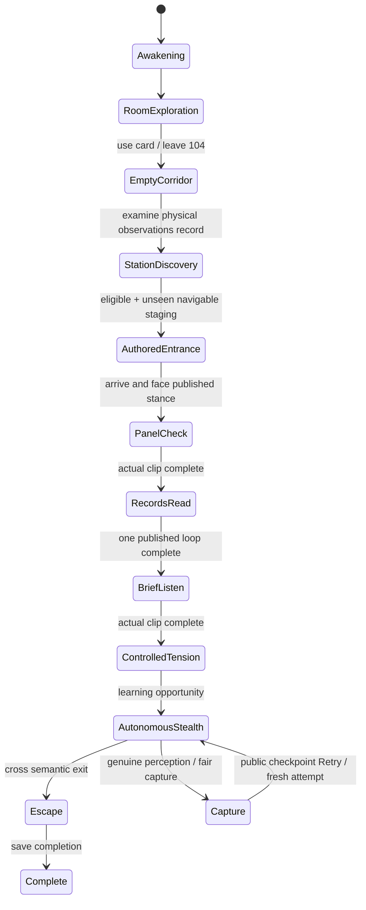

# NW-007C: integrated cinematic opening — verification report

Draft PR: [#24](https://github.com/Seb-Simpson/Claude-and-Co...dex/pull/24). Branch: `feat/nw-007c-cinematic-integration`, stacked on `feat/nw-007a-cinematic-gameplay`. Nothing is merged into main or a source branch.

## Sources and resolutions

- Exact start: NW-007A PR #23, `5f4b2c76a1dae44135b9cca1d4d560d30d96368d`.
- Initially integrated NW-007B PR #22: `dbebd306dbe52e9f7142873995b7935ae83a502b`.
- Final B asset pin: `ec4ed996db34f3608d0583393fa7c408f951ef99`. Claude published a targeted head-export/bake repair while verification was running. We fetched and inspected that commit, stopped the just-started old-asset public batch, explicitly merged the repair and restarted validation. No subsequent unfinished commits are silently included.
- Common ancestor: `0097264bf07a21b22ca7b5b1ac14ddaff951a046`.

The only initial overlapping source, `src/world/dressing/station.ts`, auto-merged without conflict. It retains A's immutable source-byte loader and owned texture cleanup together with B's station artwork/material treatment. The later repair merged cleanly. No Blender source or character geometry/material authoring is changed by the integration implementation; the producer's repair is imported intact.

Compatibility fixes connect actual published work stances/facing, clip durations/completion, live getter forwarding, gait-speed scaling, action sound timing and per-attempt cancellation. They preserve A's real navigation, collisions, director transitions, canonical world creation and checkpoint restoration.

[Audit](AUDIT.md) · [Integration/API details](INTEGRATION.md) · [Normal play instructions](PLAY.md).

## Director flow and ownership



The Narrative Director owns ordered discovery/milestones. The Encounter Director owns the authored routine and handoff to the same autonomous Nurse. The Experience Coordinator leases the actor/camera/dialogue. Aborting a lease cancels its authored clip and sounds synchronously. A capture emitted inside AI cannot be overwritten by that tick's stale normal-pose write. The capture clip/camera/fade share the published 1.4-second clock, remain skippable and respect Reduced Motion.

The same physical actor/capsule walks through actual geometry. Animation does not translate her. Safe phases disable perception/capture without globally disabling later AI. Autonomous stealth retains actual vision/sound investigation, directional trolley cover, staff locker, Room 105 bed and witnessed-entry memory. No Patient is enabled; no later chase is added.

## Verification in progress

Final repaired-model browser results and representative screenshots/recording will be recorded here when the runs finish. This document does not count unfinished cases as passing.

Commands already completed after importing the repair:

```sh
npm run typecheck
npm test
npm run build
```

Results: typecheck pass; **627 tests passed, one optional Blender sampler skipped (78 files)**; production build pass. Vite reports its existing large-chunk advisory; no compilation failure. New tests cover actual clip clocks, action sounds/cancellation, real-GLB investigation gait/stationary contacts, capture duration/progress, director-lease interruption and the synchronous capture ownership race. Producer head regression tests are included unchanged.

The initial six-case Chromium batch passed in 18.3 minutes on the **old** B asset, including five real captures/UI retries and the sole real director actor. Those files under `evidence/pre-repair/` deliberately show the broken head. They are historical, not final repaired-model evidence. The public batch interrupted upon discovery of the repair has no completed cases and contributes no pass count.

## Visual and acceptance gates

The initial close-ups independently confirmed the displaced face covering/cap/hair and streaked face/neck. The repaired asset was then independently rendered through the integrated game/model library in rest, look-around, panel and capture poses, and inspected. The covering/cap/hair now follow the head; the prior striped face/neck bake is absent in these views. The 10 imported geometry/rig regression tests pass as well. The **specific original export/bake defect is verified repaired on `ec4ed99`**; this is not final artistic or human acceptance of the stylised model. The isolated head renderer creates a temporary preview actor and hides the gameplay visual; the separate C fixture verifies the sole actual director actor.

Actual director-driven pre-repair close-ups also show hands hovering short of the work props. At the cue sampling instants, nearest strongly right-hand-weighted skinned vertex distances to published target points were panel **24.0 cm** and record **15.9 cm**. These point samples do not represent whole-clip contact, and wrist positions are not fingertips. Integration does not silently solve this by changing producer coordinates, adding unreviewed IK or deforming the character. Final repaired-asset contact evidence and remaining staging issues will be reported separately.

No real GPU or independent human playtest is available in this environment. `/dev/dri` is absent. Chromium uses SwiftShader; ordinary Low-quality screenshots and reduced rendering-scale functional runs must be distinguished. No hardware frame-rate, human usability or atmospheric acceptance is claimed.

**NW-007 acceptance: pending, not complete.** The draft remains open for visual/staging review and the required independent human playtest. No NW-008 implementation or automatic merge.

## Repaired-model retry resource sample

The completed five-cycle test uses actual Nurse perception/capture and the public Retry button, then verifies New Game restores a usable visible card. The initial Continue is a valid saved-stealth milestone fixture; it is not the full fresh-start walkthrough.

| Restored attempt | Colliders | Draw calls | Triangles | Renderer geometries | Renderer textures |
| --- | ---: | ---: | ---: | ---: | ---: |
| 1 | 230 | 332 | 193,799 | 303 | 85 |
| 2 | 230 | 332 | 193,799 | 303 | 85 |
| 3 | 230 | 332 | 193,799 | 303 | 85 |
| 4 | 230 | 332 | 193,799 | 303 | 85 |
| 5 | 230 | 332 | 193,799 | 303 | 85 |

Each attempt has fresh object identities and one canonical room/station/card/Nurse, no active authored clip/hum on ready, no remaining cinematic voices/loop schedulers, and one canvas. Later asset requests were deliberately blocked, but **zero requests** were attempted because the canonical bytes remained owned. No page errors. This bounded sampled renderer inventory is evidence against attempt accumulation; it is not a full GPU/heap leak certification or a real-hardware frame-time benchmark.
