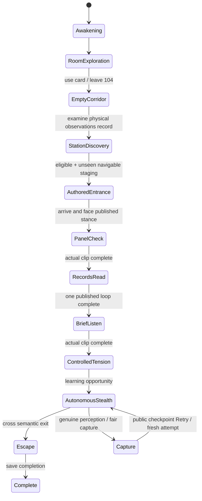

# NW-007C: integrated cinematic opening — verification report

Draft PR: [#24](https://github.com/Seb-Simpson/Claude-and-Co...dex/pull/24). Branch: `feat/nw-007c-cinematic-integration`, stacked on `feat/nw-007a-cinematic-gameplay`. Nothing is merged into main or a source branch.

## Sources and resolutions

- Exact start: NW-007A PR #23, `5f4b2c76a1dae44135b9cca1d4d560d30d96368d`.
- Initially integrated NW-007B PR #22: `dbebd306dbe52e9f7142873995b7935ae83a502b`.
- Final B asset pin: `ec4ed996db34f3608d0583393fa7c408f951ef99`. Claude published a targeted head-export/bake repair while verification was running. We fetched and inspected that commit, stopped the just-started old-asset public batch, explicitly merged the repair and restarted validation. No subsequent unfinished commits are silently included.
- Common ancestor: `0097264bf07a21b22ca7b5b1ac14ddaff951a046`.

The only initial overlapping source, `src/world/dressing/station.ts`, auto-merged without conflict. It retains A's immutable source-byte loader and owned texture cleanup together with B's station artwork/material treatment. The later repair merged cleanly. No Blender source or character geometry/material authoring is changed by the integration implementation; the producer's repair is imported intact.

Compatibility fixes connect actual published work stances/facing, clip durations/completion, live getter forwarding, gait-speed scaling, action sound timing and per-attempt cancellation. They preserve A's real navigation, collisions, director transitions, canonical world creation and checkpoint restoration.

[Audit](AUDIT.md) · [Integration/API details](INTEGRATION.md) · [Normal play instructions](PLAY.md).

## Director flow and ownership



The Narrative Director owns ordered discovery/milestones. The Encounter Director owns the authored routine and handoff to the same autonomous Nurse. The Experience Coordinator leases the actor/camera/dialogue. Aborting a lease cancels its authored clip and sounds synchronously. A capture emitted inside AI cannot be overwritten by that tick's stale normal-pose write. The capture clip/camera/fade share the published 1.4-second clock, remain skippable and respect Reduced Motion.

The same physical actor/capsule walks through actual geometry. Animation does not translate her. Safe phases disable perception/capture without globally disabling later AI. Autonomous stealth retains actual vision/sound investigation, directional trolley cover, staff locker, Room 105 bed and witnessed-entry memory. No Patient is enabled; no later chase is added.

## Verification

The repaired-model asset/reliability batch completed: **7 passed in 21.2 minutes**. The public regression batch completed: **15 passed in 40.2 minutes**. That is **22 distinct selected Chromium scenarios passed**, including all relevant NW-007A reliability/public-route cases plus the B staging/head and new integrated-actor coverage. The older pre-repair runs are not added to this final pass count. No production source changed during these final browser runs.

```sh
NW007B_HEAD=/tmp/nw007c-head-repaired NW005_SOFTWARE_SCALE=1 PLAYWRIGHT_CHROMIUM_EXECUTABLE=/usr/bin/chromium npm run test:browser -- tests/browser/nw-007c-integration.spec.ts tests/browser/nw-007b-staging.spec.ts tests/browser/nw-007b-head.spec.ts tests/browser/nw-007a-reliability.spec.ts tests/browser/nw-007a-scenes.spec.ts
```

Passed: later-request canonical-world failure/retry regression; five real AI captures/public retries followed by New Game; fresh-page Continue/New Game; ordered discovery, physical clue range and unseen staging/pause ownership; four head-pose renders; all fourteen B staging views; the **sole actual gameplay Nurse** performing panel, records and listening with timed audio, paused clip clock, real locker concealment and autonomous handoff.

[Batch log](evidence/repaired-assets/run.log) · [Actual actor/state/contacts/sound](evidence/repaired-assets/director/integrated.json) · [Five retry snapshots](evidence/repaired-assets/retries/five-retries.json).

Commands already completed after importing the repair:

```sh
npm run typecheck
npm test
npm run build
```

Results: typecheck pass; **627 tests passed, one optional Blender sampler skipped (78 files)**; production build pass. Vite reports its existing large-chunk advisory; no compilation failure. New tests cover actual clip clocks, action sounds/cancellation, real-GLB investigation gait/stationary contacts, capture duration/progress, director-lease interruption and the synchronous capture ownership race. Producer head regression tests are included unchanged.

The initial six-case Chromium batch passed in 18.3 minutes on the **old** B asset, including five real captures/UI retries and the sole real director actor. Those files under `evidence/pre-repair/` deliberately show the broken head. They are historical, not final repaired-model evidence. The public batch interrupted upon discovery of the repair has no completed cases and contributes no pass count.

## Visual and acceptance gates

The initial close-ups independently confirmed the displaced face covering/cap/hair and streaked face/neck. The repaired asset was then independently rendered through the integrated game/model library in rest, look-around, panel and capture poses, and inspected. The covering/cap/hair now follow the head; the prior striped face/neck bake is absent in these views. The 10 imported geometry/rig regression tests pass as well. The **specific original export/bake defect is verified repaired on `ec4ed99`**; this is not final artistic or human acceptance of the stylised model. The isolated head renderer creates a temporary preview actor and hides the gameplay visual; the separate C fixture verifies the sole actual director actor.

Actual director-driven pre-repair close-ups also show hands hovering short of the work props. At the cue sampling instants, nearest strongly right-hand-weighted skinned vertex distances to published target points were panel **24.0 cm** and record **15.9 cm**. These point samples do not represent whole-clip contact, and wrist positions are not fingertips. Integration does not silently solve this by changing producer coordinates, adding unreviewed IK or deforming the character. The repaired asset retains the same issue: nearest weighted-hand point samples are panel **24.0 cm**, record **16.0 cm** (261 strongly right-hand-weighted vertices evaluated). See the actual actor close-ups below. Correcting producer animation/staging alignment remains necessary before claiming convincing physical contact.

No real GPU or independent human playtest is available in this environment. `/dev/dri` is absent. Chromium uses SwiftShader; ordinary Low-quality screenshots and reduced rendering-scale functional runs must be distinguished. No hardware frame-rate, human usability or atmospheric acceptance is claimed.

**NW-007 acceptance: pending, not complete.** The draft remains open for visual/staging review and the required independent human playtest. No NW-008 implementation or automatic merge.

## Repaired-model retry resource sample

The completed five-cycle test uses actual Nurse perception/capture and the public Retry button, then verifies New Game restores a usable visible card. The initial Continue is a valid saved-stealth milestone fixture; it is not the full fresh-start walkthrough.

| Restored attempt | Colliders | Draw calls | Triangles | Renderer geometries | Renderer textures |
| --- | ---: | ---: | ---: | ---: | ---: |
| 1 | 230 | 332 | 193,799 | 303 | 85 |
| 2 | 230 | 332 | 193,799 | 303 | 85 |
| 3 | 230 | 332 | 193,799 | 303 | 85 |
| 4 | 230 | 332 | 193,799 | 303 | 85 |
| 5 | 230 | 332 | 193,799 | 303 | 85 |

Each attempt has fresh object identities and one canonical room/station/card/Nurse, no active authored clip/hum on ready, no remaining cinematic voices/loop schedulers, and one canvas. Later asset requests were deliberately blocked, but **zero requests** were attempted because the canonical bytes remained owned. No page errors. This bounded sampled renderer inventory is evidence against attempt accumulation; it is not a full GPU/heap leak certification or a real-hardware frame-time benchmark.


## Independent visual evidence (repaired pin)

- [Head rest](evidence/repaired-assets/head/game_rest.png), [head capture](evidence/repaired-assets/head/game_capture_43.png), [head turn](evidence/repaired-assets/head/game_look_around_46.png): in-game model-library/renderer preview, independently rerun and inspected, not a claim of an input-only capture close-up.
- [Actual panel action](evidence/repaired-assets/director/01-actual-panel.png), [native-Low panel close-up](evidence/repaired-assets/director/01-panel-close.png), [native-Low record close-up](evidence/repaired-assets/director/02-record-close.png): the sole director-driven actor. The diagnostic close-ups freeze gameplay and reposition **only the player/camera**, hiding pause chrome for inspection. They do not pose or move Shaw.
- [Locker illumination](evidence/repaired-assets/staging/11-torch-by-lockers.png), [trolley view](evidence/repaired-assets/staging/10-crouched-at-trolley.png), [capture asset pose](evidence/repaired-assets/staging/14-capture.png): producer staging spec rerun on the integrated build; these isolated previews are distinct from the full input-only walkthrough.

Final Nurse GLB SHA-256: `dcd42fc80654f2b5b9ab271a48aa09ccec381f445609302aabddf2f03e0582ac`.

Final actual-actor fixture's last engine sampling window (208 frames, capacity 240): fixed work p95 **3.9 ms**, physics p95 **0.8 ms**, update p95 **1.7 ms**, render submission p95 **37.5 ms**. Software-rendered frame interval p95 **999.9 ms**; this is visibly slow and **not a hardware performance pass**. The sample includes pause/native-resolution diagnostic redraws, not a steady hardware benchmark. Whole-fixture fixed/update peaks were **52.0 / 42.4 ms**; renderer inventory after exploring diagnostic views was 402 geometries / 99 textures versus the same-view retry inventory above. Visibility/lazy uploads mean counts across different views are not a valid leak comparison. No claim of complete heap/GPU leak certification.

The opening's two existing intercom recordings remain explicitly temporary `.temporary.wav` assets. B's station/heel/cloth/key/paper/capture sounds are original procedural synthesis through the existing mixer; this integration adds no paid service or final voice acting. Event timing and settings/cancellation are automated checks; subjective audibility, mix, animation weight and foot sliding on real hardware still need human playtesting.

## Normal-game walkthrough and usability limits

The complete fresh-start input-only route **passed in 11.6 minutes wall time**. It watches full-motion awakening, tries the locked door, crouches/takes the physical card, uses the reader, opens the actual door, explores the empty corridor, examines the station record, watches the real panel routine, walks to/enters the locker, observes records/listening/tension, then plays autonomous stealth with actual trolley cover. The position and aim shortcut methods throw in this test; mouse-look is sent through input events and movement uses keys.

The bot made a route mistake during autonomous escape and was captured **13.05 simulated seconds after stealth began**, after the first-alert recovery opportunity. It used the **public Retry button**, restored the saved stealth milestone, sprinted to the semantic exit and completed the encounter. It then returned to menu, reloaded/Continued the completion checkpoint and started a clean New Game. This is **a complete route with one capture/recovery**, not a death-free first attempt. No page errors. No actor/phase/position write or teleport between phases.

The phase snapshots record first-attempt capture at 88.33 simulated engine seconds and retry escape at 3.93 seconds in its fresh session. These are engine counters across two attempts, **not measured human playtime or pure player-controlled duration**. Software rendering and the engine's bounded delta make wall time much longer. The full video additionally includes loading, pauses, waits and post-escape menu validation.

An actual behind-player capture is visible in the route evidence: the real actor's capture clip/sound run, but the existing bounded camera turn does not necessarily bring Shaw into frame. Reduced Motion intentionally keeps that camera still. The isolated head/capture preview proves the asset pose, not guaranteed framing of every live capture. This remains a presentation limitation for review; the integration does not teleport Shaw or snap the player around to disguise it.

Automated routes establish reachable interactions, ordered eligibility, safe exploration and recoverable progression. Their read-only access to semantic anchors does **not** establish blind first-time discoverability. Human review should assess the floor card, motivation to inspect the station record, locker cue, cue audibility/mix, escape readability and live capture framing. Give the tester launch/controls before the spoiler walkthrough in [PLAY.md](PLAY.md).


## Final public regression command and evidence

```sh
NW005_REAL=1 NW005_SOFTWARE_SCALE=1 PLAYWRIGHT_CHROMIUM_EXECUTABLE=/usr/bin/chromium npm run test:browser -- tests/browser/nw-006b-encounter.spec.ts tests/browser/nw-005b-opening.spec.ts tests/browser/foundation.spec.ts tests/browser/nw-005c-onboarding.spec.ts tests/browser/room104-prototype.spec.ts tests/browser/nw-005d-readability.spec.ts -g 'input-only normal game|awakening locks|locked door, two|saved station Continue|boots the renderer|context loss|literal normal|playable game shows|obsolete procedural|normal title-to-station|three minutes|assisted visual inspection|shipping Low checkpoint|real capture after a forgiving first alert|autonomous stealth: real sprint'
```

**15 passed**. Includes literal public URL startup without the QA bridge; engine/WebGL context-loss cleanup; full-motion awakening/pause/settings/skip/handoff; door-first and card-first puzzle, one-shot intercom, reader/door/corridor; safe three-minute dwell/denial/restart; Continue/menu/reload/New Game; native-Low visual checks; canonical room and ignored obsolete procedural query; complete input-only encounter route; keyboard capture skip/Retry; restored safe tension; real sprint-noise investigation/unseen under-bed concealment. These selected files are the applicable opening regressions, not a claim that every historical prototype/legacy browser spec was run.

- [Public batch log](evidence/public/run.log), [route summary](evidence/public/normal-route-summary.json), [complete route snapshots](evidence/public/nw-006b-encounter-input-on-75b23-stealth-and-exit-checkpoint/normal-route.json).
- [Complete input-only recording](evidence/public/normal-route.webm): 800×450, software rendering; full timing retained, silent Playwright video, reduced to eight encoded frames/second for a reviewable file. It includes the real capture/Retry, escape, Continue and fresh New Game validation. No cut or speed-up. This recording uses Full Motion; separate tests verify Reduced Motion.
- [Actual station action](evidence/public/nw-006b-encounter-input-on-75b23-stealth-and-exit-checkpoint/01-authored-station.png), [locker](evidence/public/nw-006b-encounter-input-on-75b23-stealth-and-exit-checkpoint/02-first-locker-hide.png), [trolley cover](evidence/public/nw-006b-encounter-input-on-75b23-stealth-and-exit-checkpoint/03-real-trolley-cover.png), [live capture from behind](evidence/public/nw-006b-encounter-input-on-75b23-stealth-and-exit-checkpoint/04-route-capture.png), [escape](evidence/public/nw-006b-encounter-input-on-75b23-stealth-and-exit-checkpoint/04-escape.png). These functional screenshots use renderer pixel ratio 0.25 for SwiftShader; they are not native-resolution quality/performance proofs.
- [Native-Low card](evidence/public/nw-005d-readability-assist-22717--at-shipping-Low-resolution/01-card-from-wake.png), [native-Low corridor](evidence/public/nw-005d-readability-assist-22717--at-shipping-Low-resolution/03-empty-corridor.png), [native-Low collapse](evidence/public/nw-005d-readability-assist-22717--at-shipping-Low-resolution/04-ceiling-collapse.png). These assisted observer views preserve shipping Low pixel ratio 0.75; they are explicitly separate from the input-only walkthrough.
- [Unseen bed investigation](evidence/public/nw-006b-encounter-autonomo-c4b69-d-entry-conceals-the-player/unseen-bed.json), [keyboard capture/Retry](evidence/public/nw-006b-encounter-real-cap-a8d7f--repeating-the-introduction/capture-retry.json), [safe tension restoration](evidence/public/nw-006b-encounter-shipping-8f430--do-not-replay-the-entrance/tension-restart-native-low.json).

## Explicit acceptance status

| Requirement | Status |
| --- | --- |
| Canonical Room 104/03:17/card across New Game, Continue and five actual retries | Verified in final integrated browser run. |
| Quiet corridor, ordered physical clue, safe authored introduction, real panel/records/listen clips | Verified, with one actual gameplay actor. |
| Locker, directional trolley cover, autonomous sound/vision/search, unseen Room 105 hiding and escape/recovery | Unit and public browser checks passed. |
| Real clip completion, pause, cancellation, no repeated owned hum/gesture after retry | Verified by actual actor clocks, audio diagnostics and unit tests. |
| Original face-cover/head-export and striped face/neck bake defect | Specifically verified repaired on pinned `ec4ed99`; before/after retained. |
| Convincing hand-to-prop contact | **Incomplete**: hovering in sampled actual work poses; producer staging/animation correction required. |
| Capture framing from every angle | **Limited**: behind-player capture can remain off-screen; no forced teleport/snap is used. |
| Final Nurse voice acting | **Incomplete**: existing two intercom recordings remain marked temporary. |
| Real-GPU performance and full heap/GPU leak certification | **Unverified**; only software-rendered timings and bounded repeated-attempt inventories. |
| Independent human clarity/atmosphere/animation/mix playtest | **Not performed**; instructions provided. |
| Full NW-007 acceptance / release readiness | **Not complete**. Keep PR #24 draft and unmerged. |

PR #22 was rechecked at delivery and still points to the final tested pin. All production source and tests remain identical to the tree after importing the repair (`eec5099`); later integration commits add documentation/evidence only. No automatic merges and no NW-008 work.
